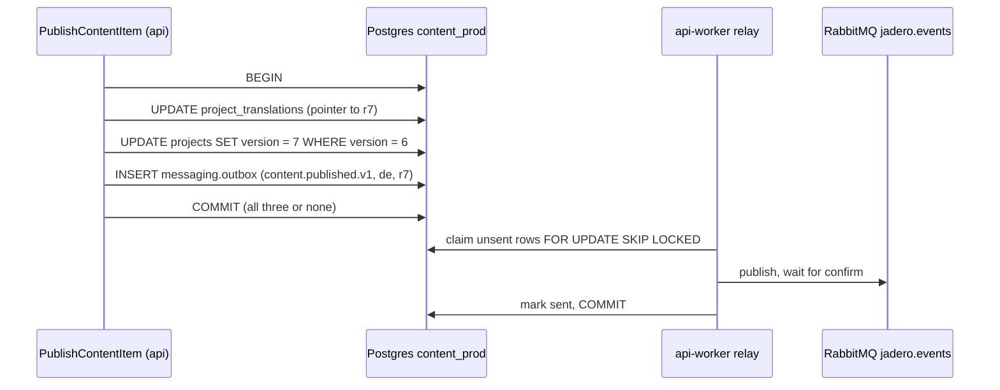
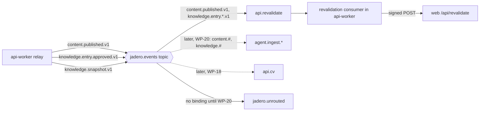

# WP-14: Content events

Issue #22, branch `wp/14-content-events`, release R1, size M, tag learning. Depends on WP-5 (messaging foundation) and WP-12 (content domain), both done. Unblocks WP-17 (admin), WP-18 (PDF CV), WP-20 (the agent's read model), WP-50 (event operations) and WP-57 (translated entries).

Deliverable (report section 14, decisions.json, issue #22): outbox writes on publish and on knowledge entry approval and withdrawal; the relay in `api-worker`; the events `content.published.v1`, `knowledge.entry.approved.v1`, `knowledge.entry.withdrawn.v1` and the daily `knowledge.snapshot.v1`; a revalidation consumer that calls `web`; scheduled jobs that run once even when two worker processes exist. The knowledge events carry `locale` (es, en or de; always `en` until WP-57), so WP-57 needs no new event version.

What the owner learns (decisions.json): the dual-write problem, event-carried state transfer, idempotent consumers. Event-driven architecture is one of the two depth priorities, so this file compares each choice with SNS, SQS, EventBridge and Kubernetes where it helps, and with a NestJS, Drizzle and broker stack like the one at work.

**ADRs in the front matter.** ADR-029 (service boundaries and messaging) is superseded by ADR-054, which restates it unchanged except four broker details (prefetch below the pool, one shared dead-letter exchange, retry by a confirmed copy, what the delivery limit counts). Both are listed because the rules this WP leans on (rule 3, event-carried state transfer; rule 4, expand/contract) are ADR-029 text that ADR-054 keeps. ADR-012 gives the outbox, the inbox and the scheduled jobs; ADR-011 says publishing emits `content.published.v1`; ADR-031 gives the knowledge events and the snapshot; ADR-047 the internal revalidation endpoint; ADR-010 the trace across the hop; ADR-008 the signed internal header this WP's signature copies.

**What you already know, and what is new.** The outbox, the relay with its atomic claim, at-least-once delivery, the inbox and the retry tiers come from WP-5 (D2 to D4). The use case owning the transaction, with the outbox row inside it, comes from WP-10 (D6). Revisions, the publish and approval state machines and the version column come from WP-12 (D2, D4, D5); the cache tags `web` already sets come from WP-16. Consumer-first deploys and additive topology come from WP-9 (D6). This file spends its words on what is new: what an event should carry, a consumer whose effect is an HTTP call, a signed call between two of our own deployables, and a job that must run once a day on its own.

**What checking the repo and the tools found (2026-10-24).** Each fact is used below; sources in Facts checked.
1. `packages/messaging` has everything the producer side needs: `addToOutbox(tx, contract, data, source)` inserts into `messaging.outbox` inside the caller's transaction, `OutboxRelay` polls every second, claims 50 rows with `FOR UPDATE SKIP LOCKED`, publishes with confirms and marks them sent. `api-worker` already runs it, plus a heartbeat ping on a `setInterval` every 5 minutes and a daily cleanup on another `setInterval`. No scheduler library is installed.
2. `ContentScope` (the unit of work's scope) has no outbox writer; its comment says "WP-14 adds the outbox writer". `DrizzleContentUnitOfWork.run` calls platform-nest's `withTransaction`, which hands both a Drizzle `db` and a raw `executor` on the same connection, so `addToOutbox` can join the transaction with no new plumbing.
3. Three callers reach `PublishContentItem.executeIn`: the publish use case, the journal publish command (`journal:publish`) and the seed (`db:seed`). All three will emit events once the write is in `executeIn`.
4. Seven localized types publish: `profile`, `now`, `experience-item`, `project`, `post`, `skill`, `cv-bullet`. Five of them can be archived (all but `profile` and `now`); archiving hides an item from every public read (`archived_at IS NULL` in the queries), and no ADR or deliverable names an event for it (Q2).
5. Knowledge entries change state through approve, withdraw and delete (a withdraw plus a terminal tombstone). Save, submit and request changes are draft-side: ADR-031 says drafts never produce events. The revision document holds only public fields (title, sections, questions, stack, `cvBullet`, `related`, `indexable`); the private ones (`sources`, `conflicts`, `publicNames`, `confidence`) live apart in the revision's provenance.
6. `api` has no inbox table yet (`apps/api/src/db/messaging.schema.ts`: "consumes none yet"). The revalidation consumer is its first consumer, so a migration adds `messaging.inbox` to `content_<env>`.
7. `web` caches every content `fetch` for 60 seconds under tags: `content:<type>` on lists and `content:<type>:<slug or id>` on items, the slug without the locale (`apps/web/src/content/api.ts`, `contentTags`). It has no route handler under `/api` yet; its proxy skips `/api`; nginx answers 404 on every `/api/` path of `new.jadero.dev` except `/api/v1/content/`.
8. Next 16.4.1's `revalidateTag(tag, profile)` requires the second argument. `"max"` marks the data stale and serves it stale once more while it refreshes; `{ expire: 0 }` makes the next request wait for fresh data. `updateTag` throws outside a Server Action, so a route handler uses `revalidateTag`. The refresh happens on the next request for the tag, not at the call.
9. `jadero.unrouted` (the alternate exchange's queue) has no TTL, no length limit and no alert.
10. `api-worker`'s database pool defaults to 4 connections (`DATABASE_POOL_MAX`).
11. `@nestjs/schedule` 12.0.2 declares `@nestjs/core ^11 || ^12`, depends on `cron` 4.4.0, MIT. Its `@Cron` options include `timeZone`, `waitForCompletion` (no overlapping run inside one process) and `disabled`.
12. Postgres advisory locks are local to a database: the lock tag's first field is the current database's id (`lockfuncs.c`, "ensures locks are local to each database"). Staging and production share one Postgres instance with separate databases, so their locks never meet.
13. RabbitMQ's default `max_message_size` is 16 MiB. A journal post body is a few KB.
14. platform-nest's telemetry instruments `node:http`, Express, pg, amqplib and pino. Node's global `fetch` runs on undici, which `instrumentation-http` does not patch (**verify**), so a `fetch` from `api-worker` to `web` does not carry `traceparent` unless the code adds it.

## Decisions explained

### D1. Why does a publish write its event in the same transaction, and not send it after the commit?

**Recap (WP-5 D2, WP-10 D6).** Saving to Postgres and telling RabbitMQ are two writes into two systems, and no transaction covers both: the dual-write problem. The fix is the transactional outbox: the event is a row in `messaging.outbox`, inserted in the same transaction as the state change, and the relay in `api-worker` publishes it later. Both commit or neither does. WP-5 proved it with the ping, which changes no other state; WP-10 put the outbox row inside the use case's unit of work.

**What is new here: the first real state change with an event, and who turns it into the event.**

**Problem.** Until now the outbox carried a ping that changes nothing. A publish moves a pointer that visitors and, from WP-20, the agent depend on. If the event is lost, the agent answers from the old text forever; if the event goes out but the publish rolls back, the agent indexes text that was never public. Both are silent.

**Example.** The owner publishes the German translation of `jobs-hub`, revision 7. The use case updates `content.project_translations` (the published pointer) and `content.projects` (version 6 to 7). With "commit, then publish", a deploy that restarts `api` between the two leaves revision 7 live on the site and unknown to every consumer. The 60-second cache hides it from the owner, and the agent keeps quoting revision 6 until someone notices.

**Decision (ADR-012, ADR-011, ADR-031).** The outbox row is one more write inside the same `uow.run`. `ContentScope` gains an `events` writer (a port, an abstract class like the repositories), and its Drizzle adapter calls `addToOutbox(executor, ...)` on the transaction's connection. The use case decides what to emit from the domain's result: `PublishResult.published` lists each locale whose pointer moved, so a publish of de and en writes two `content.published.v1` rows, and a publish that moved nothing (every locale already live) writes none. `ApproveKnowledgeEntry` writes `knowledge.entry.approved.v1` only when `alreadyApproved` is false; withdraw and delete write `knowledge.entry.withdrawn.v1`.



**Alternatives.**
- *Publish to RabbitMQ right after `COMMIT`, in the request.* Discarded: a crash or a deploy between the two loses the event, and a broker outage slows or fails the owner's publish. Wins when losing an event now and then is fine (a page-view counter).
- *Domain events: the aggregate records "published" events in a list, and the unit of work flushes that list into the outbox on commit.* The use case writes nothing explicitly; every save of an aggregate carries its events. Discarded for now: WP-12 left the domain without events on purpose (its result objects already say what changed), there are three emitting use cases, and the mapping from a domain fact to a public contract (which fields go out, which locale) is an application decision. Wins when many use cases change the same aggregates and forgetting an event is a real risk; then the aggregate records internal domain events and one place translates them into integration events.
- *Change data capture: Debezium reads Postgres's write-ahead log and publishes row changes.* Discarded: a JVM service and Kafka Connect on one small server, and row changes are not contracts (a column rename becomes a breaking event). Wins on a large platform with many producers and a team to run it, or when the producer's code cannot be changed (a legacy system).
- *`LISTEN`/`NOTIFY` from a trigger.* Discarded: a notification sent while no listener is connected is gone, so it is fire and forget inside the database. Wins for waking a poller early, never as the record of the event.

**Patterns:** dual-write problem, transactional outbox, unit of work (WP-10), domain event versus integration event, change data capture.

**At work.** The same shape in a NestJS and Drizzle service: the repository save and `INSERT INTO outbox` run on the same `tx` handed to the use case; the relay is a separate worker. A "send to SQS or EventBridge after save" in a service handler is the dual write, and an SNS publish inside the transaction is worse (the event goes out even when the transaction rolls back).

### D2. Why do the events carry the published document, and not just "project X changed, come and get it"?

**Problem.** A consumer needs data that another service owns. Either the event carries it, or the consumer asks the owner for it. Asking means a synchronous call between services, and the asking service then fails whenever the owner is down: the coupling the service split exists to avoid.

**Example.** From WP-20, `agent-ingest` turns every approved entry into chunks and embeddings. With a thin event `{ "entryId": "kb-outbox-relay" }`, it must call `api` for the text. If `api` is down for a deploy at that moment, ingestion fails and retries, and ADR-029 rule 3 ("the agent never calls `api`") is broken. With the document in the event, `agent-ingest` has everything it needs, even if `api` is gone for an hour.

**Decision (ADR-029 rule 3, kept by ADR-054; ADR-031 producer check; report section 3.4).** Event-carried state transfer: `content.published.v1` carries the full published translation of one item in one locale, and `knowledge.entry.approved.v1` carries the full approved revision. Three details make that work:
- *A version for ordering.* Delivery order is not promised (WP-5 C6: retries and prefetch reorder). Each event carries the revision id (a UUIDv7, so it sorts by time) and the revision number; a consumer that already holds a newer number ignores an older one. This is version-based "last writer wins", decided by data, not by arrival.
- *Only what is public.* The approved event carries the revision's document, which holds only public fields (fact 5), plus `confidence`, which the agent needs to hedge ("according to the design notes", D-67). It never carries `sources`, `conflicts` or `publicNames`: a field that is not in the event cannot leak from a consumer's logs or database.
- *Two styles from one event.* This WP's own consumer, the revalidation consumer, needs none of the document: it only needs to know what changed, and then `web` reads the current state from `api` (an allowed edge read, ADR-029). So for revalidation the same event is a notification; for the agent in WP-20 it is the state. The producer does not choose for its consumers.

**Alternatives.**
- *Event notification plus callback (thin event, the consumer calls back for the data).* Discarded: the callback is the synchronous dependency rule 3 forbids, and the data read later may already be a newer revision than the one announced. Wins when the data is large or sensitive and only a few consumers need it, when consumers always want the latest state anyway (a cache refresh, like this WP's own consumer), or when consumers need different views of the same change.
- *Claim check: the event carries a pointer to a blob in object storage.* Discarded: payloads here are a few KB against RabbitMQ's 16 MiB default. Wins when payloads outgrow the broker: SQS's limit is 1 MiB, and the SQS extended client stores larger bodies in S3 and sends the reference; SNS and EventBridge entries were capped at 256 KB the last time AWS documented them (**verify**).
- *Delta events (only the changed fields).* Discarded: every consumer must hold the previous state to apply a delta, and a lost delta corrupts it until a full resync. Wins for frequent small updates of large records (a price change on a product with a hundred fields).
- *Event sourcing (the events are the source of truth, state is rebuilt from them).* Discarded: `api`'s tables are the source of truth (D-42), and the events are a feed of facts about them. Wins when the history itself is the product (a ledger, an audit trail of approvals).

**Patterns:** event-carried state transfer, event notification, claim check, version-based ordering (last writer wins by version), CQRS read model (the agent's index, WP-20).

**Consequence for WP-20.** A read model created after events were already sent needs a backfill: events published before the agent's queue existed went to `jadero.unrouted` or to the revalidation queue only. WP-20's deliverable already includes a re-index command (ADR-029 names the command `knowledge.reindex.requested.v1`), so this WP does not pre-create the agent's queue.

### D3. Why four versioned event types, frozen now, with `locale` on the knowledge events from day one?

**Recap (WP-5 step 2b, WP-6, WP-9 D6).** Each event is a Zod contract in `packages/contracts`, typed `<context>.<event>.v<N>`, inside a CloudEvents envelope whose `id` is the inbox key. `pnpm --filter @jadero/contracts compat:accept` freezes a version's JSON Schema in `compat/<routingKey>.json`, and a test refuses any later change to that version except a new optional field. A breaking change is a new version published next to the old one until every consumer moved (expand/contract), and consumers deploy before producers.

**What is new here: designing a field before its first freeze.**

**Problem.** Once `knowledge.entry.approved.v1` is frozen and consumed, its required fields are fixed for as long as v1 lives. A field that turns out to be needed later can only be added as optional, and every consumer must then handle "missing".

**Example.** Today entries are English only (D-50). WP-57 will approve entries per locale. If v1 has no `locale`, WP-57 either adds an optional `locale` (every consumer forever treats "missing" as `en`) or ships v2 next to v1 (two versions in parallel, consumers moved one by one, the old binding retired by hand, WP-9 D6).

**Decision (ADR-029 rule 4, ADR-031, the WP-14 deliverable).** Four contracts, frozen in this WP:
- `content.published.v1`: one item, one locale, one revision, with its document. One event per locale that moved.
- `knowledge.entry.approved.v1`: the entry id, `locale` (always `en` until WP-57), the approved revision (id and number), `approval: { state: "approved", approvedAt }` (the field the consumer's check of ADR-031 reads), the document and `confidence`.
- `knowledge.entry.withdrawn.v1`: a tombstone: the entry id, `locale`, `reason` (`withdrawn` or `deleted`) and the time. No document.
- `knowledge.snapshot.v1`: `asOf` and the list of approved `(entryId, locale, revisionId)` triples (D7).

`locale` is required now, with only `en` produced, so WP-57 changes the values a producer sends, not the schema. `content.*` and `knowledge.*` are separate contexts on purpose: the approval gate is its own state machine, and a consumer can bind exactly the gated stream (`knowledge.#`).

**Alternatives.**
- *Add `locale` later as an optional field.* Allowed by the compat check. Discarded: every consumer carries a default forever, and a consumer that forgets it misfiles a German entry as English. Wins when the future need is a guess; here WP-57 is planned.
- *Ship v2 at WP-57.* Discarded: two versions in parallel and a consumer migration, for a field we can add today at no cost. Wins when the change is truly unforeseen.
- *One generic `content.changed.v1` with a `kind` field for everything.* Discarded: consumers bind by routing key, so a consumer that wants only approvals would receive every publish and filter in code; one schema with optional fields for every case also weakens validation. Wins with a very small number of consumers that all want everything.

**Patterns:** expand/contract for messages, schema freeze, published language, tombstone event, tolerant reader.

### D4. Why does `api-worker` consume its own service's events through a queue, one queue per purpose?

**Problem.** Revalidation is a side effect of `api`'s own content (ADR-029's boundary table: PDF CV and cache revalidation are process types of `api`). It could be wired directly, but every direct wiring couples the side effect to something it should not slow down.

**Example.** Three ways to trigger revalidation after the publish of `jobs-hub`:
1. The publish request calls `web` after `COMMIT`: the dual write again (a crash loses the revalidation), and a `web` deploy makes the owner's publish slow or failed.
2. The relay calls `web` right after it publishes a row: the relay now waits on `web`; during a 30-second `web` deploy every other event (the agent's, later the CV's) waits behind it (head-of-line blocking), and the relay needs its own retry logic for each side effect.
3. The relay publishes, and a consumer on its own queue `api.revalidate` calls `web`: a failing `web` only fills that queue's retry tiers.

**Decision (ADR-012, ADR-054).** Option 3. One durable quorum queue per consumer and purpose: `api.revalidate`, bound to `content.published.v1` and `knowledge.entry.*.v1` (and to the archive event if Q2 adds it), with the usual retry tiers (10 s, 1 min, 10 min), its own `api.revalidate.dlq` and the shared `jadero.dlx`. WP-18's PDF regeneration will get its own queue (`api.cv`), so a slow PDF never delays a revalidation. The topology module generates the queue, its bindings and the `api` user's read permission on it (`buildPermissions` gives a service read on its own queues and write on its `api.retry` exchange). ADR-029 names a single `api.worker.content` queue as the example; splitting per purpose follows its own rule "one queue per consumer and purpose", it changes no ADR line.



**Alternatives.**
- *Call `web` from the publish request.* Discarded above (dual write, availability coupling). Wins when the side effect must finish before the user sees a result and both sides are one process.
- *Run side effects inside the relay.* Discarded above (head-of-line blocking, no per-effect retries or dead letters). Wins when the relay has exactly one destination and nothing else to do.
- *One queue for every `api-worker` purpose, a switch on the event type in code.* Discarded: one slow handler (a PDF render of several seconds) blocks the others, and a dead letter does not say which purpose failed. Wins with one consumer purpose only.

**Patterns:** publish-subscribe (fan-out between purposes), competing consumers (within one purpose, if `api-worker` ever runs twice), bulkhead (one queue per purpose), head-of-line blocking.

**Compared.** A RabbitMQ topic exchange with one queue per consumer is the same shape as an SNS topic with one SQS queue subscribed per consumer: the topic fans out, each queue buffers, retries and dead-letters for its consumer alone. EventBridge does the routing with a rule per target, and the target's own queue or retry policy does the buffering. In Kubernetes, running three replicas of a consumer means three competing consumers on one queue, not three copies of each message.

### D5. Why does a consumer whose effect is an HTTP call still record an inbox row, and why after the call?

**Recap (WP-5 D3, WP-10 step 5).** Delivery is at least once: the relay can publish a row twice (a crash after the confirm, before the commit), and a consumer can be handed a message twice (a crash after its work, before its ack). The idempotent consumer records the event id in `messaging.inbox` with a unique key `(consumer, event_id)`; a second delivery finds the row and skips the work. In the agent, the inbox row and the effect share one transaction, so they commit or roll back together (the backlog line "idempotency without atomicity loses messages").

**What is new here: the effect is not in the consumer's database.**

**Problem.** The revalidation consumer's effect is a `POST` to `web`. No transaction covers a database row and an HTTP call to another process: the dual write again, this time on the consumer side. Whatever order is chosen, a crash in between leaves one side done and the other not.

**Example.** The consumer receives the event for revision 7.
- *Record first, then call.* `INSERT` inbox, `COMMIT`, then `POST` to `web`; `web` is down, the call fails, the message is retried; the retry finds the inbox row and skips. The revalidation never happens: a lost effect.
- *Call first, then record.* `POST` succeeds, the process dies before the `INSERT`; the redelivery calls `web` again. `web` drops two tags a second time: nothing a visitor can see.

**Decision (ADR-012: every consumer is idempotent and records processed ids).** Check, act, record: look the id up in the inbox (a duplicate is acked at once), call `web`, then insert the inbox row with `ON CONFLICT DO NOTHING`, then ack. The effect can run twice but never zero times, and that is safe because revalidation is naturally idempotent: dropping a tag that is already dropped changes nothing. No transaction is held open across the HTTP call, so a slow `web` does not hold one of `api-worker`'s pooled connections. The inbox row still matters: it absorbs the relay's duplicates before they reach `web`, and it is the "consumed and duplicate counts" the WP-50 Events page reads. This is not a departure from ADR-012: its "same transaction as the effects" is about effects in the consumer's database, and this effect has none.

Failures are classified once: a network error, a timeout or a 5xx is transient (the bus's `retry` outcome, then the tiers); a 400 or 401 is permanent (`dead`, straight to `api.revalidate.dlq`), because a wrong secret or a malformed body will not heal by waiting.

**Alternatives.**
- *Inbox row and HTTP call in one transaction: `BEGIN`, insert, call, `COMMIT`.* Same outcome (a commit that fails after the call means one more call on redelivery), but a pooled connection and an open transaction wait for `web` for up to the timeout. Wins when the effect is fast and local, never across a network.
- *No inbox, rely on natural idempotency.* Correct here, and simpler. Discarded: ADR-012 asks every consumer for the inbox, the relay's duplicates would each cost a call, and WP-50 would have no counts. Wins for a pure state overwrite where nobody needs the counts.
- *An idempotency key sent to the remote (the event id in an `Idempotency-Key` header, the remote remembers it).* Discarded: `revalidateTag` needs no deduplication. Wins when the remote effect is not idempotent: charging a card, sending a mail (WP-11), creating an order. Stripe's API works this way.
- *An outbox on the consumer side (record "call web" as a row, a second relay makes the call).* Discarded: a second relay for a call that is safe to repeat. Wins when the consumer's database change and a non-idempotent remote call must both happen.

**Patterns:** idempotent consumer (inbox), natural idempotency, idempotency key, check-act-record, at-least-once effect, transient versus permanent failure.

### D6. Why is the revalidation endpoint signed, and not only hidden?

**Recap (ADR-008, WP-13 plan).** Internal calls between our own deployables prove who sent them with a signed header: an HMAC (a keyed hash) over the request with a shared internal key and a timestamp, so a captured header expires.

**Problem.** `web`'s revalidation route exists for `api-worker`, not for browsers. Anyone who can reach it can make every page miss its cache on each request: an invitation to load `api` with uncached reads.

**Example.** A later nginx change adds a `location /api/` block for a new feature and, by mistake, proxies every `/api/*` path to `web`. Without a signature, `POST https://jadero.dev/api/revalidate` from anywhere drops the cache of the whole site in a loop.

**Decision (ADR-047).** Two independent layers. nginx keeps answering 404 on every `/api/` path except the content API (it already does, fact 7). The route itself verifies a signature: `api-worker` sends `X-Jadero-Signature: t=<unix seconds>,v1=<hex HMAC-SHA256 of "<t>.<body>">` with `REVALIDATE_SECRET`, which only `api-worker` and `web` hold (rendered from 1Password, ADR-043). `web` recomputes it, compares in constant time, and refuses a timestamp more than 5 minutes off. A replay inside that window only repeats a harmless revalidation (D5). The call goes over the environment's private Docker network, never through nginx.

**Alternatives.**
- *Network trust only (the route is not routed by nginx).* Discarded by ADR-047: one misconfigured location is enough to expose it. Wins for a route that is not reachable over HTTP at all (a Unix socket).
- *A static bearer token in a header.* Simpler, but the token in one log line or proxy trace works forever, and it does not protect the body. Wins for low-value internal reads behind a private network.
- *mTLS between the services.* Strongest identity, but needs a certificate authority and rotation, which ADR-050 declined for internal traffic on one host. Wins across hosts or networks we do not control.
- *A JWT signed by `api` with an asymmetric key.* Verifiers need only the public key. Wins with many callers or many verifiers; here one caller and one verifier share one secret.

**Patterns:** HMAC request signing (the webhook signature of Stripe and GitHub), replay window, constant-time comparison, defense in depth.

### D7. Why a daily snapshot, and how does a cron run once when two workers exist?

**Problem, part 1: events can go missing in ways the outbox does not cover.** The outbox makes "state changed but no event" impossible inside one database, but the whole system can still drift: a message dead-lettered and never replayed, a consumer bug that dropped an event, a restore that mixes one service's newer backup with another's older one (the WP-8 backlog line). For knowledge entries drift has a cost: an entry the owner withdrew, still answered by the agent.

**Example.** The owner withdraws `kb-outbox-relay` on Monday. The `withdrawn` event reaches `agent-ingest`, which fails on a bug and dead-letters it; nobody replays it. Without reconciliation the entry is in the index for good.

**Decision, part 1 (ADR-031, check 3).** Anti-entropy: once a day `api-worker` writes a `knowledge.snapshot.v1` with `asOf` (the transaction time) and every approved `(entryId, locale, revisionId)`. From WP-20, `agent-ingest` deletes whatever it indexed that the list lacks. `asOf` is in the contract now because of one race WP-20 must handle: an entry approved one second after the snapshot's read may reach the agent before the snapshot does (order is not promised), so the agent only deletes entries it ingested before `asOf`. Until WP-20 binds a queue, the snapshot lands in `jadero.unrouted`, about one small message a day (D2's consequence).

**Problem, part 2: "once a day" with more than one process.** ADR-012 puts each cron in the process type that owns the data and relies on one replica, with "a Postgres advisory lock elects one runner" if a process is ever scaled out. Two `api-worker`s against one database happen already: in development, `pnpm dev` and `pnpm images:up` both run one against `content_dev`, and during a deploy the old and new containers can overlap for a moment.

**Example.** Both workers' crons fire at 04:00:00. Without a guard, the outbox gets two snapshots. That is harmless for this job (applying the same list twice deletes nothing more), but a job that sends a mail or bills a customer would do it twice.

**Decision, part 2 (ADR-012).** `@nestjs/schedule` with `@Cron("0 4 * * *", { timeZone: "UTC", waitForCompletion: true })` in `api-worker`, after the 02:30 backup. The job runs in one transaction: `SELECT pg_try_advisory_xact_lock(<job key>)`; `false` means another worker is running it, so skip. Under the lock it checks whether today's snapshot is already in the outbox (rows are kept 7 days), skips if so, and otherwise reads the approved entries and inserts the snapshot row. The lock gives mutual exclusion (never two at once); the check gives once per day (a worker whose timer fires after the first one committed also skips). The lock is released by the commit, and it is per database (fact 12). A run missed because `api-worker` was down at 04:00 is skipped, not caught up: tomorrow's snapshot covers the same ground. The heartbeat and cleanup timers move to the same scheduler (`@Interval` and `@Cron`), so `api-worker` has one way to schedule.

**Alternatives.**
- *`setInterval` in the process (how the heartbeat works today).* Discarded for a daily job: the period restarts at every boot, so "daily" drifts with deploys and never means "at 04:00", and two processes each run it. Fine for the heartbeat, whose exact time does not matter.
- *A host timer (systemd, like the backup) calling a command in the container.* Discarded: one more entrypoint and secret path per job, and it still needs the same lock when two environments or workers exist. Wins for operations jobs outside the app (backups, certificate renewals).
- *A run ledger: a table `job_runs (job, slot)` with a unique key; the job inserts `('knowledge-snapshot', '2026-11-04')` and runs only if the insert succeeds.* Exactly once per slot, catch-up on boot, a run history. Departs from ADR-012's mechanism (an advisory lock), so it would need a superseding ADR. Wins when a run must happen exactly once per period and a missed one must be caught up: a monthly invoice run, a nightly supplier rating recalculation.
- *A persistent job scheduler (pg-boss schedules in `api`'s own database, BullMQ repeatable jobs).* Discarded: a library and tables for one daily job. Wins with many jobs, retries per job, catch-up and a dashboard.
- *The platform's scheduler: a Kubernetes `CronJob` with `concurrencyPolicy: Forbid`, or EventBridge Scheduler invoking a target.* Not available on one Compose host. Wins in those platforms; both can still start a job twice in rare cases (**verify** for each), so the job keeps its own guard.

**Patterns:** anti-entropy reconciliation, snapshot with a high-water mark (`asOf`), leader election by advisory lock, mutual exclusion versus once per period, missed-run policy (skip or catch up).

## Open questions

Two choices no ADR decides. Q1 is a contract between two deployables that release on their own; Q2 changes what the agent's read model will hold.

### Q1. What does the revalidation call send: `web`'s cache tags, or what changed?

**What you need first.** `web` caches each content response under tags it chose itself (fact 7): `content:projects` on the list, `content:projects:jobportal` on one project, `content:work:kb-outbox-relay` on one entry, and so on. Only `web` knows which pages read which tags: the home page reads the profile, the featured project and the skills. `api` and `web` are separate services with separate releases (WP-7, WP-9): a change that needs both deployed together is the "always deployed together" smell of ADR-029 rule 6. The report's trace (section 3.4) sketched the call with tags, but tags were named later, in WP-16.

**Example.** WP-16 renames the item tag `content:projects:<slug>` to `content:project:<id>` to fix a slug rename. If `api-worker` builds tag strings, revalidation silently stops working for projects until `api` ships a matching change, and the two must deploy together. If `api-worker` sends "project `0199f3a2-...`, slug `jobportal` changed", the rename is a `web`-only change.

**Options.**
- *A. `api-worker` sends tags: `{ "tags": ["content:projects", "content:projects:jobportal"] }`.* `web`'s route is a generic "drop these tags". Simplest route; `api-worker` must know `web`'s tag vocabulary, and the two change together. Wins when the cache owner is a shared platform with a stable, documented key scheme (a CDN's surrogate keys, purged by many producers).
- *B. `api-worker` sends what changed: `{ "changes": [{ "kind": "project", "id": "0199f3a2-...", "slug": "jobportal" }] }`, a Zod contract in `packages/contracts`; `web` maps each change to its own tags.* `web` owns its cache keys; `api-worker` knows only content facts it already has. One small mapping table in `web`, tested there. Wins when the cache belongs to one consumer that may restructure it.
- *C. `web` consumes RabbitMQ itself (a consumer next to the Next.js server).* No `api-worker` hop and no internal endpoint. Departs from ADR-029's process table (revalidation is an `api` process type) and gives `web` broker credentials, an inbox and a database it does not have. Wins when the cache owner is a long-running service that already consumes events.

**The question.** A or B?

### Q2. What does archiving an item emit?

**What you need first.** Archiving hides a project, post, skill, experience item or CV bullet from every public read at once (fact 4), and keeps its revisions. The deliverable and the ADRs name events for publish, approve and withdraw, nothing for archive. `web`'s 60-second cache drops an archived project from the list within a minute anyway. The agent's read model (WP-20) is fed only by events plus the knowledge snapshot, which covers entries, not projects; adding a new event type later is additive (no version bump), but WP-20 would then start with an index that already holds items archived before the event existed.

**Example.** The owner archives the old `early` project `todo-app`. The site stops listing it within 60 seconds. The agent, from WP-20, keeps answering "tell me about the todo app" from its copy forever, because nothing tells it the project is gone.

**Options.**
- *A. `content.archived.v1` now: a tombstone with `aggregate`, `id` and the time, written by the archive use case in the same transaction; the revalidation consumer binds it.* One more contract and binding; the agent's tombstone handling in WP-20 has a source from the first day; the list pages drop the item in seconds like a publish. Wins when every consumer must mirror deletions, which any read model must.
- *B. Nothing now; WP-20 adds the event when the agent needs it.* Smallest WP; `web` relies on its 60 seconds. WP-20's re-index (D2's backfill) must then also clear archived items. Wins when no consumer of deletions exists yet and a full rebuild is cheap.
- *C. Fold it into `content.published.v1` with a `status: "archived"` field.* One event type; but "published" then means "changed", and a consumer that wants only publishes cannot bind past archives. Wins when consumers always treat both the same way.

**The question.** A, B or C?

### Recommendations

Read after answering.

- **Q1: B.** The cache keys are `web`'s internals, and WP-16 already changed its tag scheme once (the report's `project:jobs-hub` became `content:projects:<slug>`). With B the contract between the two services is content facts both already understand, it is validated with Zod on both sides like every other boundary, and `web` can restructure its cache without an `api` release. The cost is one mapping function in `web` with a unit test per kind. A would be my pick only if several producers purged one shared cache.
- **Q2: A.** A deletion that no event announces is the classic way a read model drifts, and the agent's read model is the reason these events exist. The cost now is one small contract and one binding; the cost later is a backfill that must also find what was removed. It also keeps the site's lists in step with publishes (seconds, not up to a minute). If you choose A, `content.archived.v1` joins the freeze of step 2; no ADR changes, because ADR-011 names the publish event without excluding others.

## Implementation choices

What the agent will do for everything else; object to any line.

- Contracts in `packages/contracts/src/events/`: one file per event (`content-published.v1.ts`, and so on), added to `eventContracts`, an example fixture each, `asyncapi.json` regenerated, each version frozen with `compat:accept`: the WP-5 pattern, four times.
- `content.published.v1` data: `aggregate` (one of the seven types), `id`, `locale`, `revision: { id, number }`, `publishedAt`, the item's neutral fields that live on the base row (slug, kind, sort order, featured, where the type has them) and `document`: everything a read model needs without a call back (D2).
- One event per locale that moved: a publish of de and en writes two rows; consumers handle one locale at a time, the way the read API already works.
- `ContentScope.events`, an abstract `ContentEventWriter` port with a Drizzle adapter over `addToOutbox(executor, ...)` and an in-memory adapter that records events for unit tests, checked by a shared contract suite (WP-10's fakes rule).
- Source `jadero/api` on every event, as the ping already does: the producing service, not the process.
- The seed and `journal:publish` emit events like any publish (fact 3): a fresh environment's consumers learn about seeded content the same way.
- `messaging.inbox` added to `api`'s schema file and generated as a migration in `apps/api/drizzle/` (expand-only): the revalidation consumer is `api`'s first consumer.
- Queue `api.revalidate`, bindings `content.published.v1`, `knowledge.entry.approved.v1`, `knowledge.entry.withdrawn.v1` (plus `content.archived.v1` if Q2 is A); `definitions.json` and `permissions.tsv` regenerated; deploy order topology, then `api` (WP-9 D6).
- Consumer prefetch 2 and `api-worker`'s `DATABASE_POOL_MAX` default raised from 4 to 6 (relay, readiness, consumer 2, the scheduled job, cleanup): prefetch below the pool (ADR-054).
- The call to `web`: `POST ${WEB_REVALIDATE_URL}` with a 5-second timeout, the signed header of D6 and `traceparent` added by hand from the active context, since `fetch` is not instrumented (fact 14).
- `web`'s route `apps/web/src/app/api/revalidate/route.ts`: verify the signature, parse the body with its contract, call `revalidateTag(tag, { expire: 0 })` for each tag, answer 204; 401 on a bad signature, 400 on a bad body. `{ expire: 0 }` so the visitor right after a publish sees the new text, at the cost of one blocking read from `api` (fact 8).
- The 60-second fetch cache stays as the backstop for anything a tag misses (the old slug's page after a slug rename); raising it is a later choice once revalidation has run in production.
- The consumer logs event id, type and outcome at info, never the document or the request body; `web` logs only the count of tags dropped (AGENTS.md section 7).
- New environment variables: `WEB_REVALIDATE_URL` and `REVALIDATE_SECRET` for `api-worker`, `REVALIDATE_SECRET` for `web`, `KNOWLEDGE_SNAPSHOT_CRON` (default `0 4 * * *`); added to both `.env.example` files, the env templates (`op://` references), Compose and the README in step 7.
- Snapshot job key: a fixed bigint constant in code, documented next to the job, so no two jobs share a lock by accident.
- Snapshot size: every approved entry in one message (a few hundred triples, a few tens of KB at most); paging only if it ever nears the broker's limit.
- No catch-up for a missed snapshot (D7): tomorrow's run covers it.
- Tests: unit tests per use case (the in-memory writer sees the right events, none on a no-op publish or an already approved entry); Postgres integration tests that a rolled-back publish leaves no outbox row and that two concurrent snapshot runs write one row; a Testcontainers end-to-end test from publish to the signed call (a stub `web`) through real RabbitMQ in step 7.

## One concrete trace

### Trace 1: the owner publishes German revision 7 of `jobs-hub`

Assumes Q1 B and Q2 A; the other answers change only step 7's body and step 9's tags.

1. `PublishContentItem.execute({ type: "project", id: "0199f3a2-1b7c-7e10-8d4f-2a6b9c0d1e3f", locales: ["de"], expectedVersion: 6 })`. The domain returns `{ published: [{ locale: "de", revisionId: "01a1a0e4-7850-7d22-a6b1-0c1d2e3f4a5b" }], alreadyPublished: [], warnings: [] }` (WP-12 Trace 1 step 6).
2. In the same `uow.run`, on one connection:
   ```sql
   BEGIN;
   UPDATE content.project_translations
     SET published_revision_id = '01a1a0e4-7850-7d22-a6b1-0c1d2e3f4a5b', published_slug = 'jobportal', published_at = now()
     WHERE project_id = $1 AND locale = 'de';
   UPDATE content.projects SET version = 7 WHERE id = $1 AND version = 6;   -- 1 row
   INSERT INTO messaging.outbox (id, type, routing_key, envelope)
     VALUES ('01a1a0e4-edfb-7c41-9b2e-3f6a1d8c5e07', 'dev.jadero.content.published.v1', 'content.published.v1', $2);
   COMMIT;
   ```
   with `$2`:
   ```json
   {"specversion":"1.0","id":"01a1a0e4-edfb-7c41-9b2e-3f6a1d8c5e07","source":"jadero/api","type":"dev.jadero.content.published.v1","time":"2026-11-03T10:12:00.123Z","datacontenttype":"application/json","traceparent":"00-4bf92f3577b34da6a3ce929d0e0e4736-00f067aa0ba902b7-01","data":{"aggregate":"project","id":"0199f3a2-1b7c-7e10-8d4f-2a6b9c0d1e3f","locale":"de","revision":{"id":"01a1a0e4-7850-7d22-a6b1-0c1d2e3f4a5b","number":7},"publishedAt":"2026-11-03T10:12:00.120Z","item":{"slug":"jobs-hub","kind":"project","featured":true,"sortOrder":2},"document":{"slug":"jobportal","title":"Jobportal","summary":"Eine Jobbörse mit Volltextsuche und Filtern.","body":"## Problem\n...","stackTags":["NestJS","PostgreSQL"],"repoUrl":null,"demoUrl":null}}}
   ```
3. Within a second the relay claims it (`SELECT ... FROM messaging.outbox WHERE published_at IS NULL AND next_attempt_at <= now() ORDER BY created_at LIMIT 50 FOR UPDATE SKIP LOCKED`), restores the trace from `traceparent`, publishes to `jadero.events` with routing key `content.published.v1`, waits for the confirm and sets `published_at`.
4. RabbitMQ routes it to `api.revalidate` (binding `content.published.v1`). Nothing else binds it yet.
5. The revalidation consumer in `api-worker` receives it (prefetch 2), parses the envelope with `contentPublishedV1.envelope`, and looks up `('api.revalidate', '01a1a0e4-edfb-...')` in `messaging.inbox`: not there.
6. It builds the body and signs it: `t = 1793700721`, `v1 = hex(HMAC-SHA256(REVALIDATE_SECRET, "1793700721." + body))`.
7. `POST http://web:3000/api/revalidate` (the port is checked against Compose in step 7) with `X-Jadero-Signature: t=1793700721,v1=5f2c...`, `traceparent`, and the body `{"changes":[{"kind":"project","id":"0199f3a2-1b7c-7e10-8d4f-2a6b9c0d1e3f","slug":"jobportal"}]}`.
8. `web` checks the timestamp (within 5 minutes), recomputes the HMAC, compares in constant time, parses the body.
9. `web` maps the change to its tags and calls `revalidateTag("content:projects", { expire: 0 })` and `revalidateTag("content:projects:jobportal", { expire: 0 })`, answers `204`.
10. The consumer runs `INSERT INTO messaging.inbox (consumer, event_id, type) VALUES ('api.revalidate', '01a1a0e4-edfb-...', 'dev.jadero.content.published.v1') ON CONFLICT DO NOTHING` and acks.
11. The next visitor of `/de/projekte/jobportal` waits one read from `api` and sees revision 7. About two seconds after the publish, instead of up to 60.

### Trace 2: three failures

*2a. `web` is being deployed.* Step 7 gets `ECONNREFUSED` (the call goes straight to the container, so nginx's maintenance page plays no part). The handler returns `retry`; the bus publishes a confirmed copy to `api.retry`, which routes it to `api.revalidate.retry.10s`, then acks the original (ADR-054). Ten seconds later the copy is back in `api.revalidate` with `x-jadero-attempt: 2`; `web` is up; steps 8 to 10 run. The inbox has no row from the failed attempt, because the row is written only after the call (D5).

*2b. The relay dies between the confirm and its commit.* RabbitMQ has the message; `published_at` is still null. On restart the relay publishes the same envelope again, same `id`. The consumer handles the first copy (steps 5 to 10). The second copy finds the inbox row at step 5: ack, no call to `web`, a debug line "duplicate".

*2c. Two `api-worker`s at 04:00.* Both crons fire. Worker A: `BEGIN; SELECT pg_try_advisory_xact_lock(1401)` returns `true`; no `knowledge.snapshot.v1` row in the outbox since `2026-11-04T00:00Z`; it reads the approved entries and inserts the snapshot with `asOf` `2026-11-04T04:00:00.050Z`; `COMMIT` releases the lock. Worker B, 3 ms later: its `pg_try_advisory_xact_lock(1401)` returns `false` while A holds it, so it skips; had it come after A's commit, it would get the lock, find today's row and skip. One snapshot either way.

## Patterns

| Pattern | Where it appears |
|---|---|
| Dual-write problem | D1 (producer), D5 (consumer calling `web`) |
| Transactional outbox | D1, Trace 1 step 2 |
| Domain event versus integration event | D1 alternatives |
| Change data capture | D1 alternatives |
| Event-carried state transfer | D2, the agent's use in WP-20 |
| Event notification (plus callback) | D2, how the revalidation consumer uses the same event |
| Claim check | D2 alternatives (SQS extended client) |
| Version-based ordering | D2, revision number in every event |
| CQRS read model | D2, WP-20 |
| Expand/contract, schema freeze | D3, step 2 |
| Tombstone event | D3 (`withdrawn`), Q2 (`archived`) |
| Publish-subscribe, fan-out | D4 |
| Competing consumers | D4 (one purpose, several replicas) |
| Bulkhead, head-of-line blocking | D4 |
| Idempotent consumer (inbox) | D5, Trace 2b |
| Natural idempotency, idempotency key | D5 |
| Transient versus permanent failure | D5, Trace 2a |
| HMAC request signing, replay window | D6 |
| Defense in depth | D6 (nginx 404 plus signature) |
| Anti-entropy reconciliation | D7 |
| Leader election by advisory lock | D7, Trace 2c |
| Mutual exclusion versus once per period | D7 |
| Missed-run policy | D7 |

## Proposed steps

The explainer is the gate, not a step. Each step ends with a green `pnpm verify`, one scoped commit and two lines in the step log.

1. *Explainer* (this file).
2. *Contracts* (learning): the four events (five if Q2 is A), fixtures, `asyncapi.json`, `compat:accept`; the revalidation request contract if Q1 is B.
3. *Outbox writes in the content use cases* (learning): `ContentScope.events`, the Drizzle and in-memory writers and their contract suite, publish, approve, withdraw and delete (and archive if Q2 is A), the no-op cases.
4. *Relay and topology for content events* (candidate `known`: the relay exists from WP-5): the `api.revalidate` queue and bindings, `definitions.json` and permissions regenerated, the `api` inbox migration. Then the mid-WP `reviewer`.
5. *Revalidation consumer and `web` endpoint* (learning): the consumer with check-act-record, failure classification, the signed call; the `web` route with signature check and tag mapping.
6. *Scheduled daily snapshot* (learning): `@nestjs/schedule` in `api-worker`, the heartbeat and cleanup moved onto it, the snapshot job with the advisory lock and the once-a-day check, the concurrency integration test.
7. *End to end and configuration*: the Testcontainers test from publish to the signed call, the environment variables in `.env.example`, env templates, Compose and README.
8. *Docs and map*: `apps/api/AGENTS.md`, `apps/web/AGENTS.md`, the status line in `AGENTS.md`, `/map` (event catalog and flow graph: four or five new events, the `api.revalidate` queue, the call to `web`), `/wrap-wp 14`.

## Decision

Recorded 2026-10-25. The owner accepted D1 to D7 and the implementation choices without objection.

- **Q1: B.** The revalidation call sends what changed (`{"changes":[{"kind","id","slug"}]}`) as a Zod contract in `packages/contracts`; `web` maps each change to its own cache tags. Owner's reason: in this project the cache belongs to one consumer (`web`) that may restructure its tags, so `api` must not know them. Matches the recommendation.
- **Q2: A.** Archiving writes a `content.archived.v1` tombstone in the archive transaction, bound to `api.revalidate`; it joins the freeze in step 2 (five events). No unarchive use case exists, so no inverse event is needed. No ADR changes: ADR-011 names the publish event without excluding others. Matches the recommendation.
- **ADR-012 note:** ADR-012 puts the inbox row "in the same transaction as the effects". The revalidation effect is an HTTP call with no database effect, so the consumer uses check, call, record (D5). Not a departure: no database effect exists to share the transaction.
- **ADR-029 / ADR-054:** ADR-054 supersedes and restates ADR-029. The single example queue `api.worker.content` is split per purpose (`api.revalidate` now, `api.cv` in WP-18), following ADR-029's own rule of one queue per consumer and purpose.

## Step log

- Step 2 (contracts): `packages/contracts` gains five event contracts, one file each under `src/events/` and added to `eventContracts`: `content.published.v1` (a discriminated union on `aggregate` over the seven publishable types, each with `id`, `locale`, `revision { id, number }`, `publishedAt`, `item` with that type's base-row fields, such as a project's canonical slug, kind, featured flag and sort order, a post's kind and `wp`, a CV bullet's parent and importance, and a `document` that is a `pick` of the same type's public read DTO); `content.archived.v1` (a tombstone per archivable type with `archivedAt`, plus `slugs`, the published localized slug per locale, on projects and posts, because `web` tags item pages by that slug); `knowledge.entry.approved.v1` (`entryId`, required `locale`, `revision`, `approval { state: "approved", approvedAt }`, `document` as `knowledgeEntryDto` without its id, and `confidence`); `knowledge.entry.withdrawn.v1` (`entryId`, `locale`, `reason` withdrawn or deleted, `at`); `knowledge.snapshot.v1` (`asOf`, `entries` of `entryId`, `locale`, `revisionId`). Shared enums `contentAggregate` and `archivableAggregate` and the HTTP contract `revalidateRequest` (`src/content/revalidate.ts`: 1 to 20 changes, each `kind` and `id`, with `slug` only for projects and posts, no locale and no tags) are exported too. Each event has a fixture, a frozen schema in `compat/` and an entry in the regenerated `asyncapi.json`. A new test file covers every aggregate branch and proves that `sources`, `conflicts` and `publicNames` are dropped by a parse at both levels and never appear in the frozen schema. / Why: building each event document from the public read schemas means an event can carry nothing the public API does not show, and the two cannot drift apart. `locale` and `revision.number` are required before the first freeze, so per-locale entries (WP-57) and ordering by version need no v2. The revalidation body names content facts and leaves the cache tags to `web` (Q1 B), and the archive tombstone carries just enough (the localized slugs) for `web` to find the pages to drop (Q2 A). Note: a discriminated union freezes as `oneOf`, which the compat check compares whole, so a later optional field inside one branch is refused until the check learns to walk `oneOf`. The check is stricter than the rule, never looser.
- Step 2 check: strip versus strict parsing. Answered right with the facts given: without `.strict()` a leaked `sources` is dropped and nothing is dead-lettered (the real schema is the default strip, tested); with `.strict()` an old consumer dead-letters every event once the producer adds an optional field, because the field is unknown to the consumer's old schema, not optional in it. The question did not state the parse mode or which side ran which schema version; logged as interesting with question feedback. Warm-up (tolerant reader, SRM `riskClass` ticket) partial, logged weak. Open: the compat check compares a frozen `oneOf` whole, so an optional field inside one branch would be refused (stricter than ADR-029, never looser); proposed as step 2b.

## Recap

## Named here

| Name | What it is, in one line | When |
|---|---|---|
| WP-5 | Messaging foundation: outbox, relay, inbox, topology, the ping | done |
| WP-10 | Data layer: Drizzle, migrations, unit of work | done |
| WP-12 | Content domain: aggregates, revisions, publish and approval | done |
| WP-16 | Site pages, with the cache tags this WP drops | done |
| WP-9 | Deploy pipeline: consumer-first order, topology import | done |
| WP-11 | Contact service: a consumer whose effect (a mail) is not idempotent | R1 |
| WP-13 | Admin login and the signed internal header | R1 |
| WP-17 | Admin app, which calls the publish and approve endpoints | R1 |
| WP-18 | PDF CV, regenerated on publish from its own queue | R1 |
| WP-20 | The agent's read model, first consumer of the knowledge events and the snapshot | R2 |
| WP-50 | Dead-letter archive, replay and the Events page, which reads the inbox counts | R1 |
| WP-57 | Per-locale knowledge entries; uses the `locale` field frozen here | R2 |
| ADR-012 | Outbox, broker, inbox, scheduled jobs with an advisory lock if scaled out | accepted |
| ADR-054 | The messaging topology as built; restates ADR-029 | accepted |
| ADR-031 | Two-layer content, the approval gate's three checks, the snapshot | accepted |
| ADR-047 | HTTP hardening, internal endpoints blocked and signed | accepted |
| `@nestjs/schedule` | Nest's cron, interval and timeout decorators, over the `cron` package | step 6 |
| Debezium | Change data capture from the database log into Kafka | not used |
| pg-boss, BullMQ | Job queues with schedules, in Postgres and in Redis or Valkey | not used |

## Facts checked

| Tool | Version on 2026-10-24 | Source | Note |
|---|---|---|---|
| `next` | 16.4.1 in the catalog, 16.4.3 latest | `npm view next`, `npm pack next@16.4.1` (`dist/server/web/spec-extension/revalidate.d.ts` and `.js`), raw docs at tag `v16.4.1` (`revalidateTag.mdx`) | `revalidateTag(tag, profile)`; no profile logs a deprecation and acts as `{ expire: 0 }`; `"max"` serves stale once while refreshing; `updateTag` throws outside a Server Action; refresh happens on the next request |
| `@nestjs/schedule` | 12.0.2 (2026-09-14) | `npm view`, `npm pack` (`dist/decorators/cron.decorator.d.ts`) | peers `@nestjs/core ^11 \|\| ^12`, depends `cron` 4.4.0, MIT; options `timeZone`, `waitForCompletion`, `disabled` |
| `cron` | 4.4.0 | `npm view cron` | MIT |
| `@nestjs/core` | 12.1.2 in the catalog, 12.2.0 latest | `npm view` | inside the schedule peer range |
| `@golevelup/nestjs-rabbitmq` | 9.1.0 in the catalog, 9.1.1 latest | `npm view` | unchanged here |
| Postgres advisory locks | 18 | `src/backend/utils/adt/lockfuncs.c` at `REL_18_STABLE`; docs `functions-admin` (18) | lock tag field 1 is the database id; `pg_try_advisory_xact_lock` returns `false` at once, released at transaction end |
| RabbitMQ `max_message_size` | 4.3 (dev image 4.3.6) | `rabbitmq-website` `docs/configure.md` (main) | default 16777216 bytes |
| Amazon SQS message size | as documented | AWS SQS developer guide, message quotas | 1 MiB; the extended client stores larger bodies in S3 |
| SNS and EventBridge entry size | not confirmed | EventBridge quotas page lists no entry size today | **verify**: 256 KB as last known |
| Kubernetes `CronJob`, EventBridge Scheduler | not checked | none | **verify**: both document that a job can run twice in rare cases |
| OTel `instrumentation-http` and `fetch` | not checked | none | **verify**: `fetch` (undici) is not patched; the code adds `traceparent` by hand either way |
| Repo facts 1 to 10 | `main` at 786bedf | the files named in each fact | read on the WP branch |

## Delegated details

- `revalidateTag(tag, { expire: 0 })` inside a route handler; tags are case-sensitive, at most 256 characters.
- `@Cron(expression, { name, timeZone: "UTC", waitForCompletion: true })` needs `ScheduleModule.forRoot()` in `WorkerModule`; `@Interval(ms)` for the heartbeat.
- `SELECT pg_try_advisory_xact_lock($1::bigint)` inside `withTransaction`; the lock goes with the transaction.
- HMAC: `createHmac("sha256", secret).update(`${t}.${body}`).digest("hex")`; compare with `timingSafeEqual` on equal-length buffers.
- The trace header by hand: `propagation.inject(context.active(), headers)` from `@opentelemetry/api`, as `currentTraceparent()` already does in `packages/messaging`.
- Topology: a line in `JADERO_QUEUES` (`{ name: "api.revalidate", service: "api", bindings: [...] }`), then `pnpm --filter @jadero/messaging topology`.
