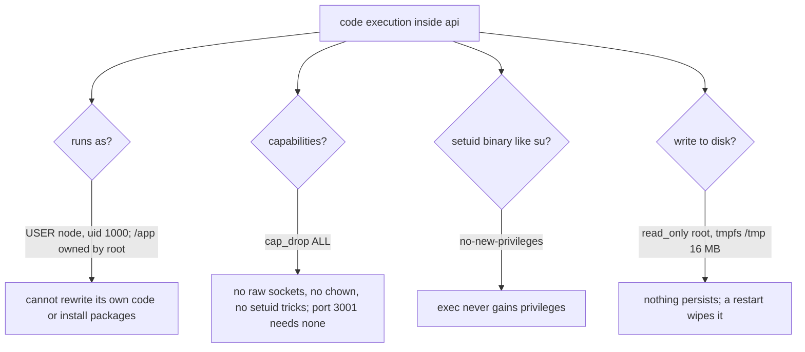

# WP-7: Images and per-service release

Issue #15, branch `wp/7-images-and-release`, release R0, size M, tag learning. Depends on WP-6 (done). Unblocks WP-8 (the server) and WP-9 (the deploy pipeline).

Deliverable (report section 14, decisions.json): one multi-stage non-root image per service, release-please with one component per service, GHCR push, SBOM, Trivy. Hardening from the 2026-10-09 audit: images pinned by digest; containers run non-root with `cap_drop: [ALL]`, `security_opt: no-new-privileges` and a read-only root filesystem where possible; deploys authenticate with OIDC or scoped tokens, never long-lived broad tokens. ADR-048 adds the Docker build check on every pull request and Trivy on built images, both "arriving with WP-7".

What the owner learns (decisions.json): image layers, least-privilege containers, semver per service.

**Out of scope, accepted at `/wp`:** the staging deploy at the end of `release.yml` (ADR-048 line "then deploy that service to staging"): there is no server until WP-8 and `deploy.yml` is WP-9's. The issue's "Deployed to staging" box is n/a for the same reason. `contact` and `admin` get their images and release components with their own WPs.

**What you already know, and what is new.** Process types (one codebase, several commands) come from WP-5 C13; the one-off migrate step from WP-10 D2; liveness and readiness from WP-3; affected runs, declared inputs, the single trusted cache writer, SHA pinning and required checks from WP-6 (D1, D2, D3, D10); the `PR title is the squash commit` rule from WP-6 D8. This file spends its words on what is new: what an image is made of, what a process inside it may do, how a version is born from a commit, and how anyone can check that an image came from this repo.

**What checking the repo found (2026-10-12).** Eight facts shape the plan; each is used below.
1. No Dockerfile exists. Three deployables today: `api` (entry files `main`, `worker`, `migrate`, `seed`), `agent` (`main`, `consumer`, `migrate`) and `web` (Next 16 with `output: "standalone"` and a script that copies the static files next to `server.js`).
2. A real `pnpm --filter @jadero/api --prod deploy` into a scratch folder works on the repo's pnpm 11.28.2 without `injectWorkspacePackages` (pnpm writes a dedicated lockfile and copies the workspace packages in): 233 packages, 109 MB of `node_modules`, no TypeScript, Vitest or drizzle-kit. It also copied `src/`, `test/` and `AGENTS.md` (no `files` field in `apps/api/package.json`), and `pino-pretty` came along as a runtime dependency of `platform-nest` (D1).
3. Trivy 0.75.0 on the official `node:24.21.0` slim images finds 8 HIGH vulnerabilities in packages under `/usr/local/lib/node_modules/npm` (`brace-expansion`, `tar`, `undici`, `ip-address`, `http-cache-semantics`): npm's own dependencies. Our services never run npm (D3).
4. `node:24.21.0-slim` is Debian 12 bookworm: 4 CRITICAL and 54 HIGH OS findings, 3 CRITICAL and 4 HIGH with a fix available (all in `perl-base`). `node:24.21.0-trixie-slim` (Debian 13): 0 CRITICAL, 43 HIGH, none with a fix. Distroless Node 24: no HIGH or CRITICAL. Debian 12's regular security support ended on 2026-07-11 (D3, D10).
5. Trivy does not see the Node.js runtime in the official images: it lists 79 Debian packages and 146 npm packages, and no `node`. A Node security release reaches us through Renovate's tag update, not through Trivy (D8).
6. This repo does not allow workflows to create pull requests (the "Allow GitHub Actions to create and approve pull requests" setting is off, the default for a personal repository), and events made with the job's `GITHUB_TOKEN` do not start other workflows. release-please opens its Release PR with that token by default (D11).
7. release-please gives a commit to a component by the files it touches. The pnpm catalog and the lockfile live at the root, so a dependency-only update touches no service folder and releases nothing (Q2).
8. A package pushed to GHCR from a personal account starts private; making it public cannot be undone (Q1).

## Decisions explained

### D1. Why a multi-stage build with `pnpm deploy --prod`, and not one stage, `turbo prune` or a bundle?

**First, what an image is.** An image is a stack of read-only filesystem layers plus a small config (user, command, environment, healthcheck). Each instruction that changes files (`COPY`, `RUN`) adds one layer, identified by the hash of its content. A build reuses a cached layer when the instruction and its inputs are unchanged; the first changed layer and every layer after it rebuild. A container is the image plus one thin writable layer on top. Two consequences matter: order instructions from "changes rarely" to "changes often" (dependencies before source), and deleting a file in a later layer does not remove it from the image, because the earlier layer still holds it. A **multi-stage** Dockerfile has several `FROM` lines; only the last stage becomes the image, and it takes files from earlier stages with `COPY --from`. Stages are how the toolbox stays out of the product.

**Problem.** Building a service in this monorepo needs the whole workspace: every `package.json`, the lockfile, TypeScript, the shared packages' sources and the dev tools. Running it needs compiled JavaScript, the migrations and the production dependencies. If one image does both, production carries the toolbox: more bytes to pull, more files an attacker can use, more packages for the scanner to flag.

**Example.** `api` at runtime needs `dist/`, `drizzle/` and 233 production packages (109 MB, measured with a real `pnpm deploy`). The workspace install behind it resolves 995 package versions (WP-6's count), including TypeScript, Vitest, drizzle-kit with esbuild, and Playwright for `web`. A single-stage `api` image would carry all of them, plus `src/` and `test/`, and every one would be scanned on every build.

**Decision (ADR-048, "Images").** Each service gets a three-stage Dockerfile:

```mermaid
flowchart LR
  B[base: node 24.21.0 trixie-slim, pinned by digest] --> BU[build stage: pnpm fetch from the lockfile, install offline, turbo build of the service and its workspace packages, pnpm deploy --prod into /out]
  B --> R[runtime stage: same base, npm removed, /out copied in, owned by root, USER node]
  BU -- COPY --from=build /out --> R
  R --> I[image: dist, drizzle, package.json, node_modules with production packages only]
```

`pnpm fetch` reads only the lockfile, so the layer that downloads packages is rebuilt only when the lockfile changes, not on every source edit. `pnpm --filter @jadero/api --prod deploy /out` then writes a self-contained folder: the service's files (limited by a `files` field), its own lockfile, and a `node_modules` with production dependencies only, the workspace packages copied in as real folders instead of links into the monorepo. The runtime stage copies that folder and nothing else. ADR-048 allows `pnpm deploy --prod` or `turbo prune`; `pnpm deploy` is chosen because it is the package manager's own command and the real run above shows it works on pnpm 11.28.2 as the repo is today.

**Alternatives.**
- *One stage* (copy the repo, install everything, build, run). Discarded: the toolbox ships to production. Wins for a development container or a throwaway prototype where image size and surface do not matter.
- *`turbo prune --docker` first.* It writes a pruned workspace (`out/json` with only the manifests and a pruned lockfile, `out/full` with the sources) before the install. A real run for `api` kept `api`, `config`, `contracts`, `messaging`, `platform-nest` and `testing` and a 7,864-line lockfile. Its gain: a dependency used only by `web` no longer invalidates `api`'s install layer. Discarded for now: one more step for three services whose lockfile changes about once a week in grouped Renovate PRs anyway. Wins with many services and frequent per-service dependency changes, where build cache hit rates cost real CI minutes; it can be added in front of the same stages later.
- *Build outside Docker and copy `dist/` in.* CI already builds with the Turborepo cache. Discarded: the image then depends on the machine that built it (its Node version, its OS for native modules), so a local image and a CI image differ. Wins when a reproducible build host already exists (Bazel, Nix) and builds are slow.
- *Bundle the service into one file* (esbuild, ncc) and ship no `node_modules`. Discarded: OpenTelemetry's automatic instrumentation (WP-3) works by hooking the moment Node loads `pg`, `express` or `amqplib`; its README requires that those modules are not included in a bundle, or the hooks never fire and the traces go blank. Nest's decorator metadata adds more friction. Wins for small serverless functions where cold start and size dominate.

**Patterns:** multi-stage build, layer caching (content-addressed, order by change rate), minimal runtime image, attack surface reduction.

### D2. Why one image per service, with the process types and migrate as commands, and not one image per process?

**Problem.** `api` runs three kinds of process from one codebase: the HTTP server, the `api-worker` (outbox relay, heartbeat) and the one-off `migrate`. `agent` has the same shape with its consumer. If each process type is a separate image, nothing forces them to be built from the same commit.

**Example.** Release 0.4.0 of `api` adds the column `summary` in migration `0007` and code that reads it. If `api-migrate:0.4.0` and `api:0.4.0` were two builds, a cache miss in one, or a retry of one job, could produce a migrate image from one commit and a server from another: migrations and the code that reads the tables would disagree, and the deploy would fail in a way no test saw.

**Decision (ADR-048, `release.yml`: "one image per service; process types and the migrate step are commands of that image").** One image per service, `ghcr.io/josealbdr/jadero-dev-api`. Its default command starts the HTTP server; Compose overrides the command for the other processes:

| Compose service | Image | Command | Restart |
|---|---|---|---|
| `api` | `jadero-dev-api:0.4.0` | `node --import @jadero/platform-nest/instrumentation dist/main.js` (default) | unless-stopped |
| `api-worker` | same | `... dist/worker.js` | unless-stopped |
| `api-migrate` | same | `node dist/migrate.js` | no (one-off, WP-10 D2) |
| `agent`, `agent-consumer`, `agent-migrate` | `jadero-dev-agent:0.3.1` | the same pattern | as above |

**Recall from WP-5 C13 and WP-10 D2.** A process type is the same code started with a different command, with its own memory limit and restart policy, so a stuck relay never slows a request. The migrate step runs once per deploy, before the service starts, and its exit code gates the deploy. What this WP adds: one image makes "same code" true by construction, because all three commands read the same bytes.

**Alternatives.**
- *One image per process type.* Discarded for the drift above and three builds per release. Wins when process types need different dependencies or bases: a Python classifier next to a Node service (R7's `guard-classifier` is its own image), or a worker with a heavy native library the server must not carry.
- *One image for every service* (a monorepo image started as `api` or `agent`). Discarded: every release would ship every service, which breaks independent deploys (ADR-029, ADR-025). Wins for a modular monolith deployed as one unit.
- *Migrations in a separate migration-tool image* (Flyway, Atlas, Liquibase). Discarded: Drizzle's `migrate()` already runs from our image (WP-10). Wins when database administrators own migrations, or several languages share one database.

**Patterns:** process types (twelve-factor processes and one-off admin processes), build once run many, deploy gate.

### D3. Why the official `node:24` slim image pinned by tag and digest, and not Alpine, distroless or a floating tag?

**Problem.** `FROM node:24` is a moving pointer. Tomorrow's build may get another Node minor and other Debian packages, so two builds of the same commit differ, and a tampered or broken upstream push lands in your image without any change in your repo. The default variant is also a full Debian with compilers.

**Example.** On Docker Hub, `node:24.21.0` (Debian 12, full) is 412 MB compressed for amd64; `node:24.21.0-trixie-slim` is 82 MB; `-alpine` is 62 MB. Node 24.21.0 was released on 2026-09-07, yet its tags were last updated on 2026-10-06: the same tag now points at different bytes, rebuilt with newer Debian packages. A pin by tag alone would have silently changed under every build since then.

**Decision (ADR-042: Node 24 LTS from a `node:24` base; ADR-048 and the 2026-10-09 audit: pinned by digest).** Every Dockerfile starts from `node:24.21.0-trixie-slim@sha256:173f125896c3b47ddf056734c7ea789d04595a6a08769a8f78e0df642781fb66`. The tag is for people and Renovate; the digest is what Docker uses, the same idea as pinning actions by commit SHA in WP-6 D1. The digest is the multi-architecture index, so your Mac (arm64) and CI (amd64) use the same pin. A unit test checks that the three Dockerfiles carry one pin and that its Node version equals `.nvmrc` (24.21.0), the same environment-parity test WP-6 added for the Postgres and RabbitMQ images. The runtime stage deletes npm, npx and corepack, which removes the 8 HIGH findings of fact 3 from what the container can run.

Why trixie-slim over the default `-slim` (bookworm): Debian 12's regular security support ended on 2026-07-11 (only LTS until 2028-06-30), and today it carries 3 fixable CRITICAL findings that trixie does not. Why the official image at all: ADR-042 names it, Node's own team publishes it, and its tag carries the exact Node version.

**What differs from WP-6.** For an action, a digest change with no version change is a warning sign (someone moved a tag). For an official base image it is routine: the maintainers rebuild the same tag when Debian ships fixes. Renovate's digest pull requests for the base are how those fixes reach us, so they are merged, not just noted.

**Alternatives.**
- *`node:24-alpine`* (musl libc, smallest official variant, no OS HIGH today). Discarded: Node lists musl builds as "Experimental" support tier for Node 24 (BUILDING.md at v24.21.0), musl's DNS and native-module behavior differ from the glibc that CI and most libraries assume. Wins when size dominates and every dependency is pure JavaScript and tested on musl.
- *Distroless* (`gcr.io/distroless/nodejs24-debian13:nonroot`: Node 24.21.0, user 65532, no shell, no package manager, no HIGH or CRITICAL findings today). Discarded here: it departs from ADR-042's "node:24 base" wording (a superseding ADR), the tag does not carry the Node version (only the digest does), and debugging needs the separate `:debug` variant because `docker exec sh` has no shell. Wins when the smallest surface matters most and the team debugs with ephemeral debug containers.
- *Docker Hardened Images* (`dhi.io/node:24`; free under Apache 2.0 since December 2025, non-root, near-zero CVEs, signed SBOM and SLSA provenance). Discarded: pulling needs `docker login dhi.io` with a Docker account, in CI and on the server, which adds one more credential to both. Wins for a team with a Docker account policy or compliance needs (FIPS and STIG variants).
- *Floating tags* (`node:24-slim`, `node:lts`). Discarded: builds are not reproducible and upstream changes arrive unreviewed. Wins nowhere for production; fine in a throwaway script.

**Patterns:** immutable reference (pin by content hash), reproducible build, environment parity, base image hygiene.

### D4. Why non-root, no capabilities, no new privileges and a read-only root filesystem?

**Problem.** Suppose an attacker gets code execution inside `api`: a bug in a parser, or a malicious dependency release that slipped past the cooldown. What they can do next depends on what the process is allowed to do. By default Docker runs the container as root (user 0) with a set of Linux capabilities (including `NET_RAW` to craft raw packets, `CHOWN`, `SETUID`, `SETGID`) on a writable filesystem.

**Example.** The trixie and bookworm slim images contain setuid-root programs: on bookworm-slim, `su`, `mount`, `umount`, `passwd`, `newgrp`, `chfn`, `chsh` and `gpasswd` (listed with `find / -perm -4000`). As root, the attacker rewrites `dist/main.js` so the backdoor survives a restart, drops tools into `/usr/local/bin`, and probes the network with raw packets. As a non-root user, a setuid binary is the classic way back up to root.

**Decision (ADR-048 "non-root user, read-only root filesystem where possible"; the 2026-10-09 audit).** Four independent layers, so a failure of one does not hand over the others:



1. **Non-root.** The runtime stage ends with `USER node` (uid 1000, created by the official image). The application files are copied as root and are only readable by `node`, so even without the read-only filesystem the process cannot change its own code. (The Next.js Docker example copies its files with `--chown` to the runtime user, which leaves them writable; this project does not.)
2. **`cap_drop: [ALL]`.** The services listen on ports above 1024 (3001, 3002, 3011, 3012 and web's), which needs no capability; only ports below 1024 need `NET_BIND_SERVICE`.
3. **`no-new-privileges`.** The kernel refuses to grant more privileges on `exec`, so `su` and the other setuid programs cannot raise the user to root.
4. **`read_only: true`** with a small `tmpfs` for `/tmp`, and for `web` one for `.next/cache` (Next's server cache is on disk by default). Memory-backed, size-capped and gone at restart.

And the rule from ADR-043 (ADR-007's secrets decision, restated): **secrets are never in an image.** Runtime secrets come from the `.env` file the deploy renders on the server (WP-8, WP-9) and Compose passes as environment. The root `.dockerignore` excludes `.env*`, so a developer's local `.env` never enters the build context, and Trivy's secret scanner reads every built image (D8). A secret baked into a layer stays in that layer even if a later layer deletes it, which is the D1 layer rule seen from the security side.

**Alternatives.**
- *Root in the container, "Docker isolates it anyway".* Discarded: containers share the host kernel, so root in a container plus a kernel or runtime bug is root on the host, and root can rewrite the app regardless. Wins nowhere in production; acceptable in a local throwaway container.
- *Rootless Docker or user namespace remapping on the host* (container root maps to an unprivileged host user). Not instead of this, in addition: it is host configuration (WP-8). Wins when you must run third-party images that insist on root.
- *A sandboxed runtime* (gVisor, Kata Containers). A stronger wall, with overhead. Wins when running untrusted code from customers.
- *Custom seccomp or AppArmor profiles.* Docker's default seccomp profile already applies. A custom profile wins for a high-value service that needs syscall-level lockdown, at the cost of maintaining it.

**Patterns:** least privilege, defense in depth, attack surface reduction, immutable container.

### D5. Why a `HEALTHCHECK` in the image that asks readiness, and why that is safe only because Docker never restarts an unhealthy container?

**Recall from WP-3.** Two questions, two endpoints: `/health/live` asks "should this process be restarted?" and checks nothing outside the process; `/health/ready` asks "can it take traffic now?" and checks its dependencies (for `api`, Postgres; for `api-worker`, Postgres and RabbitMQ, WP-5 C14). Readiness is false while booting and while shutting down.

**Problem.** "Container running" is not "service ready". A deploy that recreates `api` and moves on immediately sends traffic to a process that is still booting, and a migrate container that never ran is invisible.

**Example.** `docker compose up -d api` returns as soon as the process starts. Nest needs about a second to build its modules and open the pool; until then nginx answers 502.

**Decision (ADR-048: `HEALTHCHECK` in the image; the deploy checks `/health/ready`).** Each image declares a `HEALTHCHECK` that calls its own `/health/ready` on `$PORT` with Node's built-in `fetch` (the slim image has no `curl` or `wget`). Compose uses it in `depends_on: condition: service_healthy` and `up --wait`, and WP-9's deploy waits for `healthy`. The `*-migrate` services disable it (a one-off has no server). `web` has no health route, so its check requests `/robots.txt`, which the Next server renders itself without calling the content API and the locale proxy skips.

**Why readiness is safe here.** Docker's restart policy acts only when the process exits; the health status changes a label and nothing else (Docker's restart policy reference). That closes WP-3's **verify** ("plain Compose marks unhealthy but does not restart"). So a Postgres blip turns `api` unhealthy without a restart storm.

**When it would change.** Under Kubernetes the image's `HEALTHCHECK` is ignored and the two probes are separate (liveness to `/health/live`, readiness to `/health/ready`). Under Compose with an "autoheal" container that restarts unhealthy containers, a readiness check would restart every service during a database outage, a cascading failure; the check would have to move to `/health/live`.

**Alternatives.**
- *No `HEALTHCHECK`; the deploy script polls the endpoint itself.* Discarded: Compose's `depends_on` and `--wait` could not use it. Wins on Kubernetes, which ignores it.
- *Install `curl` for the check.* Discarded: one more binary with its own CVEs, for something Node already does. Wins when `curl` is already in the image.
- *Check liveness.* Wins with a restarter in place (above).

**Patterns:** health check API, liveness versus readiness, deploy gate, cascading failure (what to avoid).

### D6. Why release-please with one component per service, and not one product version, semantic-release or Changesets?

**Problem.** Each service must say which version of it runs, and a change to one service should release only that one. One product version redeploys every service for a one-line fix in one of them, which hides whether the services really are independent (ADR-029).

**Example.** A merged `fix(agent): stop retrying a refused prompt` should produce `agent-v0.3.1`, an `agent` image and nothing else; `api` stays at 0.5.0 and `web` at 0.2.0.

**Decision (ADR-025).** release-please with a manifest that lists one component per service. How a version is born:

```mermaid
sequenceDiagram
  participant Dev as squash commit on main
  participant RP as release.yml, release-please job
  participant PR as Release PR
  participant Img as release.yml, images job
  Dev->>RP: fix(agent): stop retrying a refused prompt (files under apps/agent)
  RP->>RP: attribute by path: component agent; fix means patch, 0.3.0 to 0.3.1
  RP->>PR: open or update "chore(main): release": manifest, apps/agent/package.json, apps/agent/CHANGELOG.md
  Note over PR: the owner reviews and merges when ready (the checkpoint)
  PR->>RP: merge commit on main
  RP->>RP: tag agent-v0.3.1, GitHub release; output paths_released = [apps/agent]
  RP->>Img: build, scan and push jadero-dev-agent:0.3.1 and :sha-<short>
```

- **Commit type to version** (Conventional Commits and semver): `feat` bumps the minor, `fix` and `perf` the patch, `!` or a `BREAKING CHANGE` footer the major. `chore`, `docs`, `ci`, `build`, `test`, `refactor` and `style` release nothing (release-please's default sections, read in its source). Recall WP-6 D8: the PR title is the squash commit, so the title linted on every PR is exactly what release-please reads. Before 1.0, `bump-minor-pre-major` keeps a breaking change at a minor bump.
- **Attribution by path.** A commit belongs to every component whose folder holds a file it touches. Tags are `<component>-v<version>`: release-please strips the npm scope, so `@jadero/agent` becomes `agent-v0.3.1`, the form ADR-025 asks for.
- **One combined Release PR** is the checkpoint: it shows every pending release; merging it tags only the components that changed.
- **Shared packages.** ADR-025 asked to verify the `node-workspace` plugin. Read in release-please 17.11.2 (and the `^17.6.0` the action v5.0.0 bundles): when a shared package that is a component releases, every component that depends on it gets a patch bump and a changelog line ("The following workspace dependencies were updated"); `workspace:*` ranges are left as they are. It counts `devDependencies` too, so `packages/config` and `packages/testing` (development only, never in an image) are not components; `contracts`, `messaging`, `platform-nest` and `ui` are.
- **The gap.** The real inputs of a service image are wider than its folder: the catalog and the lockfile at the root, and the base image. That is WP-6 D2's undeclared-input problem in a new tool, and it is Q2.

**Alternatives.**
- *One product version* (release-please with a single component). Discarded: every release ships every service. Wins with one deployable.
- *semantic-release.* Releases on every qualifying push, no checkpoint, one package per repo unless plugins are added. Wins for a single library published continuously.
- *Changesets.* Built around publishing npm packages with hand-written intent files. Wins for a monorepo that publishes libraries to npm.
- *No versions, only commit SHAs* (every merge deploys). Wins for continuous deployment where a version number means nothing to anyone. Here versions name what runs (`versions.env`, ADR-025) and feed the per-service changelogs of the case study.

**Patterns:** semantic versioning, conventional commits, release checkpoint (the Release PR), independent deployability, changelog as code, declared inputs.

### D7. Why GHCR with the job's own token, version and SHA tags, and one image promoted through every environment?

**Problem.** The server must run exactly the bytes CI built and scanned. A registry tag such as `0.3.1` is a movable pointer, like the action tags of WP-6 D1, and whoever holds a push credential can move it.

**Example.** `ghcr.io/josealbdr/jadero-dev-agent:0.3.1` and `:sha-1a2b3c4` both point at one digest `sha256:...`. The deploy of WP-9 pulls by version into staging, then the same image into production.

**Decision (ADR-048, ADR-025, ADR-043).**
- **Push from `release.yml` with the job's `GITHUB_TOKEN`** and `packages: write` on that job only. The token exists for the length of the job, so no stored registry credential exists for publishing. Publishing from the workflow, plus the label `org.opencontainers.image.source`, links the package to the repository and makes it inherit the repository's access permissions (not its visibility, Q1).
- **Two tags**: the version for people and `versions.env`, `sha-<short>` to go from a running container to its commit. No `latest`: it moves on every release and says nothing.
- **Build once, promote.** The image carries no environment: config comes from the environment at start (ADR-043), and `web` reads `SITE_URL` when its server starts (its build only checks that the variable is set). So one digest goes to staging and then to production, never a rebuild per environment.
- **A note for WP-9, not decided here:** `versions.env` could record the digest next to the version, so a moved tag could not change what a redeploy pulls.

**Alternatives.**
- *Docker Hub.* A separate account and token, pull rate limits for anonymous users. Wins for images meant for wide public distribution.
- *A registry on the server.* One more service to run and patch. Wins in an air-gapped network.
- *Build on the server at deploy* (`docker build` there, no registry). Discarded: the server needs the toolchain and the source, and the image that runs was never scanned or attested. Wins for a hobby box with one service.
- *A cloud registry with OIDC* (ECR, Artifact Registry). Wins when the deploy target is that cloud.

**Patterns:** build once deploy many (immutable artifact promotion), immutable reference, short-lived credentials, configuration in the environment (twelve-factor).

### D8. Why an SBOM, a vulnerability scan and a signed build provenance, and what each one answers?

**Problem.** Three different questions, three different tools:
- "Is the package from today's advisory in what we run?" needs an inventory of every package in the image: a **software bill of materials (SBOM)**.
- "Does this image contain known vulnerabilities?" needs a **scanner** against today's advisory databases.
- "Did our workflow build this image from our commit, or did someone with a stolen token push it?" needs a **signed build provenance**: a statement of which repository, workflow, commit and runner produced which digest, signed so it cannot be forged.

**Example, real.** On 2026-03-19 attackers force-pushed 75 of the 76 version tags of `aquasecurity/trivy-action` (plus `setup-trivy` and a malicious Trivy 0.69.4 binary) to code that stole CI secrets and then ran the real scan, so pipelines looked normal for about 12 hours. The root cause was a token stolen earlier through a `pull_request_target` workflow. The scanner itself was the attack, the same pattern as `tj-actions` in WP-6 D1.

**Decision (ADR-048: SBOM, Trivy on built images; the owner's step list adds the provenance attestation).**
- **SBOM:** BuildKit generates it during the push (`sbom: true` on the build action) and attaches it to the image in the registry, so it travels with the digest.
- **Scanner:** Trivy, run as its official container pinned by digest (`aquasec/trivy:0.75.0@sha256:af6a...`), like gitleaks and zizmor in WP-6, never through the action. It scans the image saved to a file, so no Docker socket (root on the runner) is handed to a third-party container. It also runs its secret scanner on every image (D4). What it gates is D10. Its blind spot (fact 5): the Node runtime itself, which Renovate's tag updates cover.
- **Provenance:** `actions/attest` (v4.2.2) creates a SLSA build provenance for the pushed digest and signs it **without a stored key**: the job asks GitHub for an OIDC token (`id-token: write`), Sigstore issues a certificate valid for minutes that names this repository and workflow, and the signature plus certificate are stored in GitHub's attestation API and pushed to the registry. Anyone can check it: `gh attestation verify oci://ghcr.io/josealbdr/jadero-dev-api:0.1.1 --owner JoseAlbDR`. Free for public repositories. Recall WP-6: Scorecard's publish job uses the same OIDC token to prove a result came from this repository.

**Alternatives.**
- *No SBOM, scan on demand.* Wins when images are rebuilt daily anyway; loses the record of what ran last month.
- *Syft (`anchore/sbom-action`) or Trivy as the SBOM generator.* Equivalent results; wins when you need SBOMs of things that are not images, or a specific format attached to the GitHub release.
- *cosign with a long-lived signing key.* Wins outside GitHub, or where keyless signing is not allowed; the key becomes one more secret to guard and rotate.
- *Trust the registry, no provenance.* Wins nowhere for a public repo; the verify step in WP-9 needs something to verify.

**Patterns:** software bill of materials, SLSA build provenance, keyless signing (OIDC and Sigstore), supply chain attack, verify before run, defense in depth.

### D9. Why a Docker build check on every pull request, only for the affected services, as a required check?

**Problem.** A broken Dockerfile, or a change that the image needs but the tests do not see, is found only at release time, after the merge.

**Example.** Someone moves the migrations from `apps/api/drizzle` to `apps/api/db/migrations` and updates `drizzle.config.ts`, but not the `files` field. Every test passes (tests read the sources), the image builds, and `node dist/migrate.js` in the container fails on a missing `drizzle/meta/_journal.json`. Without a check on the pull request, the first deploy finds it.

**Decision (ADR-048, `ci.yml`: "Docker build without push (validates Dockerfiles), arriving with WP-7").** A new `images` job in `ci.yml`:
- **Affected only** (WP-6 D2): Turborepo lists the services whose inputs changed. The root `.dockerignore` is outside every package, so it is declared as an input, and the out-of-package read test of WP-6 covers it.
- **Builds, then smokes.** For each affected service: build for amd64 without pushing, then run the image twice: `id -u` must not be 0, and the server started with an empty environment must stop on the config error of ADR-043 (`DATABASE_URL`: required) instead of `ERR_MODULE_NOT_FOUND`, which proves every import resolves. Then the scan of D8 and D10.
- **Build cache with one trusted writer** (WP-6 D3): the job reads BuildKit's GitHub cache on pull requests and writes it only on `main`.
- **Always reports** (WP-6 D10): with no service affected the job skips its steps inside and reports success; never a workflow `paths:` filter, which would leave a required check Pending.
- **Required, added by expand** (WP-6 step 8's rename lesson): the job lands first; its name joins the `protect-main` ruleset after it has reported on `main`.

**Alternatives.**
- *Build every image on every pull request.* Three images, a few minutes with a warm cache. A valid simpler choice; discarded because it grows with every service. Wins in small repos.
- *Build only at release.* Discarded: breakage appears after the merge and blocks the release. Wins nowhere when images are the product.
- *A `paths:` filter on the workflow.* Discarded: a required check that never reports blocks the merge (WP-6 D10).

**Patterns:** shift left, affected build, smoke test, required check, single trusted writer.

### D10. What does Trivy block, and where? (proposed here; no ADR decides it)

No ADR sets the scanner's policy. It is proposed as a decision rather than asked, because a policy line is cheap to change later; object if you disagree.

**Problem.** WP-6 Q2 set the rule for npm packages: a **diff gate** (OSV-Scanner fails a PR only for vulnerabilities the PR brings in) plus a scheduled **full scan** that reports without blocking (study backlog: "a diff gate needs a second channel"). An image scan is naturally full-state: it reports everything in the image today, including advisories published this morning for packages nobody touched. Gate on that, and unrelated PRs turn red.

**Example.** Debian ships a fix for a HIGH finding in `libsystemd0` on a Wednesday. Renovate waits three days (the cooldown) before proposing the new base digest. With a full-state gate, every PR that affects `api` is red from Wednesday until that update merges, a typo fix included.

**Decision (proposed).** Apply WP-6's rule to images:
- **What blocks a PR:** in the `images` job, fixable HIGH and CRITICAL OS findings (`--ignore-unfixed`), but only when the PR changes what the image is built from (a Dockerfile, the base pin, `.dockerignore`, `.trivyignore.yaml`). On other PRs Trivy prints its findings in the job summary and passes. A secret found in an image always fails (D4).
- **Releases** scan before the push and report without blocking: a release may be the one carrying a fix.
- **The second channel:** a weekly job in `security.yml` scans the released images (OS and npm, all severities) into the Security tab and opens an issue on a fixable CRITICAL.
- **One tool per job:** npm findings stay with OSV-Scanner on the lockfile, the overlap you avoided in WP-6 Q1 (dependency review kept for licenses only).
- **Exceptions** go in `.trivyignore.yaml` with an `expired_at` date, so none outlives its reason.
- Real numbers today: the trixie-slim base has 43 HIGH OS findings, none fixable, so the gate is quiet; bookworm-slim would fail on 3 fixable CRITICAL (Trace 2a).

Departure: ADR-048 lists "Trivy on built images" under `security.yml` and the Docker build under `ci.yml`. Scanning in the job that just built the image avoids a second build; it moves the PR-time scan to `ci.yml`, a placement line for the next superseding ADR (as WP-6 left gitleaks' placement). The weekly scan stays in `security.yml`.

**Alternatives.**
- *Full-state gate on fixable HIGH and CRITICAL.* Every PR that affects a service fails while its image has one. Simplest and strictest; unrelated PRs turn red for the cooldown after each Debian fix, unless a dated ignore is added. Wins in a team where a red build reliably triggers a base update the same day.
- *Full-state gate on fixable CRITICAL only, HIGH reported.* Fewer red PRs. Wins as a step down when the full gate proves too noisy.
- *Report only, never block.* Wins when someone reads the Security tab every week without fail.
- *Gate npm findings in Trivy too.* Two checks fail for one advisory. Wins only where no lockfile scanner exists.

**Patterns:** diff-based gate versus full-state gate, second channel, alert fatigue, time-boxed exception, one tool per job.

### D11. Which token opens the Release PR and creates the tags? (proposed here; no ADR decides it)

ADR-043 says GHCR uses the built-in `GITHUB_TOKEN`; that stays for the image push (D7). No ADR names the token for the Release PR. Proposed, not asked: switching later is one secret and one line.

**Problem.** release-please runs in `release.yml` on every push to `main`. It must push a branch, open or update the Release PR, add labels and, after the merge, create tags and GitHub releases (`contents`, `pull-requests` and `issues: write`). Whatever token does that decides two things: what a leak of it could do, and whether the Release PR gets its required checks.

**Example, checked on 2026-10-12.** With the job's `GITHUB_TOKEN`: this repo's setting "Allow GitHub Actions to create and approve pull requests" is off (the default for personal repositories), so the token cannot open the PR at all. Turned on, the PR opens, but events made with `GITHUB_TOKEN` do not start other workflows, so `ci.yml` never runs on it and its 8 required checks wait forever. GitHub's docs now describe an exception rolling out on github.com: a PR opened or updated by `GITHUB_TOKEN` gets its runs in an "approval required" state, and a person with write access starts them with one click (**verify** on the first Release PR).

**Decision (proposed).** The job's `GITHUB_TOKEN`, with the repository setting turned on (your manual action). No stored secret at all; you merge the Release PR by hand anyway, so one "Approve workflows to run" click is small. The same switch also lets a workflow approve PRs, which grants nothing here because `protect-main` requires 0 approvals, and only the `release-please` job has `pull-requests: write`. If step 7 shows no approval banner on the first Release PR, the fallback is a GitHub App (next line), never a classic token.

**Alternatives.**
- *A GitHub App installation token.* You create an app, install it on this repository only with those three permissions, and the job mints a token valid for one hour (`actions/create-github-app-token` v3.2.0). Events made with it start workflows, so checks run with no click. Its private key is a repository secret: long-lived, but it can only mint tokens for this one repository. Wins when automation must trigger workflows without a person.
- *A fine-grained personal access token for this repository.* Simplest setup, checks run on their own; the PR appears as yours and the token lives as long as you choose, up to no expiry. Wins for a quick start, accepting a token tied to your account.
- *A classic personal access token.* Reaches every repository you own; the audit's "never long-lived broad tokens" rules it out. Wins nowhere here.

**Patterns:** least privilege, short-lived credentials, recursive-trigger protection, human in the loop.

## Open questions

Two choices no ADR decides and that are expensive or impossible to undo. They are independent.

### Q1. Are the images public or private on GHCR?

**What you need first.** The first push creates each package (`jadero-dev-api`, `-agent`, `-web`) as **private**, whatever the repository's visibility. You can make a package public later; **you cannot make it private again**. A public image can be pulled by anyone without logging in. A private one needs a credential on every machine that pulls it: CI gets the job's token for free, but the server (WP-8, WP-9) needs one too. GHCR accepts only **classic** personal access tokens (`read:packages`), which can read every package of your account, or a workflow's `GITHUB_TOKEN`. ADR-048's deploy step says "log in to GHCR with a read-only token", written before anyone checked which tokens GHCR accepts.

What a public image reveals: the compiled code of a public repository, the dependency list (already in the public lockfile) and the SBOM. It must never contain a secret (D4), which Trivy's secret scan checks on every build.

**Options.**
- *A. Public.* Anonymous pulls: the server needs no registry credential at all, and anyone (a reviewer, you) can pull an image and run `gh attestation verify` on it. One-way. The ADR-048 deploy line about logging in becomes unnecessary (a superseding ADR line when WP-9 builds the deploy). Wins for open-source and portfolio projects.
- *B. Private, pulled with a short-lived token.* The deploy job hands its own `GITHUB_TOKEN` (`packages: read`, expires with the job) to the server for one pull. No stored registry token on the server; WP-9 must pass it safely through the SSH forced command. Wins when the code is private or images contain things not meant for the public.
- *C. Private, pulled with a classic token stored on the server.* Simplest for WP-9; the token reads every package of your account and lives until revoked, which the audit rules out. Wins nowhere here.

**Patterns:** least privilege, one-way door (a decision that cannot be undone), trust boundary.

**Question 1.** A, B or C?

### Q2. How does a dependency-only change become a service release?

**What you need first.** release-please gives a commit to a component only through the files it touches (D6), and only `feat`, `fix`, `perf` and `revert` (or a breaking change) produce a release. Three kinds of change alter what an image contains without touching a service's own files:
- a **runtime package update in the catalog** (`pnpm-workspace.yaml`) and `pnpm-lock.yaml`, both at the root: no component is touched, so no release;
- a **base image digest update**: the Dockerfile lives in `apps/<service>/`, so the path matches, but Renovate titles digest updates `chore(deps)`, which releases nothing;
- a **shared package** change: handled by the `node-workspace` plugin (D6).

This is WP-6 D2's undeclared input again: the tool decides "what belongs to `api`" from the folder, while `api`'s real inputs include root files. ADR-025's fallback for shared packages (a CI check that fails unless the affected services are bumped) is the same idea.

**Example.** Renovate's weekly group bumps `pg` 8.23.1 to 8.23.2 to fix a connection leak. The commit touches `pnpm-workspace.yaml` and `pnpm-lock.yaml`. release-please sees no component; `api` and `agent` keep running 8.23.1 until their next `feat` or `fix`, which might be weeks away.

**Options.**
- *A. Accept the gap.* Dependency updates ship with each service's next release; the weekly image scan (D10) shows what is behind. Renovate's base digest updates are titled `fix(deps)` so at least those release. Wins when dependency fixes are rarely urgent.
- *B. A release-inputs file per service.* `apps/<service>/release-inputs.txt` lists the service's production dependency closure (`name@version`, one per line, generated by a script); a unit test fails when it is stale. A dependency PR must regenerate it (one command), so its squash commit touches `apps/api/release-inputs.txt` and `apps/agent/release-inputs.txt`, and with the title `fix(deps): ...` both services release a patch whose changelog names the update. The diff also shows the reviewer which services a dependency update reaches. Renovate's base digest and runtime package updates get the `fix(deps)` title. The cost: the hosted Renovate cannot run the script, so each dependency PR needs you to run it and push. Wins when every dependency fix should ship within the week, with a visible record.
- *C. Release every service on any lockfile change.* Simple, coarse: services whose dependencies did not change also release. Wins with very few services.
- *D. Rebuild the current version with fresh dependencies and push the same tag again.* Discarded: a version would no longer name one set of bytes, which breaks D7 and `versions.env`. Listed so you recognize it in other projects.

Options B and C add a mechanism beyond ADR-025 (a superseding ADR line).

**Patterns:** declared inputs (hermeticity), generated file with a staleness test, release trigger, semantic versioning.

**Question 2.** A, B, C or D?

### Recommendations

Read after answering.

- **Q1: A, public,** after step 7's dry run shows Trivy's secret scan clean on all three images. The repository is public, so the images reveal nothing new; anonymous pulls remove the only long-lived credential the deploy would otherwise need, which is the audit's rule taken to its end, and reviewers can verify the attestations themselves. If you prefer to keep the one-way door closed for now, B is the safe private choice; never C.
- **Q2: B, the release-inputs file,** because a security fix in a dependency should reach production within the week without waiting for an unrelated feature, and the diff tells you which services an update touches. If running one command on each Renovate PR feels like too much friction, A is acceptable for now with the weekly scan as the reminder; C releases too much and D breaks immutable versions.

## Implementation choices

What WP-7 builds, assuming the recommendations. Object to any line.

- **Files:** `apps/<service>/Dockerfile` for `api`, `agent` and `web`, build context at the repository root, one root `.dockerignore` (`.git`, `node_modules`, `dist`, `.next`, `.turbo`, `coverage`, test output, `docs`, `.claude`, `.env*`): a small context and no local secrets in it.
- **Base pin:** `node:24.21.0-trixie-slim@sha256:173f125896c3b47ddf056734c7ea789d04595a6a08769a8f78e0df642781fb66`, written once per Dockerfile in an `ARG` used by every stage; a unit test checks one pin across the Dockerfiles and that its Node version equals `.nvmrc`.
- **Build stage:** corepack (bundled with Node 24, version 0.36.0 in the image; Node 25 no longer bundles it) activates the `packageManager` pnpm 11.28.2; `pnpm fetch` with a BuildKit cache mount on the store, then `pnpm install --offline --frozen-lockfile`, `pnpm turbo run build --filter=@jadero/<service>...`, `pnpm --filter @jadero/<service> --prod deploy /out`.
- **`files` fields:** `["dist", "drizzle"]` in `apps/api` and `apps/agent`, so the deploy copies compiled code and migrations only (today it copies `src`, `test` and `AGENTS.md`).
- **`pino-pretty`:** moves to `platform-nest`'s `devDependencies` (it loads only under development, `logger-params.ts`), so images do not ship it; step 2 shows a production boot without it.
- **Runtime stage:** the same base; npm, npx and corepack removed; `/app` copied as root, readable by `node`; `USER node`; `NODE_ENV=production`; the command in exec form (`["node", ...]`) so Node is process 1 and gets SIGTERM directly, which runs the shutdown hooks of WP-3 (a shell form would put `/bin/sh` in between, and it does not forward signals); no `tini`, because no process spawns children.
- **Process types:** default command starts the HTTP server with `--import @jadero/platform-nest/instrumentation`, as `pnpm start` does; Compose overrides it for `api-worker` (`dist/worker.js`), `agent-consumer` (`dist/consumer.js`) and the `*-migrate` one-offs (`dist/migrate.js`, no instrumentation, `restart: "no"`, healthcheck disabled). `seed` is a development command and gets no Compose service.
- **`HEALTHCHECK`:** exec form, `node -e` with `fetch` to `http://127.0.0.1:$PORT/health/ready`, interval 30 s, timeout 3 s, start period 20 s with 2 s start interval; `web` asks `/robots.txt`.
- **`web` image:** the standalone output plus the existing copy script; `HOSTNAME=0.0.0.0`, because Docker sets `HOSTNAME` to the container id and Next's standalone server binds to it, which would make the server unreachable on `127.0.0.1`; built with a neutral `SITE_URL` only to pass the build check, the real value at runtime; step 4 checks that the build value appears nowhere in the output (**verify**).
- **Labels:** `org.opencontainers.image.source`, `.revision` and `.version` (links the package to the repository, D7).
- **Local runtime proof:** `infra/compose/compose.images.yml`, used together with `compose.dev.yml`, runs `api`, `api-worker`, `api-migrate`, `agent`, `agent-consumer`, `agent-migrate` and `web` from the built images against the dev Postgres and RabbitMQ, on the Compose network, ports bound to `127.0.0.1` (ADR-027); one YAML anchor carries the hardening (`read_only: true`, `cap_drop: [ALL]`, `security_opt: [no-new-privileges:true]`, `tmpfs` `/tmp` 16 MB); `web` adds a 32 MB `tmpfs` for `.next/cache`; a unit test fails when a service lacks the anchor (a fitness function, like dependency-cruiser in WP-3).
- **Memory:** `mem_limit` from ADR-027's table (`api` and `api-worker` 300 MB, `agent` 512 MB, `agent-ingest` 256 MB, `web` 320 MB) and `NODE_OPTIONS=--max-old-space-size` with heap plus tmpfs at most 80% of the limit, because the `tmpfs` pages count against the same limit (verified in step 5).
- **Migrate first:** the long-running services `depends_on` their `*-migrate` with `condition: service_completed_successfully`, so a failed migration keeps them from starting, as WP-9's deploy will.
- **`images` job (D9):** Turborepo's affected list with the root `.dockerignore` declared; `docker/setup-buildx-action` v4.4.1 and `docker/build-push-action` v7.4.0 by SHA; `linux/amd64`; `load` into the runner's Docker; GitHub build cache per service, written only on `main`; the two smoke runs; then Trivy (D10).
- **Trivy:** `aquasec/trivy:0.75.0@sha256:af6acf9a6b85dfe389a1941505c0ce9efef52a4719635e1a962f022a3d855daa` through `docker run`, reading the image saved with `docker save` (`--input`), its database cached between runs; Renovate updates the digest through the existing custom manager, extended to Docker Hub images.
- **release-please:** `googleapis/release-please-action` v5.0.0 by SHA (bundles release-please `^17.6.0`); `release-please-config.json` and `.release-please-manifest.json` with components `apps/api`, `apps/agent`, `apps/web`, `packages/contracts`, `packages/messaging`, `packages/platform-nest`, `packages/ui`; the `node-workspace` plugin; `bump-minor-pre-major: true`; versions start from today's `0.0.0`; `bootstrap-sha` at the WP-7 merge commit so the first changelogs start there and not at the first commit of the repo; one combined Release PR (its title `chore(main): release` already passes commitlint, which allows the `main` scope).
- **`release.yml`:** on push to `main` and `workflow_dispatch`; `permissions: {}`; job `release-please` (`contents`, `pull-requests` and `issues: write`, token per D11); job `images`, a matrix over `paths_released` filtered to `apps/*`, with `contents: read`, `packages: write`, `id-token: write`, `attestations: write`, `artifact-metadata: write`; `docker/login-action` v4.6.0 with `GITHUB_TOKEN`; build, scan (D10), push `:x.y.z` and `:sha-<short>` with `sbom: true`; `actions/attest` v4.2.2 with `push-to-registry: true`. The `workflow_dispatch` run takes a `service` input and builds and scans without pushing or attesting: the dry run.
- **Image names:** `ghcr.io/josealbdr/jadero-dev-<service>` (ADR-048's example); `linux/amd64` only (ADR-048; the CX33 is x86). Local builds on your Mac are arm64 from the same multi-architecture pin.
- **Renovate:** the Dockerfile manager pins and updates the base digest (`config:best-practices`), one grouped PR for the three Dockerfiles; base image and runtime catalog updates titled `fix(deps)` (Q2). Whether Renovate's cooldown applies to Docker Hub digest updates is **verify**.
- **Docs:** `AGENTS.md` (status, commands such as `pnpm images:build`), `.github/workflows/README.md` (the `images` job, `release.yml`, the new required check), the code map's deploy view (`/map`).

## One concrete trace

Commands and outputs marked **real** were run on 2026-10-12 in a scratch folder; everything else is **expected output** until its step runs.

### Trace 1: a fix in `api` travels from the merge to a signed image, and runs hardened

1. You merge PR #130, `fix(api): refuse an empty slug on publish`, which touches `apps/api/src/modules/content/domain/...`. The squash commit's title is the PR title (WP-6 D8).
2. The push to `main` starts `ci.yml` (full run, saves the caches) and `release.yml`. The `release-please` job lists commits since the tag `api-v0.1.0`, gives this one to `apps/api` by path, reads `fix`, and updates the Release PR. **Expected** diff in the PR:
   ```json
   // .release-please-manifest.json
   { "apps/api": "0.1.1", "apps/agent": "0.1.0", "apps/web": "0.1.0", "packages/contracts": "0.1.0", ... }
   ```
   ```markdown
   <!-- apps/api/CHANGELOG.md -->
   ## [0.1.1](https://github.com/JoseAlbDR/jadero-dev/compare/api-v0.1.0...api-v0.1.1) (2026-10-20)
   ### Bug Fixes
   * **api:** refuse an empty slug on publish ([#130](...)) ([1a2b3c4](...))
   ```
3. The Release PR's checks run (after one approval click, D11). `ci.yml` sees `apps/api/package.json` changed, so `api` is affected: `verify`, `integration` and `images` run for `api` only.
4. You merge the Release PR. The next `release-please` run creates the tag `api-v0.1.1` and its GitHub release and outputs `releases_created: true`, `paths_released: ["apps/api"]`, `apps/api--version: 0.1.1`.
5. The `images` matrix gets one entry, `api`. Its token may write packages and request an OIDC token, nothing else.
6. BuildKit builds `apps/api/Dockerfile` for `linux/amd64`. The base layer and the `pnpm fetch` layer come from `main`'s build cache (the lockfile did not change); the build and deploy stages run. **Real**, from the scratch deploy: the runtime folder gets 233 packages, 109 MB of `node_modules`, no `typescript`, `vitest` or `drizzle-kit`.
7. Trivy reads the saved image. **Expected** with the trixie base and npm removed: 0 fixable HIGH or CRITICAL OS findings (**real** for the base: 43 HIGH, none fixable, and the 8 npm findings gone with npm), no secrets.
8. Push: `ghcr.io/josealbdr/jadero-dev-api:0.1.1` and `:sha-1a2b3c4`, both on one digest `sha256:...`, with the BuildKit SBOM attached.
9. `actions/attest` gets a Sigstore certificate through the job's OIDC token and pushes the signed provenance. From your machine, **expected**:
   ```
   $ gh attestation verify oci://ghcr.io/josealbdr/jadero-dev-api:0.1.1 --owner JoseAlbDR
   Loaded 1 attestation from GitHub API
   Verification succeeded!
   sha256:... was attested by:
   REPO                    PREDICATE_TYPE                  WORKFLOW
   JoseAlbDR/jadero-dev    https://slsa.dev/provenance/v1  .github/workflows/release.yml@refs/heads/main
   ```
10. Locally (step 5), the hardened stack: `docker compose -f infra/compose/compose.dev.yml -f infra/compose/compose.images.yml up -d --wait`. `api-migrate` prints `api: migrations applied` and exits 0; then `api`, `api-worker`, `agent` and `agent-consumer` become healthy. **Expected**:
    ```
    $ docker compose ... exec api id
    uid=1000(node) gid=1000(node) groups=1000(node)
    $ docker compose ... exec api touch /app/dist/x
    touch: cannot touch '/app/dist/x': Read-only file system
    ```
    **Real** for the base user: `uid=1000(node) gid=1000(node)` in all three variants checked.
11. `api-worker`'s heartbeat publishes `system.ping.v1` through the outbox and RabbitMQ (container name `rabbitmq` on the Compose network instead of `127.0.0.1`), and `agent-consumer` logs it with the same trace id as WP-5's ping: the event crosses the broker between containers.

### Trace 2: three failures

**2a. A base image with fixable CRITICAL findings.** A PR changes the base to the default `node:24.21.0-slim` (bookworm). The PR changes the base pin, so Trivy gates it (D10). **Real** findings for that base on 2026-10-12: `CVE-2026-13221`, `CVE-2026-42496` and `CVE-2026-8376` (CRITICAL, `perl-base` 5.36.0-7+deb12u3, fixed in deb12u4), plus 4 fixable HIGH in the same package. The `images` check is red; the merge button is disabled. The fix is the trixie base, or waiting for the bookworm image to be rebuilt with the fixed package.

**2b. `web` writes to a read-only filesystem.** Step 4 runs `web` with `read_only: true` but forgets the `.next/cache` `tmpfs`. Next's server cache is on disk by default (its self-hosting guide), so the first cached fetch tries to write under `/app/apps/web/.next/cache` and fails with `EROFS: read-only file system` (**expected**; step 4 shows whether Next crashes or only logs and serves uncached). The fix is the 32 MB `tmpfs`; its pages count against `web`'s 320 MB memory limit.

**2c. A migration fails.** `0008` has a typo. `api-migrate` exits 1 with Drizzle's error; `api` and `api-worker` depend on it with `service_completed_successfully`, so Compose never starts them (**expected**: `service "api-migrate" didn't complete successfully: exit 1`). Under WP-9's deploy the same exit code stops the rollout and the previous version keeps serving (WP-10 D2).

## Patterns

| Pattern | Where it appears |
|---|---|
| Multi-stage build, layer caching, minimal runtime image | D1, Trace 1 step 6 |
| Attack surface reduction | D1, D3 (npm removed), D4 |
| Process types, one-off admin process, build once run many | D2 (from WP-5 C13 and WP-10 D2) |
| Deploy gate | D2, D5, Trace 2c |
| Immutable reference (pin by content hash) | D3 (base digest), D7 (tags move, digests do not), Trivy pinned by digest (from WP-6 D1) |
| Reproducible build, environment parity | D1, D3 (`.nvmrc` parity test, from WP-6 D2's image tests) |
| Least privilege | D4, D7 (`packages: write` on one job), D11, Q1 |
| Defense in depth | D4 (four layers), D8 |
| Immutable container | D4 (read-only root, tmpfs) |
| Liveness versus readiness, health check API, cascading failure | D5 (from WP-3) |
| Semantic versioning, conventional commits, release checkpoint | D6, Trace 1 steps 2 to 4 |
| Independent deployability | D2, D6 (from ADR-029) |
| Declared inputs (hermeticity) | D6 (the gap), D9 (`.dockerignore`), Q2 (from WP-6 D2) |
| Build once deploy many (artifact promotion) | D7 |
| Short-lived credentials | D7, D8 (OIDC), D11, Q1 |
| Software bill of materials, SLSA provenance, keyless signing | D8, Trace 1 steps 8 to 9 |
| Supply chain attack (moved tags) | D8 (Trivy, March 2026; from WP-6 D1's tj-actions) |
| Shift left, smoke test | D9 |
| Affected build, required check, single trusted writer | D9 (from WP-6 D2, D10, D3) |
| Diff-based gate versus full-state gate, second channel, alert fatigue | D10 (from WP-6 Q2) |
| Time-boxed exception | D10 (`expired_at`) |
| One-way door | Q1 |
| Generated file with a staleness test | Q2 B (like the AsyncAPI catalog and the schema drift test of WP-10) |
| Fitness function | Implementation choices (the Compose hardening test) |

## Proposed steps

The explainer is the gate, not a step. Each step ends with a green `pnpm verify`, one scoped commit and two lines in the step log; image steps are shown running (a build, a boot, a request).

1. *Explainer* (this file); after your answers, the superseding ADR lines for any departure chosen (Q1 A, D10's placement, Q2 B or C).
2. *`api` image* (learning): multi-stage Dockerfile, `pnpm deploy --prod`, non-root, `HEALTHCHECK`, Node 24 base pinned by digest, one image for `api`, `api-worker` and `migrate`; the `files` field and the `pino-pretty` move; the base pin test.
3. *`agent` image and the shared `.dockerignore`* (candidate for `known`: the same shape as step 2).
4. *`web` image* (part candidate for `known`): Next standalone, non-root, `HOSTNAME`, runtime `SITE_URL`.
5. *Hardened runtime Compose* (learning): `cap_drop: [ALL]`, `no-new-privileges`, `read_only` with `tmpfs`, memory limits, migrate first; demo of the ping crossing the broker between containers and of a write refused.
   - Mid-WP `reviewer` on the branch.
6. *CI: the `images` job* (learning): affected services, Docker build, smoke runs, Trivy per D10; required check by expand.
7. *release-please and `release.yml`* (learning): config and manifest per component, the token of D11, GHCR push with `GITHUB_TOKEN` (`packages: write`), `:x.y.z` and `:sha-<short>` tags, SBOM, build provenance attestation, the `workflow_dispatch` dry run; Q1's visibility and Q2's mechanism.
8. *Docs and map*: `AGENTS.md`, `.github/workflows/README.md`, the code map (`/map`), then `/wrap-wp 7`. Staging deploy: n/a (WP-8, WP-9).

## Decision

Recorded 2026-10-12 in [ADR-049](../adr/0049-images-release-and-image-scanning.md), which supersedes ADR-048 and ADR-025.

- D1 to D9 and the implementation choices: go, no objections.
- D10 (what Trivy blocks, scan in the `images` job of `ci.yml`): go as proposed.
- D11 (Release PR token): go as proposed, `GITHUB_TOKEN` with the repository setting, a GitHub App as the fallback, never a classic token.
- Q1: B, private images. The owner first leaned public after the recommendation, then chose private because going public is a one-way door: private keeps that option open, public closes it. The deploy (WP-9) pulls with its job's `GITHUB_TOKEN` (`packages: read`) through a temporary `DOCKER_CONFIG`, removed after the pull.
- Q2: B, `apps/<service>/release-inputs.txt`. Asked for the cost of B and the consequence of A before answering; the researcher confirmed (2026-10-12) that release-please has no option to attribute root files to a package (`additional-paths` is only open PR #2534), so no cheaper middle option exists. Whether hosted Renovate may run the regenerate command as a `postUpgradeTasks` entry is verified after its first pull request.

## Step log

- Step 2 (`api` image): `apps/api/Dockerfile` builds in two stages from one `ARG NODE_IMAGE` pinned to `node:24.21.0-trixie-slim@sha256:173f1258...` (the multi-architecture index): the build stage enables corepack, runs `pnpm fetch` on the lockfile alone (store in a BuildKit cache mount), copies the sources, installs offline with `--ignore-scripts` (every build script is already off, and the root `prepare` needs git), builds `@jadero/api...` with turbo and runs `pnpm --filter @jadero/api --prod deploy /out` with no `--legacy` or `injectWorkspacePackages`; the runtime stage deletes npm, npx, corepack and yarn, copies `/out` owned by root, sets `NODE_ENV=production` and `USER node`, exposes 3001, checks `/health/ready` on `$PORT` with Node's `fetch`, and starts the server in exec form (worker and migrate are documented command overrides). `apps/api/package.json` gets `files: ["dist", "drizzle"]`, `pino-pretty` moves to `platform-nest`'s devDependencies, a root `.dockerignore` keeps `node_modules`, builds, `.git`, `.claude`, `docs` and every `.env*` but `.env.example` out of the context, and `scripts/docker-base-image.mjs` with its test (`pnpm test:scripts`, which now declares `.nvmrc` and `apps/*/Dockerfile` as inputs) fails when a Dockerfile's pin lacks a digest, differs from another's or drifts from `.nvmrc`. / Why: the image is 320 MB (arm64, uncompressed) with a 67 MB app layer and no TypeScript, Vitest, drizzle-kit or pino-pretty; it runs as uid 1000 and cannot write `/app`; with no environment it exits 1 on the config error, migrate exits 0, the server and api-worker reach `healthy` (worker connected to RabbitMQ) and Node is PID 1 and exits 0 on SIGTERM; Trivy 0.75.0 on it reports 43 HIGH Debian findings (none fixable), no npm finding and no secret, so deleting npm removed its 8 HIGH from what the container can run (its bytes stay in the base layer).
- Step 2 check question (a token copied, used and deleted in the runtime stage versus in the build stage): right on both. A later `rm` only hides the file, so the token stays readable in its earlier layer; in the build stage it never reaches the published image. Taught after: the build stage's layers still live in the local and CI build cache (a `mode=max` cache export uploads them), so the real fix is a BuildKit secret mount (`RUN --mount=type=secret`), which never writes the token to any layer. Deviations accepted with the step: yarn deleted with npm; `turbo.json` declares `.nvmrc` and `apps/*/Dockerfile` as inputs of `test:scripts`. For step 6: the gha cache does not export the pnpm store cache mount.
- Step 3 (`agent` image, fast path: known, no check question): `apps/agent/Dockerfile` copies step 2's two-stage shape line for line with the same `ARG NODE_IMAGE` digest pin (so `scripts/docker-base-image.test.mjs` sees one pin across both Dockerfiles), building `@jadero/agent...` and deploying `@jadero/agent` to `/out`; the runtime stage exposes 3002, and its comments name the `agent-consumer` (`dist/consumer.js`, with instrumentation) and `agent-migrate` (`dist/migrate.js`, without) command overrides; `apps/agent/package.json` gets `files: ["dist", "drizzle"]`, the lockfile and `.dockerignore` are unchanged. / Why: one image per service with process types as commands (D2) holds for `agent` as for `api`: the image is 319 MB (arm64, uncompressed) with a 66.5 MB app layer and no TypeScript, Vitest, drizzle-kit or pino-pretty; it runs as uid 1000 and cannot write `/app`; with no environment it exits 1 on the config error, migrate exits 0, the server and the consumer (`PORT=3012`, `SERVICE_NAME=agent-consumer`) reach `healthy` with the consumer connected to RabbitMQ, and both exit 0 on SIGTERM; Trivy 0.75.0 reports the same 43 HIGH Debian findings (none fixable), no npm finding and no secret.
- Step 3 follow-ups: the `!**/.env.example` exception in the root `.dockerignore` re-includes the `.env.example` files under `.claude/worktrees/`, so worktree churn invalidates the `COPY . .` cache; no image needs the templates, so the owner agreed to drop the exception and exclude every `.env*`, folded into step 4.
- Step 4 (`web` image, fast path: known, no check question): `apps/web/Dockerfile` keeps the two-stage shape and the same `ARG NODE_IMAGE` digest pin (the base-pin test now lists three Dockerfiles), builds `@jadero/web...` with `SITE_URL=https://build.invalid` on the build command only (no `CONTENT_API_URL`: the pages read it per request), and has no `pnpm deploy`: the runtime copies `apps/web/.next/standalone` to `/app` owned by root, creates an empty `apps/web/.next/cache` owned by `node` (the one writable folder), sets `NODE_ENV=production`, `HOSTNAME=0.0.0.0`, `PORT=3000` and `NEXT_TELEMETRY_DISABLED=1`, runs as `node`, checks `/robots.txt` on `$PORT` with the api intervals and starts `node apps/web/server.js` in exec form; the root `.dockerignore` drops `!**/.env.example`, so every `.env*` stays out of the context. / Why: the image is 293 MB (arm64, uncompressed) with a 40.5 MB app layer, reaches `healthy` in 4 s as uid 1000, cannot write `/app`, serves a `robots.txt` that names the runtime `SITE_URL`, and holds no `build.invalid` and no `.env*` file anywhere in its filesystem; read-only without the cache `tmpfs`, Next logs `Failed to update prerender cache ... ENOENT: mkdir .next/cache/fetch-cache` (7 times for 4 page requests, not the `EROFS` Trace 2b expected) and still serves 200 and stays healthy, while with a 64 MB `tmpfs` on `.next/cache` it logs nothing and writes 16 KB of fetch cache; on SIGTERM it drains and exits in 0.26 s with code 143, which Next 16.3.8's `start-server.js` returns on purpose after a graceful close (not a SIGKILL); Trivy 0.75.0 reports the same 43 HIGH Debian findings (none fixable), no npm finding and no secret.
- Step 5 (hardened runtime Compose): `infra/compose/compose.images.yml`, on top of `compose.dev.yml`, runs `api`, `api-worker`, `api-migrate`, `agent`, `agent-consumer`, `agent-migrate` and `web` from the `jadero-<service>:dev` images (the server service of each image carries the `build`), reaching Postgres and RabbitMQ by service name with the `.env.example` dev values and fake AI providers; the `x-hardened` anchor (`read_only`, `cap_drop: [ALL]`, `no-new-privileges:true`, a 16 MB `tmpfs` on `/tmp`) is merged into every service, `web` restates `/tmp` and adds a 64 MB `tmpfs` on `.next/cache` owned by uid 1000 (the merge is shallow), `x-migrate` makes the one-offs `restart: "no"` with the healthcheck disabled, `mem_limit` follows ADR-027 (`api` and `api-worker` 300 MB, `agent` 512 MB, `agent-consumer` 256 MB as the table's consumer row `agent-ingest`, `web` 320 MB, each migrate its service's) with `--max-old-space-size` at 75% in `NODE_OPTIONS`, ports bind to `127.0.0.1`, and a service waits only for Postgres and its own migrate (`service_completed_successfully`), per `.claude/rules/infra.md`; `scripts/compose-hardening.mjs` (which reads the file with the `yaml` package, merge keys on, as Compose does) and its test fail when a service loses any of these, `turbo.json` adds `infra/compose/*.yml` to the inputs of `test:scripts`, and the root gets `images:build`, `images:up` and `images:down`. / Why: `up --wait` brought the stack up in 13 s with both migrates exiting 0 and the five servers healthy; inside `api` the process is uid 1000 with `CapEff` 0 and `NoNewPrivs` 1, writes to `/app/dist` and `/` fail with `Read-only file system` while `/tmp` takes a file; `api-worker`'s boot heartbeat `system.ping.v1` crossed RabbitMQ between containers and `agent-consumer` logged `event handled` on the same trace (`85225dfe...`); `web`'s `/en` and `/en/projects` answered 200 reading `api` at `http://api:3001`; `docker stats` shows each limit, and 12 MB written to `api`'s `/tmp` raised `shmem` by 12 MB and the container's `memory.current` by 12.7 MB, so `tmpfs` pages count against `mem_limit` (the 16 MB cap answers `No space left on device`); a scratch image tag with a typo migration made `api-migrate` exit 1 (`migration failed, nothing applied: syntax error at or near "SELEC"`, the column of the same migration not added) and Compose left `api` and `api-worker` in `Created` with `service "api-migrate" didn't complete successfully: exit 1` (Trace 2c).
- Step 5 check question (a malicious dependency wants to persist a backdoor; `read_only: true` is removed; does it survive a restart?): right. With `read_only` gone, `/app` is still safe because root owns it, but the process can write to its home and that survives `docker restart` until the next deploy recreates the container; `/tmp` is memory and is lost at restart. The owner asked how the backdoor gets in without a deploy: it does come with a deploy, but the gates only know published advisories (a fresh malicious release passes them), and a bug in our own code gives code execution with no deploy at all; the layers are designed for after the attacker is in (assume breach, defense in depth). The hint ("which layer still stands") was ambiguous: it meant the defense layers, not the Compose file.
- Step 5 follow-ups: `agent-consumer` keeps 256 MB (ADR-027's consumer row, `agent-ingest`), measured again under load in WP-9 and changed by ADR if needed; `.claude/rules/infra.md` now allows `depends_on` on a service's own `*-migrate` (a deploy gate, not a peer); the hand-written YAML parser of the fitness test is replaced by the `yaml` package (owner: use an existing dependency instead of writing our own unless the case is very custom); `pnpm lint` fails under pnpm 11 (a built-in command shadows the script), for step 8.
- Mid-WP review fixes: the memory rule becomes heap plus every `tmpfs` at most 80% of `mem_limit` (ADR-027 limits unchanged), so `web`'s `.next/cache` `tmpfs` drops from 64 to 32 MB and the heaps to `web` 208, `api`, `api-migrate` and `api-worker` 224 and `agent-consumer` 188 (`agent` unchanged); `scripts/compose-hardening.mjs` now enforces that rule for every long-running service, requires a `size=` on every `tmpfs`, and rejects `privileged: true`, any `cap_add`, a root user (`root`, `0`, `0:0`), `network_mode`, `pid` or `ipc` set to `host` and a mounted `docker.sock`, one test case each (21 tests); `.dockerignore` becomes an allowlist (`*`, then `package.json`, `pnpm-lock.yaml`, `pnpm-workspace.yaml`, `turbo.json`, `apps/`, `packages/`, `templates/`, then the old excludes and every `.env*`); `renovate.json` groups `node` from the `nvm` and `dockerfile` managers into one pull request. / Why: the step 5 numbers left `web` 288 MB of heap and `tmpfs` against a 320 MB limit, and the new check fails the step 5 file on `api`, `api-worker`, `agent-consumer` and `web` and passes the fixed one; a privilege added back by one line of Compose now fails by test, not by review; the build context holds only four root files and three workspace folders (3.3 MB, `.mcp.json`, every `.env*` and every `node_modules` out; `templates/` is needed because the frozen install checks every workspace in the lockfile), the three images rebuild and `up --wait` brings every service healthy with `web`'s `/en` at 200; `renovate-config-validator` 44.155.0 accepts the file, and Renovate's own extractors report `node` for both `.nvmrc` and the `ARG NODE_IMAGE` default, so `.nvmrc` and the Dockerfile digest, which the base-pin test requires to match, move in one pull request.
- Step 6 (CI: the `images` job): `ci.yml` gets one `images` job (`contents: read` only, 45 min) that on a pull request selects the affected services with `turbo run image --affected --dry=json` and `jq` (a new root `turbo.json` task `image`, never run, `cache: false`, `dependsOn: ["^build"]`, inputs the package plus `$TURBO_ROOT$/.dockerignore` and `$TURBO_ROOT$/.trivyignore.yaml`; each Dockerfile is already a file of its package) and builds all three on every other event; then per service `docker/setup-buildx-action` v4.4.1 and `docker/build-push-action` v7.4.0 by SHA (context `.`, `linux/amd64`, `load`, no push, no provenance or SBOM, GitHub cache `scope=image-<service>` read always and written with `mode=max` only on a push to `main`), a smoke step (`id -u` not 0; `api` and `agent` run read-only with no capabilities and only `OTEL_SERVICE_NAME` set must exit non-zero with `Invalid configuration, refusing to start` naming `DATABASE_URL` and no `ERR_MODULE_NOT_FOUND`; `web` with `SITE_URL=https://ci.invalid` and the Compose `tmpfs` mounts must reach `healthy` through its own `/robots.txt` HEALTHCHECK within 60 s), and Trivy 0.75.0 by digest through `docker run` on the `docker save` tarball, as the runner's user with its database in a per-day `actions/cache` entry saved only on `main`: a secret scan that always fails, and an OS-only (`--pkg-types os`) fixable HIGH and CRITICAL scan whose exit code is 1 only on a pull request whose diff touches `apps/<service>/Dockerfile`, `.dockerignore` or `.trivyignore.yaml`, its table written to the job summary; the new `.trivyignore.yaml` holds an empty list and the `expired_at` rule; the Renovate image regex now also matches Docker Hub names, so it extracts `aquasec/trivy` next to zizmor and gitleaks. / Why: in a scratch worktree a change to `apps/api/Dockerfile` selects only `api`, one to `packages/platform-nest/src` `api` and `agent`, one to `packages/contracts/src` all three, `.dockerignore` all three, and docs, `ci.yml`, `.nvmrc` or a comment in `pnpm-workspace.yaml` none (an untracked root file such as `.mcp.json` selects everything locally, never in CI); the same dry run against `main` gives `["agent","api","web"]`, and the gate diff puts this branch in blocking mode (`.dockerignore` and the Dockerfiles changed) and a docs-only commit in report mode; with no environment the instrumentation preload stops on `OTEL_SERVICE_NAME` before `dist/main.js` loads, so a fully empty run would prove nothing about main's imports, while with only that variable set `api` names `PORT`, `DATABASE_URL` and `DATABASE_READ_URL` and `agent` `PORT` and `DATABASE_URL`, exit 1; six `api` rebuilds on a fresh BuildKit builder from an exported `mode=max` cache after a source change hit the `pnpm fetch` layer, then `pnpm deploy` downloaded 219 packages again into the empty store mount, and one of the six failed with `ERR_PNPM_EXDEV` (cross-device copy from the store mount), an open question for the owner; zizmor 1.30.1 and actionlint with shellcheck find nothing, `renovate-config-validator` 44.155.0 accepts the file, and the local Docker engine stopped answering before the image smoke and Trivy runs, so those ran as commands only.
- Step 6 fix (EXDEV in `pnpm deploy`, owner: yes): the build stage of `apps/api/Dockerfile` and `apps/agent/Dockerfile` sets `pnpm_config_package_import_method=copy` with a comment on why; `web` has no `pnpm deploy` and links its workspace packages, so it keeps its Dockerfile. / Why: the root cause is pnpm's `auto` import method, which each worker picks from the first package it imports and never revisits; with the layer cache imported and the store cache mount empty, `pnpm fetch` is a cache hit whose layer already holds `node_modules/.pnpm`, so `pnpm install --offline` only links (`Already up to date`, done in 2.4 s) and never reads the store, but `pnpm deploy` fills `/out` from the store and so downloads 219 packages; it imports the workspace packages (layer files) at once, and on a reflink filesystem (OrbStack's btrfs; a probe clones a layer file into `/out` but gets `EXDEV` from the cache mount) one of them clones, so that worker settles on clone and the next store package fails with `ERR_PNPM_EXDEV`, which the clone importer does not fall back from. Five CI-like amd64 rebuilds of `api` (fresh builder, `mode=max` cache imported, a source change) failed twice before (passing runs 95 to 99 s) and six after passed with `Packages are copied` in 62 to 79 s. The owner accepted the smoke with only `OTEL_SERVICE_NAME` set. Demo of the job's own scripts from `ci.yml` on amd64 images built one at a time (api 79 s, agent 52 s, web 79 s): all three run as uid 1000, `api` names `PORT`, `DATABASE_URL` and `DATABASE_READ_URL` and `agent` `PORT` and `DATABASE_URL` (exit 1), `web` reaches `healthy`, the step exits 0, and an `api` image without `@nestjs/core` fails it on `ERR_MODULE_NOT_FOUND`; Trivy finds no secret and 0 fixable HIGH or CRITICAL on Debian 13.7 for all three in blocking mode and for `api` in report mode (exit 0), while the bookworm-slim base reports `Total: 7 (HIGH: 4, CRITICAL: 3)` with exit 1 when blocking and 0 when reporting; the secret scan prints a summary row per `package.json` (about 1,300 log lines), and `--table-mode detailed` would print only findings (proposed).
- Step 6 notes: the owner accepted the smoke run with only `OTEL_SERVICE_NAME` set (the preload exits first on a fully empty environment, proving nothing about the server's imports) and the EXDEV fix; Renovate's cooldown does apply to Docker digest updates (the `renovate/stability-days` check held PR #126, a `pinDigest` of `compose.dev.yml`), which closes that **verify**; OrbStack's engine hung once during the build probes because its VM ran out of memory, so image builds run one at a time locally; adding `images` to `protect-main` is the owner's action once it has reported on `main` (expand). Warm-up (rename a required check): partial, see the study backlog.
- Step 6 check question (a fixable CRITICAL lands in the base on Monday; PR A fixes a typo in `api` code on Tuesday; Renovate opens PR B with the new base on Thursday): B green, right (it changes the base, the gate is on, the new image has the fix). A answered red, wrong: the gate needs both a fixable finding and a PR that changes the image inputs (`gate=0` unless the diff touches `apps/<service>/Dockerfile`, `.dockerignore` or `.trivyignore.yaml`), so A prints the finding in its summary and passes; blocking it would turn every `api` PR red until B merges (alert fatigue, diff gate). Who finds out: partial, Renovate fixes the base after its cooldown but does not detect the advisory; until step 7 nobody learns of it, which is why step 7 adds the weekly scan of the released images (second channel). Follow-up for step 7, owner yes: the secret scan writes its table to a file and prints it only on a finding (about 1,300 log lines today).
- Step 7a (release-please and `release.yml`, owner: split step 7 in two, `bootstrap-sha` at the current head of `main` so the WP-7 merge opens the first Release PR): `release-please-config.json` and `.release-please-manifest.json` list seven components at 0.0.0 with the `node-workspace` plugin, `bump-minor-pre-major`, `initial-version: 0.1.0` (otherwise the first release is 1.0.0) and the group title `chore${scope}: release` (the default `chore: release main` fails commitlint's scope rule), `bootstrap-sha` 2e9d8b2; `scripts/release-inputs.mjs` writes each service's production dependency closure from the lockfile to `apps/<service>/release-inputs.txt` (api 219, agent 219, web 300 lines) and its test fails with `run pnpm release-inputs` when one is stale; Renovate titles base digest and runtime catalog updates `fix(deps)` (no `postUpgradeTasks`: the hosted app cannot run repository commands); `release.yml` runs release-please on a push to `main` (`contents`, `pull-requests`, `issues: write`), then a matrix over the released `apps/*` builds, smokes and scans (secrets block, OS findings report) and, only on a push, logs in to GHCR with `GITHUB_TOKEN`, pushes `:x.y.z` and `:sha-<short>` with the SBOM and the OCI labels, and attests the digest with `actions/attest`; `workflow_dispatch` with a `service` input stops after the scan. / Why: release-please 17.11.2's library run on the local config with this branch's changed files plans `chore(main): release` with agent, api, platform-nest and web at 0.1.0; the CLI dry run against the branch cannot work before a push (it reads the config from the remote), and the real dry run needs the workflow on `main`; the push step rebuilds on the same builder, so every layer is a cache hit and the pushed layers are the scanned ones.
- Step 7 warm-up (the version as a concurrency token, stale `expectedVersion` after one's own save): right, 409 because the row is at 5 and the request carries 4, not a bug, the client should take the new version from the response; added: the server cannot tell its own earlier write from another tab's, the number guards what the caller saw (`If-Match` and `412` over HTTP).
- Step 7a check question (Renovate's `fix(deps): update pg to 8.23.2` touches only the root catalog and lockfile): right on the services (api and agent patch, web nothing) and on `chore` releasing nothing; the red check was implied ("we must update release-inputs.txt"): the staleness test in `verify` fails the PR until `pnpm release-inputs` runs, and the regenerated files are what put the commit in the two service folders. The owner asked why `fix` when no source changes: the version names the bytes that run, not the code we wrote; the image now carries the leak fix, so for whoever deploys `api` it is a fix (artifact versioning, declared inputs). Implementer choices `initial-version: 0.1.0` and the title `chore(main): release` accepted.
- Step 7b (weekly scan of the released images, quiet secret table): `security.yml` gets two jobs that run only on the schedule and a manual run: `released-images` (`contents: read`) reads `.release-please-manifest.json` with `jq` and outputs `[{service, version}]` for every `apps/<service>` above 0.0.0 that has a Dockerfile, and `image-scan (<service>)` (`contents: read`, `packages: read`, `security-events: write`, `issues: write`; skipped when the list is `[]`) logs in to GHCR with `GITHUB_TOKEN` (`docker/login-action` v4.6.0), pulls `ghcr.io/josealbdr/jadero-dev-<service>:<version>` (a failed pull fails the job), restores the Trivy database cache without saving it, runs Trivy 0.75.0 by digest twice on the saved tarball (all vulnerabilities, OS and npm, as SARIF uploaded with `codeql-action/upload-sarif` v4.38.3 under `trivy-image-<service>`; fixable CRITICAL as JSON, counted with `jq`) and, on a count above zero, comments on the open issue titled exactly `Weekly image scan: fixable CRITICAL in <service>` or creates it, the body holding only the image tag and one `- <id>: <package> <installed>, fixed in <fixed>` line per advisory; the secret scans of `ci.yml` and `release.yml` write their table to a file in a mounted `trivy-report` folder and `cat` it only when the scan exits 1; the workflows README lists the jobs, the issue's runbook and the quiet table. / Why: the PR gate and the release scan only see an image when it is built, so an advisory published later reached nobody (step 6 check question); with today's manifest the list is `[]` (scan skipped), with `api` at 0.1.0 it is `[{"service":"api","version":"0.1.0"}]` and a released `admin` without a Dockerfile is dropped; the scan step on `node:24-bookworm-slim` wrote 262 SARIF results and counted 3 fixable CRITICAL (`perl-base`, CVE-2026-13221, CVE-2026-42496, CVE-2026-8376) into the issue body; the secret scan of the local `api` image printed nothing (its table file holds 612 lines), and an image with a fake GitHub token printed only its masked finding and the `::error::`; zizmor 1.30.1 and actionlint with shellcheck find nothing.
- Step 7b warm-up (SRM ticket: a supplier certificate withdrawn three months after an upload check that passed): right, the weekly sweep with a task for the supplier manager plus a check at the point of use, sweep interval named as the worst-case delay; taught after: expiry by `valid_to` is predictable (a reminder), the sweep is for the unpredictable withdrawal. Step 7b check question (Monday scan opens the issue for `api:0.1.0`, Renovate's base fix merges Thursday, next Monday): first half right, the scan pulls the last release (`api:0.1.0`), finds the CRITICAL again and comments on the open issue, which only a person closes; second half wrong on the timeline: merging the Release PR on Friday publishes `api:0.1.1` with Thursday's base fix, so the next Monday scans 0.1.1, finds nothing and adds no comment, and the issue still stays open until someone closes it. The scan watches what is published, not `main`: a fix reaches it only through a release (artifact, not source).
- Step 7c (the scan issue closes itself, the pushed image is checked, a fix from the mid-WP review): the mid-WP reviewer found that the `Scan the images` loop of `ci.yml` stored the vulnerability table in `report`, the folder `trivy()` mounts, so from the second service the mount was invalid and the secret scan failed with a false "Trivy found a secret" (`release.yml` had the same overwrite, harmless with one service per job): both now use `table` (commit `fix(ci)`); `security.yml`'s `image-scan` gets `Close the scan issue`, run only when the fixable CRITICAL count is `0`, which finds the open issue by its exact title like the open step and comments "Clean in `<image>`: no fixable CRITICAL findings (<run URL>)." then closes it as completed, or does nothing when none is open (no new permission, `issues: write` was there); `release.yml` gets `Check the pushed image is the scanned one` between the push and the attest: it reads the pushed index with `docker buildx imagetools inspect --raw`, takes its one `linux/amd64` manifest and fails with `::error::` when that manifest's config digest differs from the loaded image's ID (`docker image inspect jadero-<service>:release`); the workflows README states the issue's lifecycle. Not changed: the manual dry run of release.yml keeps the push and attest permissions although those steps run only on push; splitting the job costs more than it saves, accepted. / Why: the loop run locally on `api` and `agent` exits 0 with both secret tables in the report folder (612 lines each), while the old loop fails on `agent` with `docker: invalid spec` and the false secret error; a scan issue left open after a clean release misled whoever read it (step 7b check question), so it closes only on a positive clean result (a failed pull or Trivy run fails the job before the step), a manual close while still vulnerable gets a new issue the next week (the search sees open issues only, the owner chose new over reopen) and muting goes in `.trivyignore.yaml` with a reason; with a stubbed `gh` an open issue gets the comment and the close, no open issue or one titled for `api-worker` gets nothing; the push rebuilds the image, so its sameness was a claim: a local probe build loaded and then pushed with the SBOM to a throwaway local registry gave an index of one amd64 manifest plus one attestation manifest and the same config digest as the loaded image ID (check passes), a build with another label failed it; actionlint with shellcheck and zizmor 1.30.1 find nothing. Follow-up: the digest check now compares the pushed config digest against BuildKit's `containerimage.config.digest` from the loaded build's metadata (`steps.build.outputs.metadata`, failing when it is empty), since `.Id` changes meaning under the containerd image store (Docker 29), where it is the manifest or index digest and the check would fail every release; a local probe showed the metadata digest equal to the pushed config digest and a build with another label mismatching.
- Step 7c warm-up (SRM ticket: a fake supplier repository without the real unique index on the tax id): partial, the shared contract suite was right and the owner corrected the ticket (uniqueness is per buyer organization), the limit (concurrency, transactions) was not answered. Step 7c check question (day 1 the scan opens the issue, day 8 the pull fails): partial, the issue stays open was right; the run fails red and the issue gets no comment, because a scan that could not run never counts as clean (fail-safe close). Mid-WP review done before the step: one blocking bug fixed in cd8d525, the dry run permissions accepted, the stale ADR status in Named here and the `.trivyignore.yaml` header go to step 8.
- Step 8 (docs, before `/map` and `/wrap-wp`): the root script `lint` (`biome ci .`) becomes `lint:check`, with the Turborepo root task `//#lint:check` and `verify` and `verify:all` running `turbo run lint:check ...`, and every live reference follows (`AGENTS.md`, `docs/local-playbook.md`, `docs/process/local-guide.html`, the workflows README, a comment in `write-definitions.mjs`); `AGENTS.md` gets WP-7 in the status line, ADR-001 to ADR-049, the `images:build`, `images:up`, `images:down` and `release-inputs` commands and the `images` check joining `protect-main` only after it reports on `main`; `.github/workflows/README.md` gets the `images` row of `ci.yml`, a `release.yml` section, the release write grants, Trivy among the digest-pinned images and `images` and `release` runbook entries; `.trivyignore.yaml` says all three Trivy scans read it; Named here marks ADR-025 and ADR-048 superseded by ADR-049.
- Why: under pnpm 11.28.2 `pnpm lint` runs a pnpm built-in instead of the script (`Command "eslint" not found`), so it checked nothing; a name pnpm does not own (`lint:check`) always runs the script, and the root task is renamed with it, or `pnpm verify` would stop running Biome. The docs had to catch up with what steps 2 to 7 built, so the next session reads the truth from `AGENTS.md` and the workflows README, not from this file.

## Recap

## Named here

| Name | What it is, in one line | When |
|---|---|---|
| WP-3 | Service platform; liveness and readiness, graceful shutdown | done |
| WP-5 | Messaging; process types (C13), the ping that crosses the broker | done |
| WP-6 | CI pipeline; affected runs, caches, SHA pinning, required checks, Renovate | done |
| WP-8 | The server (Hetzner, Docker, 1Password CLI) | R0, next |
| WP-9 | Deploy pipeline: `deploy(env, service, version)`, health-gated rollout | R0 |
| WP-10 | Data layer; the one-off migrate step (D2) | done |
| ADR-025 | Versioning and releases; release-please, one component per service | superseded by ADR-049 |
| ADR-027 | Hosting layout; memory limits per process | accepted |
| ADR-029 | Service boundaries; independent deploys | accepted |
| ADR-042 | Node 24 LTS, images from a `node:24` base | accepted |
| ADR-043 | Config before Nest; secrets only on the server (restates ADR-007) | accepted |
| ADR-048 | CI pipeline and supply chain; images, `release.yml`, Trivy, SBOM | superseded by ADR-049 |
| ADR-049 | Images, release and image scanning; supersedes ADR-025 and ADR-048 | accepted |
| BuildKit | Docker's build engine: stages, cache mounts, SBOM and provenance attestations | this WP |
| GHCR | GitHub Container Registry, `ghcr.io` | this WP |
| release-please | Google's release tool: Release PR, versions and changelogs from conventional commits | this WP |
| Trivy | Aqua Security's scanner for images (OS and language packages, secrets) | this WP |
| Sigstore | Public signing service; short-lived certificates from an OIDC identity | this WP |
| SLSA | Supply-chain Levels for Software Artifacts; its provenance format | this WP |
| distroless | Google's minimal images without shell or package manager | alternative |
| Docker Hardened Images | Docker's minimal non-root images on `dhi.io`, free since December 2025 | alternative |
| `turbo prune` | Turborepo command that writes a pruned workspace for one package | alternative |
| trivy-action compromise | 2026-03-19, 75 of 76 tags moved to a secret stealer | example |

## Facts checked

| Tool | Version on 2026-10-12 | Source | Note |
|---|---|---|---|
| Node.js | 24.21.0 (2026-09-07), latest of the 24 line; 26.11.1 current, not LTS | nodejs.org `dist/index.json` | matches `.nvmrc`; Node 25 image has no corepack (`docker run node:25-slim`) |
| `node:24.21.0-trixie-slim` | index `sha256:173f125896c3b47ddf056734c7ea789d04595a6a08769a8f78e0df642781fb66`, updated 2026-10-06, 82.5 MB amd64 compressed | Docker Hub tags API; `docker buildx imagetools inspect` | Debian 13.7; user `node` uid 1000; no curl, wget or tini; bash present; npm 11.19.0, corepack 0.36.0 |
| `node:24.21.0-slim` = `-bookworm-slim` | `sha256:d6aa754f16b3197301076f047b5def2f02ea1dbbc2ca920407d46d7ec7f87b20`, 80.8 MB | Docker Hub tags API | the default slim is Debian 12; `node:24.21.0` (full, bookworm) 411.9 MB; setuid binaries listed with `find / -perm -4000` |
| `node:24.21.0-alpine` | `sha256:ebfe2f90462722a7a4de65e91990e97fe0d401c70e0e762c5b53302f905ec1c1` (Alpine 3.24), 61.6 MB, 2026-09-18 | Docker Hub tags API | has wget, no bash; no setuid binaries |
| Node on musl | Experimental tier | `BUILDING.md` at tag `v24.21.0`, line 109 | "GNU/Linux x64, musl >= 1.1.19, Experimental, e.g. Alpine" |
| `gcr.io/distroless/nodejs24-debian13:nonroot` | index `sha256:9eeb7f5887d0e239e78264b06f7f11d2e14be534050481803a9e4728fcdd278e` | `docker buildx imagetools inspect`; distroless README | Node 24.21.0, uid 65532, no shell |
| Debian 12 bookworm | regular security support to 2026-07-11, LTS to 2028-06-30 | debian.org/releases/bookworm | |
| Docker Hardened Images | free, Apache 2.0, December 2025 | docs.docker.com/dhi; Docker announcement coverage | pulls need `docker login dhi.io` with a Docker account |
| Trivy | 0.75.0 (2026-10-01); image `aquasec/trivy:0.75.0@sha256:af6acf9a6b85dfe389a1941505c0ce9efef52a4719635e1a962f022a3d855daa` | GitHub releases; Docker Hub; docs at tag `v0.75.0` (`guide/configuration/filtering.md`, `guide/supply-chain/sbom.md`) | `--ignore-unfixed` = ignore statuses affected, will_not_fix, fix_deferred, end_of_life; `.trivyignore.yaml` with `expired_at`; CycloneDX and SPDX output |
| Trivy results | DB of 2026-10-12, `--platform linux/amd64` | real scans | bookworm-slim: 4 C, 62 H (54 OS, 8 npm), 3 C and 4 H OS fixable; trixie-slim: 0 C, 51 H (43 OS, none fixable; 8 npm, 7 fixable); alpine: 0 OS H, the 8 npm H; distroless: 0 H or C, 23 M, 8 L, none fixable; the npm findings sit under `usr/local/lib/node_modules/npm`; `--list-all-pkgs` on trixie-slim shows 79 Debian and 146 npm packages and no `node` |
| trivy-action compromise | 2026-03-19, about 12 hours | Snyk, Legit Security, SafeDep, CSA write-ups | 75 of 76 tags, `setup-trivy`, Trivy 0.69.4; root cause a `pull_request_target` exploit; safe: trivy 0.69.3, trivy-action 0.35.0 |
| `aquasecurity/trivy-action` | v0.36.0, 2026-04-22 | GitHub releases; README at tag | saves its own cache inside the job; not used (container by digest instead) |
| `pnpm deploy` | pnpm 11.28.2 (repo); 11.28.5 latest 11.x | real run; `npm pack pnpm@11.28.2`, `dist/pnpm.mjs`; pnpm.io `cli/deploy.md` on `main` | works without `injectWorkspacePackages` (deploys from the shared lockfile, `DEPLOY_AMBIGUOUS_PEER` on ambiguous peers; the docs date this to v12.2.0, the 11.28.2 code has it); copies files per `files`, `.npmignore`, `.gitignore`; api: 233 packages, 109 MB, `pino-pretty` included |
| `turbo prune --docker` | turbo 2.11.7 | real run | api: keeps api, config, contracts, messaging, platform-nest, testing; pruned lockfile 7,864 lines |
| OpenTelemetry instrumentation and bundlers | n/a | `@opentelemetry/instrumentation` README | requires that instrumented modules are not included in a bundle |
| Next.js standalone in Docker | 16.3.8 | `examples/with-docker/Dockerfile` and `docs/01-app/02-guides/self-hosting.mdx` at tag `v16.3.8` | example uses `node:24.13.0-slim`, `HOSTNAME="0.0.0.0"`, `USER node`, `--chown=node:node`; server cache on local disk by default |
| Docker restart and health | n/a | docs: Compose `services.md` (`restart`, `read_only`, `cap_drop`, `security_opt`, `tmpfs`, `depends_on` conditions); Dockerfile reference (`HEALTHCHECK`); "Start containers automatically" | restart acts on container termination only; `no-new-privileges` syntaxes; health statuses starting, healthy, unhealthy; `--start-interval` default 5 s |
| `release-please` | 17.11.2 (2026-08-24) | `npm view`; `npm pack`, `build/src/plugins/node-workspace.js`, `updaters/node/package-json.js`, `strategies/node.js`, `util/filter-commits.js`, `schemas/config.json` | `workspace:` ranges skipped; dependents bumped with a patch and a changelog note; `devDependencies` count; peers only with `updatePeerDependencies`; scope stripped from the component; feat, fix, perf, revert visible, chore, docs, style, refactor, test, build, ci hidden; no `additional-paths` option |
| `googleapis/release-please-action` | v5.0.0 (2026-04-22), `45996ed1f6d02564a971a2fa1b5860e934307cf7` | release notes; README and `dist/index.js` at tag | runs on node24; bundles release-please `^17.6.0` with the same workspace and scope code; outputs `releases_created`, `paths_released`, `<path>--tag_name`; by default uses `GITHUB_TOKEN`, whose PRs and tags do not trigger workflows |
| GitHub: workflows creating PRs | repo setting off | `gh api repos/.../actions/permissions/workflow` (`can_approve_pull_request_reviews: false`); docs "Managing GitHub Actions settings for a repository" | off by default for personal repositories; one switch for create and approve |
| GitHub: `GITHUB_TOKEN` events | n/a | docs "Triggering a workflow"; feature flag file `actions-github-token-pull-request-approval.yml` | exceptions: `workflow_dispatch`, `repository_dispatch`; PRs opened or updated by `GITHUB_TOKEN` get approval-required runs, "currently rolling out on dotcom": **verify** on the first Release PR |
| `actions/create-github-app-token` | v3.2.0 (2026-05-12), `bcd2ba49218906704ab6c1aa796996da409d3eb1` | GitHub releases; docs "Making authenticated API requests with a GitHub App in a GitHub Actions workflow" | app tokens trigger workflows |
| Personal access tokens | n/a | docs "Managing your personal access tokens"; GHCR and packages permission docs | fine-grained: one resource owner, expiry up to none; Packages registries accept only classic PATs (`read:packages`) |
| GHCR | n/a | docs "Working with the Container registry", "Configuring a package's access control and visibility", "About permissions for GitHub Packages" | `GITHUB_TOKEN` publishes packages of the workflow's repository; the source label links the package; linked packages inherit access, not visibility; first publish from a personal account is private; public cannot be made private again; public images can be pulled anonymously |
| `actions/attest` | v4.2.2 (2026-08-04), `1e69f48acb82d1966a394da916b4c1698aa569d6`; `attest-build-provenance` v4 is a wrapper | README at tag | permissions `id-token`, `attestations`, `artifact-metadata: write`; Sigstore public instance for public repos; `push-to-registry`; free for public repositories |
| `docker/build-push-action` | v7.4.0 (2026-09-15), `c3c9e263c25d99ce0380d002d59b67737d91b0dc` | README at tag | `sbom`, `provenance`, `load`, `push`, `cache-from`, `cache-to`; output `digest` |
| `docker/setup-buildx-action`, `docker/login-action`, `docker/metadata-action` | v4.4.1 `f87e5991...`, v4.6.0 `dbcb8138...`, v6.2.0 `dc802804...` | GitHub releases, commits API | all older than the three-day cooldown |
| This repo | 2026-10-12 | `gh api`, `git tag` | public, personal account; no tags yet; ruleset `protect-main` with 8 required checks; commitlint allows scope `main` |
| Local Docker | Engine 29.4.0, buildx 0.19.2, Compose 2.31.0 | `docker version` | the owner's Mac pulls arm64 from the same index digests |

Also **verify** during the steps: that Trivy stops reporting npm's packages once the runtime stage deletes them (step 2); that a production boot works without `pino-pretty` (step 2); that `web`'s build-time `SITE_URL` does not leak into the output (step 4); that `tmpfs` pages count against `mem_limit` (step 5); whether Renovate's cooldown holds Docker Hub digest updates and which commit type it gives catalog entries (step 7).

## Delegated details

Reference only; never asked.

- Dockerfile skeleton: `ARG NODE_IMAGE=node:24.21.0-trixie-slim@sha256:...`; `FROM ${NODE_IMAGE} AS build`, `WORKDIR /repo`, `COPY pnpm-lock.yaml pnpm-workspace.yaml package.json ./`, `RUN --mount=type=cache,id=pnpm,target=/root/.local/share/pnpm/store corepack enable && pnpm fetch`, `COPY . .`, `RUN pnpm install --offline --frozen-lockfile && pnpm turbo run build --filter=@jadero/api... && pnpm --filter @jadero/api --prod deploy /out`; `FROM ${NODE_IMAGE} AS runtime`, `RUN rm -rf /usr/local/lib/node_modules/npm /usr/local/lib/node_modules/corepack /usr/local/bin/npm /usr/local/bin/npx /usr/local/bin/corepack`, `WORKDIR /app`, `COPY --from=build /out .`, `USER node`, `HEALTHCHECK ... CMD ["node","-e","..."]`, `CMD ["node","--import","@jadero/platform-nest/instrumentation","dist/main.js"]`.
- Health one-liner: `fetch('http://127.0.0.1:'+process.env.PORT+'/health/ready').then(r=>process.exit(r.ok?0:1),()=>process.exit(1))`.
- Compose hardening anchor: `x-hardened: &hardened { read_only: true, cap_drop: [ALL], security_opt: ["no-new-privileges:true"], tmpfs: ["/tmp:size=16m"] }`, then `<<: *hardened` in each service.
- Inspect an image: `docker history --no-trunc <image>` (layers and their sizes), `docker buildx imagetools inspect <ref> --format '{{json .SBOM}}'` (the attached SBOM), `docker inspect --format '{{json .State.Health}}' <container>`.
- Trivy locally: `docker save <image> -o /tmp/api.tar && docker run --rm -v /tmp/api.tar:/img.tar:ro -v trivy-cache:/root/.cache aquasec/trivy:0.75.0@sha256:... image --input /img.tar --scanners vuln,secret --pkg-types os --severity HIGH,CRITICAL --ignore-unfixed --exit-code 1`.
- release-please config skeleton: `{"$schema": "https://raw.githubusercontent.com/googleapis/release-please/main/schemas/config.json", "release-type": "node", "bump-minor-pre-major": true, "bootstrap-sha": "<sha>", "plugins": ["node-workspace"], "packages": {"apps/api": {}, "apps/agent": {}, "apps/web": {}, "packages/contracts": {}, ...}}`; manifest `{"apps/api": "0.0.0", ...}`.
- A path output with a slash is read as `steps.release.outputs['apps/api--version']`; `paths_released` is a JSON string for `fromJSON` in the matrix.
- Verify an image from the server later (WP-9): `gh attestation verify oci://<ref> --owner JoseAlbDR`, or by digest.
