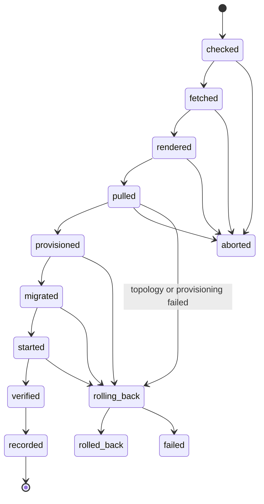

# Deploys, rollbacks and monitors

How a release reaches staging and production, how to roll one back or run it again with fresh secrets, how to read what a deploy did, what to do when one ends `failed`, and what watches the services afterwards. Background: ADR-053 (the deploy pipeline, the files fetched at the release tag), ADR-049 (deploy mechanics, restating ADR-048), ADR-051 and ADR-027 "Monitoring", D-31 (the external check) and the WP-9 explainer, D1 to D9.

Placeholders stand for values that stay out of this repo: `<profile>` (the owner's SSH client profile for this host, `docs/runbooks/server-access.md` section 2), `<env>` (the server's word for the environment: `staging` or `prod`), `<service>` (`api`, `agent` or `web`), `<version>` (a released version without `v`, for example `0.3.1`), `<pgid>` (a process group id).

Sources: `infra/scripts/deploy.sh`, `infra/scripts/deploy-entry`, `infra/scripts/smoke-deploy.sh`, `.github/workflows/deploy.yml` and `release.yml`. The CI side (job names, concurrency, what each red job means) is in `.github/workflows/README.md`, "A deploy red".

## 1. How a deploy runs

- **A release deploys itself to staging.** When release-please's Release PR merges, `release.yml` builds, scans, pushes and attests each released image, then `deploy-staging` calls `deploy.yml` once per released service, in the order `agent`, `api`, `web` (consumers before producers, the HTTP provider before `web`, D6), one at a time; a failed leg cancels the services not started yet.
- **Production waits for the owner.** `deploy-production` runs only after every staging leg passed, on the GitHub environment `production`, whose required reviewer is the owner. It sends the same digest staging ran; the server refuses an image whose digest differs (promotion by digest, D8). Approve production runs in release order, oldest first.
- **One SSH command per deploy.** The job joins the tailnet as an ephemeral `tag:ci` node and runs one command as `deploy`. The key line forces `/srv/jadero/bin/deploy-entry <env>` whatever the command says; `deploy-entry` accepts only `deploy <env> <service> <version>` and `rollback <env> <service>` for its own environment, logs one line under the tag `jadero-deploy` and calls `sudo -n /srv/jadero/bin/deploy.sh` with the same words. Standard input carries the registry user, the job's token and, for production, the expected digest.
- **By hand from GitHub.** Actions, `deploy`, Run workflow, or:

  ```bash
  gh workflow run deploy.yml -f action=deploy -f environment=staging -f service=api -f version=<version>
  ```

  A manual deploy resolves the tag's digest itself and sends it only after `gh attestation verify` passes. A manual production run still waits for the approval.

### The states

`deploy.sh` is a state machine (D1). Each state is written to `/srv/jadero/<env>/deploy.log` the moment it is reached, before the next step starts, and printed on stdout, which the job shows.



| State | What it means |
|---|---|
| `checked` | the lock is held, the words are valid, the version is newer than the current one (`newer`, `first-deploy`, `same-version` for a redeploy) |
| `fetched` | `infra/` and `packages/messaging/package.json` at the release tag are in `releases/<service>-<version>/` (`tag-commit`, `on-disk` for a redeploy) |
| `rendered` | `op inject` wrote `<service>.env.new`: exit 0, no `{{` left, every credential parsed |
| `pulled` | the image by tag, its digest and revision label checked (`digest-and-revision`, `on-disk` for a redeploy) |
| `provisioned` | the release's topology imported (`topology-imported`) or skipped as older (`topology-skipped-older`), then this service's Postgres roles and broker user converged (`this-service` for `web`) |
| `migrated` | the new env file in place, the one-off migrate exited 0 (`no-migrations` for `web`) |
| `started` | `up --wait` on the service's process types returned healthy |
| `verified` | the release's smoke script passed: `smoke-passed`, or `smoke-passed-partial-<checks>` when a check was skipped because a service on its path is not deployed yet |
| `recorded` | `versions.env` and `previous.env` written, older images and release folders pruned (`current`, `unchanged` for a redeploy) |

Two zones. Before `provisioned` nothing shared has changed: a failure is `aborted`, the files the run wrote are removed and the running release never noticed. From the topology import on (the point of no return) a failure is `rolling_back`, then the release that was current starts again with its files and its image by digest: `rolled_back reason=previous-healthy`, or `failed` when that does not get healthy either. A first deploy has nothing to go back to: its containers are stopped (not removed, so their logs stay readable) and the run ends `failed reason=nothing-to-roll-back-to`.

A refusal touches nothing and has its own line, `refused reason=<token>` (`not-newer`, `no-digest`, `bad-input`, `bad-manifest`, ...). A downgrade is never a deploy: it is a rollback.

Exit codes: 0 `recorded`; 1 `refused`, `aborted`, `rolled_back` or `failed` (the last line says which); 75 another run holds the environment's lock (section 5).

## 2. Read a run (example)

A staging deploy of api that passed, as the job and the journal show it:

```text
2026-10-24T18:40:02Z staging api 0.3.1 checked reason=newer
2026-10-24T18:40:03Z staging api 0.3.1 fetched reason=tag-commit
2026-10-24T18:40:05Z staging api 0.3.1 rendered reason=ok
2026-10-24T18:40:19Z staging api 0.3.1 pulled reason=digest-and-revision
2026-10-24T18:40:24Z staging api 0.3.1 provisioned reason=topology-imported
2026-10-24T18:40:31Z staging api 0.3.1 migrated reason=ok
2026-10-24T18:40:44Z staging api 0.3.1 started reason=healthy
2026-10-24T18:40:50Z staging api 0.3.1 verified reason=smoke-passed
2026-10-24T18:40:51Z staging api 0.3.1 recorded reason=current
```

The fields are always the same: UTC time, environment, service, version, state, a fixed reason token. Never a secret, an address or the output of a tool.

## 3. Rollback

Back to the release the server recorded as previous for that service, once (D3). From GitHub:

```bash
gh workflow run deploy.yml -f action=rollback -f environment=production -f service=api
```

or from the owner's root shell on the server: `sudo /srv/jadero/bin/deploy.sh rollback <env> <service> </dev/null`.

- **What it uses.** Only what is on disk: the previous release's files in `releases/<service>-<previous version>/`, its image (the prune keeps the current and the previous one), and the env file in place. No 1Password, no registry, no topology import and no migration: the schema and the topology only move forward, and the previous release runs on them because both change expand-only.
- **What it checks.** The health gate and the smoke again: `checked previous-recorded`, `started healthy`, `verified ...`, `recorded rolled-back-once`. `versions.env` then names the previous version and its entry in `previous.env` is removed, so a second rollback is `refused reason=no-previous`.
- **Refusals**, nothing touched: `no-previous`, `bad-manifest`, `no-release-files`, `no-env-file`, `no-image`.
- **When it fails:** `failed reason=unhealthy` or `failed reason=smoke-failed`; neither manifest changed. Section 7.
- **Before a production rollback**, reject any production approval still waiting for that service: a waiting approval holds the job's concurrency group and the rollback would wait behind it.
- **Afterwards**, the rolled-back version is newer than the current one again, so a fixed release or the same version can be deployed normally.

A deploy rolls back by itself when it fails past the point of no return (section 1); this command is for a release that passed its checks and turned out bad later.

## 4. Redeploy (fresh secrets, same version)

`redeploy <env> <service>` runs the current version again with a new render of its secrets, for example after a password was rotated in 1Password. It runs only from the owner's root shell: `deploy-entry` does not accept the verb and `deploy.sh` refuses it when `SUDO_USER` is `deploy`.

```bash
ssh <profile>
sudo /srv/jadero/bin/deploy.sh redeploy staging api </dev/null
```

- The release files and the image are already on disk (`fetched on-disk`, `pulled on-disk`). The render, the provisioning (which sets the rotated password in Postgres or RabbitMQ), the migrate run, the health gate and the smoke run as in a deploy, and the run ends `recorded unchanged`.
- Between `provisioned` and `started` the old containers still hold the old password: a pooled connection keeps working (Postgres checks a password only at connect), a new one fails authentication. In a normal run that window is seconds (step 6c drill: 49 s from `checked` to `recorded`).
- Refusals: `nothing-deployed`, `no-release-files`, `no-image`.

**End every manual run with `</dev/null`** until `deploy.sh` with sha256 `fe7b98137bb636af3e418af89ec0cd9573053be5ed668405232187142e6026e2` is installed from `main` (check with `sudo sha256sum /srv/jadero/bin/deploy.sh`), and keep doing it after, since it costs nothing. Why: `deploy.sh` runs each slow step under GNU `timeout`, which puts its command in its own process group. From an interactive shell that group is in the background, so when `docker compose run` touched the terminal the kernel sent SIGTTOU and stopped compose and `timeout` with it; the 120 s limit never fired and the run hung after `provisioned` (step 6c). The fixed script gives compose `/dev/null` as stdin and runs migrate with `-T`; the other bounded steps (`git fetch`, `op inject`, `docker pull`) still take the caller's stdin, which `</dev/null` covers.

If a run hangs anyway: `ps -eo pid,pgid,stat,cmd | grep -E '[t]imeout|[d]ocker compose'` shows the stopped ones with `T` in `STAT`. `sudo kill -KILL -<pgid>` ends that process group; `deploy.sh` reads it as a timeout of the step and rolls back (`rolling_back reason=migrate-timeout`, then `rolled_back reason=previous-healthy` in the drill). Then run it again with `</dev/null`.

## 5. Busy (exit 75)

One deploy per environment at a time: `flock -n` on `/srv/jadero/<env>/deploy.lock`. A second run prints `busy: another deploy runs on <env>` on stderr, exits 75, writes no journal line and touches nothing. Wait for the other run to end (its journal reaches a final state), then run again or rerun the job.

- The kernel releases the lock when the holding process exits, so there is never a stale lock to clean up: never delete the file.
- To see who holds it: `sudo lsof /srv/jadero/<env>/deploy.lock`. A `deploy.sh` there is a running deploy. An `op` process (the 1Password daemon) holding it is the bug of step 6b, fixed in the installed script `2b983108...` and later: install the current `deploy.sh` (`docs/runbooks/server-access.md` section 8).
- Two services of one environment deploying at the same moment (two approved production runs, a manual dispatch during a release) meet here; the second gets 75.

## 6. Reading the journal

As the owner on the server (`ssh <profile>`). The state folder is root's, so the journal needs `sudo`:

```bash
sudo tail -n 30 /srv/jadero/staging/deploy.log                 # the latest state lines
sudo grep ' prod api ' /srv/jadero/prod/deploy.log | tail -n 20 # one service's history
sudo grep -E ' (aborted|rolling_back|rolled_back|failed|refused) ' /srv/jadero/prod/deploy.log | tail
sudo cat /srv/jadero/prod/versions.env /srv/jadero/prod/previous.env   # current and previous, by digest
```

Who called it, from the system journal:

```bash
sudo journalctl -t jadero-deploy --since today   # deploy-entry: accepted verb=... or refused reason=...
sudo journalctl -t sudo --since today | grep deploy.sh   # the sudo call behind each run
```

What the containers say (the journal never holds tool output):

```bash
docker ps -a --filter label=com.docker.compose.project=jadero-staging --format '{{.Names}} {{.Status}}'
docker logs --since 30m jadero-staging-api-1
docker ps --filter name=jadero-ops --format '{{.Names}} {{.Status}}'   # Postgres and RabbitMQ healthy?
```

The last line of a run tells where it ended. A run with no final line after `checked` is either still running (`sudo lsof` on the lock, section 5) or was killed; the exit trap writes `aborted reason=unexpected-error` or `failed reason=unexpected-error` for a command that failed outside the handled paths.

## 7. Leaving `failed`

`failed` means the rollback did not get healthy, or a first deploy had nothing to go back to. No retry loop runs and nothing blocks the next run, so look first. `versions.env` and `previous.env` never change on `failed`: they still name the release that was current before the run.

1. **Read the reason** (section 6):
   - `previous-unhealthy`: the previous release started but did not pass the health gate.
   - `unhealthy` or `smoke-failed` after `checked previous-recorded`: a rollback command failed the same way.
   - `nothing-to-roll-back-to`: a first deploy failed after `up`; its containers are stopped. `stop-failed`: stopping them failed too, so they may still run.
   - `unexpected-error`: a command failed past the point of no return outside the handled paths.
2. **Find the shared cause.** When the previous release fails too, the cause is rarely the release: check that `jadero-ops-postgres-1` and `jadero-ops-rabbitmq-1` are healthy (a RabbitMQ memory alarm blocks publishers), the memory (`free -m`, `sudo journalctl -k --since today | grep -i oom`), and the containers' logs for authentication errors. The env file in place always matches what provisioning wrote: past the first provisioning write the run moves `<service>.env.new` into place before it starts anything (step 4b), and removes it otherwise.
3. **Fix it, then bring the recorded release back:** `sudo /srv/jadero/bin/deploy.sh redeploy <env> <service> </dev/null` starts the version `versions.env` names, with a fresh render and the full checks. After a failed first deploy there is nothing to redeploy: fix the cause and deploy the version again (`checked reason=first-deploy`). After `stop-failed`, stop the project's containers by hand first (`docker stop` on the names `docker ps` lists for the project).
4. **Or move forward:** a fixed newer release deploys normally, through the pipeline or `gh workflow run`.
5. Write down in the step log or the issue what failed and why.

## 8. Monitors

### Uptime Kuma (on the server)

Uptime Kuma (`jadero-ops-uptime-kuma-1`) joins `jadero_prod` and `jadero_staging`, so it reaches every process type by name on its environment's network, including the workers and `agent`, which publish no port. Use the container name, not the service name: both projects name their services `api`, `agent`, `web`, and Kuma sits on both networks, so `api` could answer from either environment. Each process type serves its own health on the port its `PORT` sets in `infra/compose/compose.services.yml` (they listen on `0.0.0.0` inside the container, `LISTEN_HOST` in the images); `web` has no `/health/ready`, so its monitor asks `/robots.txt`, as its image's `HEALTHCHECK` does.

Create them over the tunnel (`docs/runbooks/server-access.md` 2a, `http://localhost:3101`), each of type HTTP(s), interval 60 s, 2 retries before an alert, with the same email notification as `jadero backup`:

| Monitor | URL |
|---|---|
| `staging api` | `http://jadero-staging-api-1:3001/health/ready` |
| `staging api-worker` | `http://jadero-staging-api-worker-1:3011/health/ready` |
| `staging agent` | `http://jadero-staging-agent-1:3002/health/ready` |
| `staging agent-consumer` | `http://jadero-staging-agent-consumer-1:3012/health/ready` |
| `staging web` | `http://jadero-staging-web-1:3000/robots.txt` |
| `prod api` | `http://jadero-prod-api-1:3001/health/ready` |
| `prod api-worker` | `http://jadero-prod-api-worker-1:3011/health/ready` |
| `prod agent` | `http://jadero-prod-agent-1:3002/health/ready` |
| `prod agent-consumer` | `http://jadero-prod-agent-consumer-1:3012/health/ready` |
| `prod web` | `http://jadero-prod-web-1:3000/robots.txt` |
| `site es` | `https://new.jadero.dev/es/`, with "Certificate Expiry Notification" on |
| `site en` | `https://new.jadero.dev/en/`, with "Certificate Expiry Notification" on |
| `site de` | `https://new.jadero.dev/de/`, with "Certificate Expiry Notification" on |
| `jadero backup` | already there: type Push, interval 90000 s (`docs/runbooks/restore.md` 2e) |

- Ready means the process can reach what a request needs (Postgres, and RabbitMQ for the workers and `agent`), so a broker or database outage turns these red too.
- A deploy recreates the containers in seconds of downtime (ADR-049 "Downtime"): with 2 retries before an alert, a normal deploy does not page.
- The three `site` monitors go through the public edge (nginx, TLS), so they also catch a broken certificate renewal; the expiry notification warns days before the certificate runs out. They move to `https://jadero.dev/` at the cutover.
- `prod web` stays red until web's first production deploy (#162: the home page answers 404 on an empty content database); pause it until then.
- Not in this table yet, from ADR-027 "Monitoring": the SSE endpoint (arrives with the chat) and an alert when a dead-letter queue is not empty (Kuma has no native monitor type for it; a follow-up).

### The external monitor (D-31)

Uptime Kuma runs on the same box, so it cannot report the box, or itself, being down. One check from outside covers that: **UptimeRobot Free**, two HTTP(s) monitors, every 5 minutes, alerts by email to the owner. The owner creates the account.

| Monitor | URL | Down when |
|---|---|---|
| `jadero site` | `https://new.jadero.dev/` (later `https://jadero.dev/`, at the cutover) | the box, nginx, TLS or web is down: nginx answers its maintenance page with a 502, 503 or 504 when web does not answer |
| `jadero status` | `https://status.jadero.dev/status/jadero` | Uptime Kuma is down (nginx answers 502), so Kuma's own alerts would never come |

- **What it sees:** the public edge only, as any visitor: DNS, the Hetzner firewall's 443, TLS, nginx, `web`, and Kuma's public page.
- **What it cannot see:** anything on `127.0.0.1` or a Docker network: the `/health/ready` endpoints (the edge answers 404 for them on purpose), the workers, `agent`, Postgres, the broker, the backups. Those stay Kuma's job; the two alert paths fail differently, which is the point.
- Its requests reach nginx's access log like any visitor's, with the client's network only (`/24` or `/48`), never the full address.

## 9. Retiring a consumer: the order, checked

The order is in `infra/compose/README.md`, "Retiring a consumer". Its unbind call and order were checked on the local dev broker (`rabbitmq:4.3.6-management-alpine`, the same image and digest as the server's) on 2026-10-24, WP-9 step 6d, with a throwaway quorum queue `drill.retire` bound to `jadero.events`:

| Step | Result |
|---|---|
| bind `drill.retire.v1` and `drill.retire.v2`, publish 3 on `v1` | `drill.retire` 3 messages |
| `GET /api/bindings/dev/e/jadero.events/q/drill.retire` | `properties_key` `drill.retire.v1` and `drill.retire.v2` (no arguments: equal to the routing key) |
| `DELETE /api/bindings/dev/e/jadero.events/q/drill.retire/drill.retire.v1` | HTTP 204; the same call again 404 |
| `rabbitmqadmin delete binding ... --routing-key drill.retire.v2` inside the container | ok; no binding left |
| publish 1 on each key after the unbind | `drill.retire` still 3; `jadero.unrouted` 2 (the exchange's alternate exchange took them) |
| purge, then `delete_queue` | 0 messages, `Queue was successfully deleted with 0 ready messages` |

What it changed in the README: the image has no `curl`, so the call inside the container is `rabbitmqadmin` (2.35.0 ships with the image) with the credentials in its environment; over HTTP the vhost must be URL-encoded (on a throwaway vhost `/drill`, `.../bindings//drill/...` answered 405 and `.../bindings/%2Fdrill/...` 204), and the last segment is the binding's `properties_key`, which for a binding with arguments is `<routing key>~<hash>` (the routing key alone answered 404). After the unbind, events with that key that no other queue binds land in `jadero.unrouted`. The dev broker was left as found: the drill's queue, vhost and messages removed, the six queues and 14 bindings of the definitions only, then the container removed.
